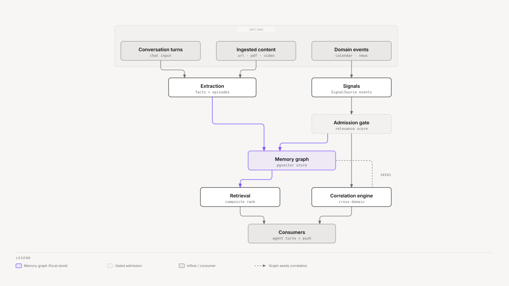

<div align="center">

# Ze

**Jarvis. Make no mistakes.**

A self-hosted personal AI assistant. Single-user, spec-first, somewhere in the middle of becoming something genuinely useful.

<p>
  <a href="https://github.com/joaoajmatos/ze/actions/workflows/ci.yml"></a>
  
  
  
  
</p>

</div>

---

## What this is

An honest attempt at building a personal AI that does more than answer questions.

The objective: an assistant that holds context across weeks, works in the background, and connects things that happen in separate parts of your life — calendar, email, news, long-running projects. Not a chat window that resets. Something closer to Jarvis. That's the whole brief.

It isn't there yet. But 166 shipped phases in, the infrastructure is real and it's getting closer.

---

## Where it is now

Python/FastAPI backend, LangGraph orchestration, React web client, plugin-per-domain architecture. By default, routing uses local embeddings (`intfloat/multilingual-e5-base`), so no LLM call happens until an agent needs to act. Two optional System One surfaces can refine routing and fact admission. All LLM traffic goes through OpenRouter. Graph state is checkpointed in Postgres and survives restarts.

- **ze-web** — React SPA (Feature-Sliced Design). `@myguyze/ze-client` is generated from the OpenAPI spec. `@myguyze/ze-ui` renders server-driven components, including charts.

### One voice, many specialists

Companion is the only agent that speaks to you. It acts as the conductor: when a request needs several specialists in sequence, the router sends it to companion, and companion calls them through one `delegate_to_agent` tool. Each call carries a full brief, runs in an isolated worker, and passes its own capability and confirmation check. Independent requests (for example, "check my calendar and summarize the news") still fan out in parallel in the graph and merge in a `synthesize` step. Work that must outlive the turn becomes a goal or a workflow; companion can promote a conductor run into either one.

### System One

System One is a small model that returns typed judgments (a choice among labels, a yes/no probability, a score), never free text. Ze treats it as a fast gate, with code making the final decision. Five surfaces use it:

- **Speech-act admission** decides whether a finished turn states a durable fact worth keeping.
- **Routing choice** picks among the agents E5 shortlisted, decides whether the request needs more than one specialist, and grades how complex it is.
- **Skill gating** picks at most one automatic skill from the skills E5 shortlisted.
- **Loop gate** decides whether text opens, declares, or resolves an open loop.
- **Corroboration** decides whether an independent source is about the same open matter as a suspected loop, and can promote it.

Four of the five surfaces are on in the shipped config, each with bars measured on a labeled set (`make calibrate-speech-act`, `make calibrate-routing`, `make calibrate-skills`, `make calibrate-loop-gate`); the corroboration surface ships off until `make calibrate-corroboration` gives a held-out `ENABLE`. The code defaults are off. When a surface is off, uncalibrated, or skips, Ze falls back to the older path: the E5 thresholds and the Haiku judge for routing, skills, and speech act, the Haiku judge for the loop gate, and the plain evidence link for corroboration. See [configuration.md](docs/configuration.md#system_one).

### Goal engine

Hand Ze an objective and it decomposes into milestones, dispatches them to specialist agents on a schedule, pauses at verification gates with a progress narrative, replans on failure, and writes a retrospective when it finishes. Steer mid-flight by talking — no slash commands. Background sweep runs every 15 minutes regardless of whether you're online.

Goals are the heavyweight, declared end of Ze's executive function. Most real commitments never get declared as a goal.

The Priority page ranks drifting loops, stuck goals, and correlation hypotheses on one scale. You can reorder items by dragging them or by telling Ze ("that can wait"). Your overrides decay or stay pinned, and they feed the same ranking that decides what Ze mentions in conversation and what it pushes. When Ze cannot read a source, the page names it.

### Open loops

Most of what someone means to follow up on is smaller than a goal: a promise made in an email thread, a decision left pending, a project quietly stalling because a dependency didn't land. `ze-worldstate` tracks these as open loops, extracted from conversation, email, calendar, and ingestion. Extraction is gated: three System One yes/no questions decide whether text opens, declares, or resolves a loop, and Haiku writes only the title. If System One skips, the older Haiku judge runs as the fallback. Confidence decays on its own; a contradiction or a missed deadline moves a loop to `drifting`. You can also ask Ze to keep something on the radar ("keep the Porto move on my radar"). The `loops` agent creates that loop in the same turn with the `track_loop` tool, and the post-turn gate skips that turn. When a later independent source matches a suspected loop, Ze asks one System One same-concern question, raises the loop's confidence, and can promote it to `active`; the loop records each source, and the Open loops page labels it "Promoted · seen in: chat, email". At the start of a new session, Ze asks whether to keep track of up to three loops it noticed. The Open loops page (Automation) lists them for review. Drifting loops surface inline in the next relevant conversation, or push through ntfy once they clear the salience bar. Loop pushes are discretionary, so they share one daily budget with every other unprompted nudge, and quiet hours hold them like the rest.


<sub>[Interactive version](docs/diagrams/root/open-loops.html)</sub>

Goals and open loops are Ze's two hands of executive function: one heavyweight and declared, one lightweight and ambient. Together they're the shipped first slice of what the doctrine calls **active concerns** — the fourth face of Ze's world-state, the model of you the rest of the system attaches to. See [the doctrine](specs/arch/ze-doctrine.md) and [cognitive architecture](docs/cognitive-architecture.md).

### Memory

Ze extracts facts and episodes after each turn, consolidates them nightly, and synthesizes a profile weekly. `pgvector` handles retrieval. Several rules keep the store honest:

- **Admission.** A keep/drop extractor decides what becomes a fact. Facts enter through typed contributions with provenance and confidence, and a constraint check can veto a write.
- **Say it, and Ze remembers it.** You can tell companion to remember or forget something. Ze says it remembered or forgot something only after the write succeeds.
- **Read contract.** Facts you reviewed are always in context. Ze shows the origin, confidence, and age of each fact to the model, and it uses facts silently instead of reciting them.
- **Evidence-backed learning.** Ze logs what its agents did in an append-only action ledger. Goal learnings cite that evidence, and Ze promotes them to long-term memory on completion.
- **Procedures.** Ze proposes a procedure when it detects a reusable multi-step pattern. The proposal goes through admission and validation before it becomes available. Companion can then invoke it as advisory guidance. A procedure never grants new tool access.

### Dreaming

Every night Ze runs an offline memory improvement loop — sleep pass then dream pass. The sleep pass replays high-priority episodes, compresses old sessions, deduplicates facts, and identifies schema and policy clusters using only structural analysis (no LLM calls). The dream pass then synthesizes those clusters into insights, procedures, and plan stress-tests using a haiku-class generator.

Nothing synthetic goes straight to memory. Every artifact passes three cheap pre-gates (NLI groundedness, embedding novelty, retrievability) and two adversarial LLM critic calls at sonnet-class before reaching a morning integration step that enforces session-diversity and temporal-spread requirements. Promoted facts carry full lineage for per-run rollback. Borderline cases surface in the morning briefing for review. Synthetic facts that go uncorroborated for 90 days are automatically expired.

The design is drawn from neuroscience (NREM/REM ordering, targeted memory reactivation) and ML (PER, Constitutional AI-style critic filtering, generative replay safety). It's the first layer of Ze becoming genuinely self-improving rather than just accumulating facts.

### How Ze gets sharper

Memory isn't a single inflow. Everything feeds the same substrate:



<sub>[Interactive version](docs/diagrams/root/memory-inflow.html)</sub>

Conversations write what Ze learns from talking. Ingestion (`ze-ingestion`) feeds knowledge from any URL, PDF, YouTube video, or file — extracted facts land in the same store. Domain plugins emit `SignalSource` events; Ze scores them for relevance, writes them to the memory graph, and feeds them into the correlation engine. Goals promote learnings on completion. Every inflow compounds.

The design intent is that Ze gets sharper without being explicitly fed. Drop a PDF in. Share a video. The facts join everything else Ze already knows.

Every domain plugin also declares a `DataDomain` — an export, import, and delete contract. The portability service honours it. You own the data at every layer.

### Proactive surface

Ze doesn't wait to be asked. Morning briefings, calendar reminders, weekly insights, goal suggestions, stuck-goal alerts, news fetch — all background jobs, configurable in `config.yaml`. Every push declares a class: reminders you set always fire, reports you switched on are never budgeted, and only discretionary nudges claim one shared daily budget. Quiet hours hold everything but reminders, then release it as a batch. After downtime, a job that missed its time runs once. Offline push goes through ntfy; the in-app notification center (REST + WebSocket) surfaces the same events while you're in ze-web.

### Agents

Thirteen agents: research, companion, calendar, messenger, reminders, workflow, goals, loops, priority, prospecting, news, ingestion, finance. Each runs in a ReAct loop via `BaseAgent`; tool access is gated per agent. Agents can also use imported Agent Skills (`SKILL.md`), which you review before they take effect, and a chat-first workspace: an isolated computer with files and a shell, reached through chat.

<details>
<summary>Agent reference</summary>

| Agent | Domain | Default posture |
|---|---|---|
| `research` | Web search + synthesis, delegation | Autonomous |
| `companion` | Reasoning, writing, conversation | Autonomous |
| `calendar` | Google Calendar CRUD + availability | Read auto · writes confirm |
| `messenger` | Cross-channel messaging (Gmail) | Read auto · draft-first |
| `reminders` | NL reminders + proactive push | Autonomous |
| `workflow` | Recurring multi-step tasks | Read auto · manage confirm |
| `goals` | Multi-week autonomous objectives | Read auto · writes confirm |
| `loops` | List, track, confirm, close, or drop open loops | Autonomous |
| `priority` | Reorder what Ze treats as most important | Writes confirm |
| `prospecting` | Browser-sidecar research + outreach | Autonomous |
| `news` | Personalized RSS headlines + search | Autonomous |
| `ingestion` | URL / PDF / video / audio / text → memory | Autonomous |
| `finance` | Portfolio, spending, recurring expenses (Trading212 + CSV) | Read auto · recurring review confirms |

</details>

### Plugin extension surface

`ZePlugin` is the seam. A domain package hooks in by declaring what it contributes:

| Hook | What it provides |
|---|---|
| `agents()` | Agents registered into the routing graph |
| `ingestion_extractors()` | Domain-specific extractors (e.g. `TransactionExtractor` for PDFs) |
| `ingestion_fetchers()` | Custom content fetchers (e.g. Notion, proprietary APIs) |
| `signal_sources()` | Domain events fed into the correlation pipeline |
| `data_domains()` | Export / import / delete contract for every table the plugin owns |
| `memory_policies()` | Per-agent retrieval strategy from the memory graph |
| `channels()` | Communication channels (email, etc.) |
| `jobs()` | Proactive background jobs |
| `bundled_skill_paths()` | Agent Skills that ship with the plugin |
| `ui_contributions()` | Nav items, settings sections, plugin pages in ze-web |
| `rest_routes()` | Plugin-owned REST routers under `/api/v0/` |

The hooks compose. The finance plugin registers a `TransactionExtractor` so that ingesting a bank statement produces structured transaction facts — which land in memory, which surface in retrieval, which the correlation engine can cross with calendar and news. That chain is the whole point.

---

## Where it's going

The attention work is in place: goals, open loops, and hypotheses share one ranking and one push budget. The next step is to make the mind earn more trust and need less supervision.

- **Calibrated System One.** Speech-act admission, routing choice and skill gating are all on in the shipped config, each with bars measured on labeled sets on 2026-10-09 and 2026-10-12. When a surface skips, Ze routes and matches skills with E5.
- **Longer unattended work.** The goal engine still needs to carry a full personal project across weeks with minimal intervention: research, plan, execute, verify, iterate, report.
- **A richer social model.** Projects and people are now graph entities with decaying last-contact, and co-occurrence inference proposes who works on what. Contacts are still closer to a directory than a relationship model.
- **More signal coverage** as more domain plugins land.

Design specs for upcoming phases live in [`specs/`](specs/). The doctrine in [`specs/arch/ze-doctrine.md`](specs/arch/ze-doctrine.md) sets the direction.

---

## How a message flows

Every turn runs through a LangGraph graph checkpointed in Postgres.


<sub>[Interactive version](docs/diagrams/root/graph-flow.html)</sub>

The diagram shows the main path. The full graph also runs `decompose` for independent compound requests and `match_skills` after `fetch_context`. Partial `trace_update` frames stream to the trace panel as each node finishes, and tokens stream as the agent writes them. You can rate each reply with a thumbs up or thumbs down. Ze stores the rating as evidence next to the reply's trace and does not use it yet. Retry regenerates the latest reply, but only when the turn ran no write tool.

See [docs/architecture.md](docs/architecture.md) for the full flow and node-by-node detail.

---

## Monorepo

```
apps/           ze-api · ze-web
plugins/        personal · messenger · calendar · news · prospecting · finance
core/           kernel/       ze-logging · ze-data · ze-components
                contracts/    ze-agents · ze-communication · ze-plugin · ze-proactive
                engine/       ze-core
                seam/         ze-collision
                cognition/    ze-memory · ze-correlation · ze-worldstate
                automation/   ze-automation · ze-skills
                arbitration/  ze-priority
                ops/          ze-workspace · ze-onboarding · ze-ingestion · ze-seed · ze-eval
packages/       ze-sdk · ze-client · ze-ui
integrations/   ze-google · ze-browser · ze-notifications · ze-trading212 · ze-yt
sidecar/        browser (Playwright) · workspace (isolated computer)
specs/          one spec per phase, written before the code
```

| Layer | Tech |
|---|---|
| Runtime | Python 3.12 · FastAPI · LangGraph · AsyncPostgresSaver |
| Client | React · Vite · TypeScript · Tailwind · shadcn/ui |
| LLM | OpenRouter · local embeddings (`intfloat/multilingual-e5-base`) · optional System One judgments |
| Data | PostgreSQL 16 + pgvector · Alembic raw-SQL migrations |
| Push | ntfy (offline) · in-app notification center · WebSocket `/ws` |
| Sidecars | Playwright browser · isolated workspace (Docker) |

---

## Quick start

**Prerequisites:** Python 3.12+, [uv](https://docs.astral.sh/uv/), [bun](https://bun.sh), Docker, [OpenRouter](https://openrouter.ai) key, ntfy for push.

```bash
git clone https://github.com/joaoajmatos/ze.git && cd ze
make install && make web-install

cp apps/ze-api/.env.example apps/ze-api/.env
make db-up && make migrate
make dev-full    # backend :8000 + web :5173
```

Google Calendar + Gmail: `make google-auth` · Config: [docs/configuration.md](docs/configuration.md)

---

## Development

```bash
make test              # ze-api (fast)
make test-<name>       # any package — docs/testing.md
make test-py           # every Python package; lists all failures (CI gate)
make test-all          # test-py with slow tests, then test-web
make lint              # ruff
make typecheck-web     # tsc for ze-web and @myguyze/ze-ui
make eval              # agent evals (make dev-eval first)
```

CI runs on every pull request to `main`: web typecheck, build, and tests, plus backend lint and `make test-py`. Every package has a README. Conventions: [CONTRIBUTING.md](CONTRIBUTING.md)

---

## Documentation

Full index (grouped by audience): [docs/README.md](docs/README.md)

| Doc | Topic |
|---|---|
| [ze-doctrine.md](specs/arch/ze-doctrine.md) | What kind of mind Ze is — the constitutional layer |
| [cognitive-architecture.md](docs/cognitive-architecture.md) | Seven cognitive functions mapped onto packages |
| [architecture.md](docs/architecture.md) | System design, graph flow |
| [package-architecture.md](docs/package-architecture.md) | Monorepo, `ZePlugin`, dependency rules |
| [sdk.md](docs/sdk.md) / [extending-ze.md](docs/extending-ze.md) | SDK reference and how to add agents, plugins, jobs |
| [memory.md](docs/memory.md) / [dreaming.md](docs/dreaming.md) | Memory store and offline sleep/dream loop |
| [goals.md](docs/goals.md) / [workflows.md](docs/workflows.md) | Goal engine and multi-step workflows |
| [frontend.md](docs/frontend.md) / [native-interface.md](docs/native-interface.md) | ze-web and WebSocket / ntfy protocol |
| [configuration.md](docs/configuration.md) / [deployment.md](docs/deployment.md) | Config keys (including `system_one`) and Fly.io deploy |
| [testing.md](docs/testing.md) / [eval.md](docs/eval.md) | Package tests and MCP evals |
| [workspace.md](docs/workspace.md) / [skills.md](docs/skills.md) | Workspace sidecar and Agent Skills |
| [specs/](specs/) | Design specs — where Ze is going next |

---

## Security

Single-user by design. Strong `ZE_API_KEY`, secrets out of git, non-guessable ntfy topic. Don't expose as a shared service without hardening.

---

## License

[The Unlicense](UNLICENSE) — public domain. Take it anywhere, zero conditions.
