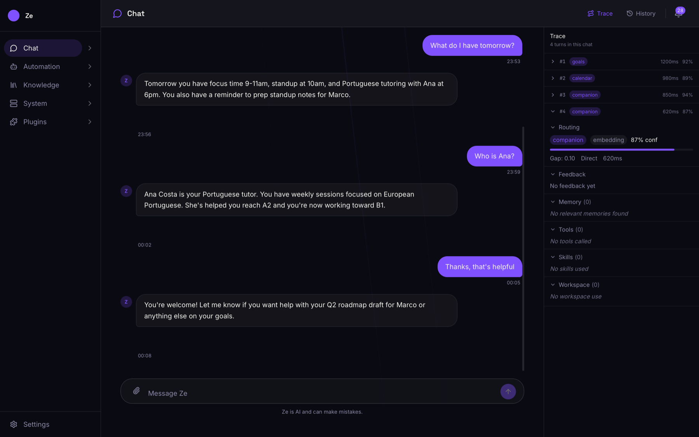
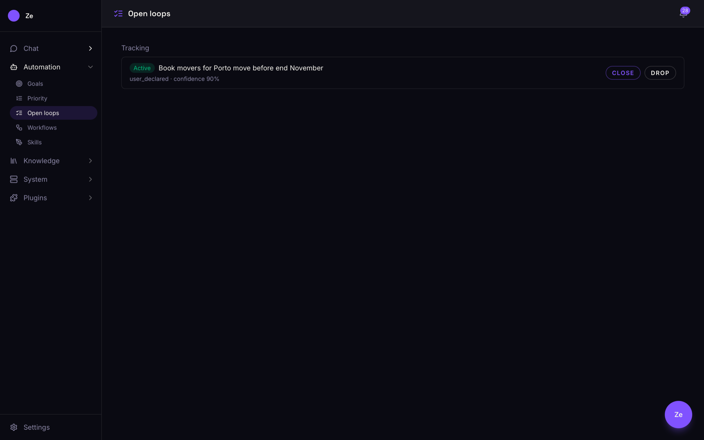
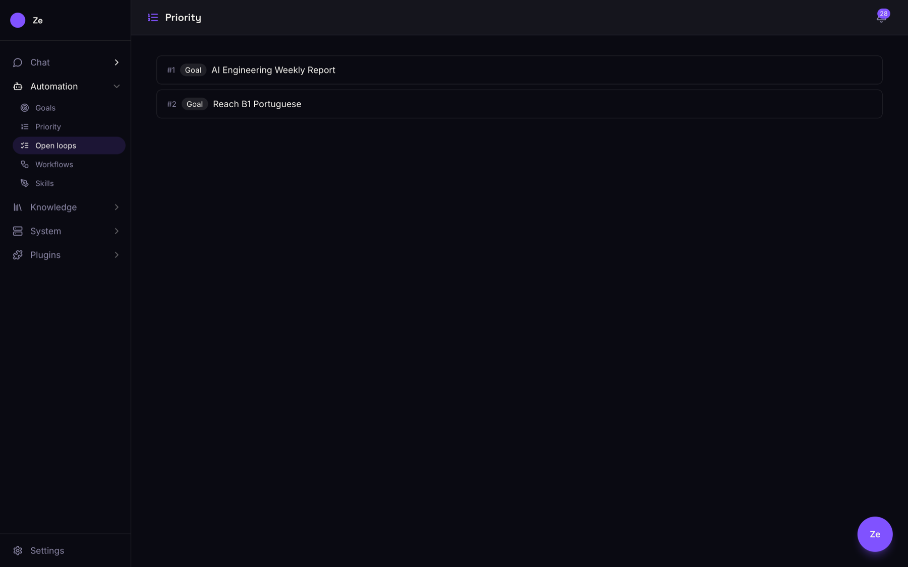
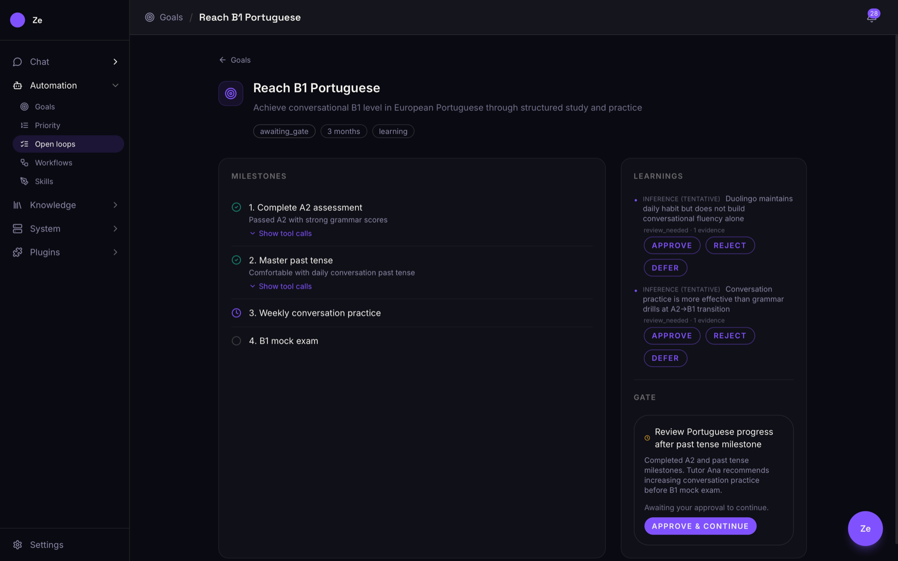

<div align="center">

# Ze

**A model of you.**

A personal AI that keeps a model of you, and says how sure it is.

<p>
  <a href="https://github.com/joaoajmatos/ze/actions/workflows/ci.yml"></a>
  
  
  
  
</p>

</div>

---

Ze is a self-hosted personal AI assistant, built for one user. This repository is for engineers who design agent systems and want to follow one worked through in the open.

Most assistants are a chat window with tools. Ze is different. One mind writes to one world-state: a model of you, your people, your projects, and everything still open. Every claim in that model has a kind, a source, and a confidence that decays. Ze may state a suspicion only as a suspicion.

Ze is pre-v1. It has one user, it runs locally, and it is in active development.

---

## What makes Ze different

**One mind, not a router over specialists.** Companion is the only agent that speaks to you. Specialists (calendar, email, research, finance) are tools it calls with a full brief, each behind its own capability and confirmation check. Ze has no swarm and no hand-offs. Read [One mind, not a router](docs/engineering/one-mind-not-a-router.md).

**Claims have kinds, sources, and decaying confidence.** A fact, an inference, a suspicion, and a priority are different things. Each carries where it came from and how fast its certainty ages. A claim reaches you only with the posture its kind allows. See the [doctrine](specs/arch/ze-doctrine.md).

**Small judgments, calibrated, with the failures on record.** System One is a small model that returns typed answers (a choice, a yes/no probability, a score) and never text. Code makes the final decision. Each use ships with bars measured on a held-out set. One use first shipped off because its held-out run failed. Another ships off today because Portuguese missed. Read [Calibrating a judgment model honestly](docs/engineering/calibrating-a-judgment-model-honestly.md).

**Executive function, not only memory.** Ze tracks open loops: the promise in an email, the decision left pending, the project that is quietly stalling. Goals cover the heavy, declared end. Loops cover the light, ambient end. Read [Open loops](docs/engineering/open-loops-executive-function.md).

**Memory with honesty rules.** A keep/drop extractor admits facts through typed contributions. Ze says it remembered or forgot something only after the write succeeds. It uses what it knows silently and does not recite it. See [memory](docs/memory.md).



<sub>Chat with the trace panel. Each turn shows its routing, feedback, memory, tools, and skills.</sub>

---

## Status

Ze is pre-v1. One person uses it, self-hosted on their own machine, and it is in active development. Each phase starts with a written spec, and `specs/phases/` holds more than 170 of them. Until v1, the project breaks APIs and schemas when the design is wrong ([pre-v1 hard cuts](specs/arch/pre-v1-hard-cuts.md)).

**What works today**

- Chat in a React web app with streaming replies, a trace panel, and thumbs up/down on replies.
- Thirteen agents: companion (the one that speaks), research, calendar, messenger, reminders, workflow, goals, loops, priority, prospecting, news, ingestion, and finance.
- Layered memory: facts, episodes, a graph, nightly consolidation, and an offline dream pass.
- Goals that run for weeks, with verification gates. Open loops with drift detection. One priority ranking over both.
- Proactive jobs behind one interruption budget and quiet hours.
- Four System One surfaces on in the shipped config: speech-act admission, routing choice, skill gating, and the loop gate.

**What is off or unfinished**

- The corroboration surface (System One promotes a suspected loop) ships off. Its held-out run passed in English and missed one clause in Portuguese.
- The model tier step (phase 182) is on at `simple_max` 0.40 after a held-out ENABLE in English and Portuguese (2026-10-16). Light turns use the agent's lighter model. The margin on held-out Portuguese is thinner than on the tuning set.
- Goals do not yet carry a full personal project across weeks without supervision.
- Contacts are closer to a directory than a relationship model.
- Ze serves one user. Do not run it as a shared service without hardening.

The full feature list is in [docs/features.md](docs/features.md).

---

## See it work

| | |
|---|---|
|  |  |
| **Open loops.** A loop Ze tracks, with its provenance and confidence. You can close or drop it. | **Priority.** One ranking over goals, loops, and hypotheses. You can reorder it. |
|  | |
| **Goals.** Milestones, learnings you approve or reject, and a verification gate. | |

---

## How a message flows

Every turn runs through a LangGraph graph checkpointed in Postgres.


<sub>[Interactive version](docs/diagrams/root/graph-flow.html)</sub>

The diagram shows the main path. The full graph also runs `decompose` for independent compound requests and `match_skills` after `fetch_context`. Partial `trace_update` frames stream to the trace panel as each node finishes, and tokens stream as the agent writes them. See [docs/architecture.md](docs/architecture.md) for node-by-node detail.

---

## Quick start

**Prerequisites:** Python 3.12+, [uv](https://docs.astral.sh/uv/), [bun](https://bun.sh), Docker, an [OpenRouter](https://openrouter.ai) key, and ntfy for push.

```bash
git clone https://github.com/joaoajmatos/ze.git && cd ze
make install && make web-install

cp apps/ze-api/.env.example apps/ze-api/.env   # add OPENROUTER_API_KEY and ZE_API_KEY
make db-up && make migrate
make dev-full    # backend :8000 + web :5173, with seeded dev data
```

Google Calendar and Gmail: `make google-auth`. All keys: [docs/configuration.md](docs/configuration.md).

---

## Engineering notes

Short write-ups of real design decisions, with evidence from the specs and the git history.

- [Calibrating a judgment model honestly](docs/engineering/calibrating-a-judgment-model-honestly.md)
- [One mind, not a router](docs/engineering/one-mind-not-a-router.md)
- [Open loops: executive function for an assistant](docs/engineering/open-loops-executive-function.md)

---

## Development

```bash
make test              # ze-api (fast)
make test-<name>       # any package — docs/testing.md
make test-py           # every Python package; lists all failures (CI gate)
make test-all          # test-py with slow tests, then test-web
make lint              # ruff
make typecheck-web     # tsc for ze-web and @myguyze/ze-ui
make eval              # agent evals (make dev-eval first)
```

CI runs on every pull request to `main`: web typecheck, build, and tests, plus backend lint and `make test-py`. Every package has a README. Conventions: [CONTRIBUTING.md](CONTRIBUTING.md)

---

## Documentation

Full index, grouped by audience: [docs/README.md](docs/README.md)

| Doc | Topic |
|---|---|
| [VISION.md](VISION.md) | What Ze is for and what it is not |
| [ze-doctrine.md](specs/arch/ze-doctrine.md) | What kind of mind Ze is — the constitutional layer |
| [features.md](docs/features.md) | What Ze does today: agents, plugin hooks, monorepo layout |
| [cognitive-architecture.md](docs/cognitive-architecture.md) | Seven cognitive functions mapped onto packages |
| [system-one.md](docs/system-one.md) | Typed judgments, the five surfaces, calibration status |
| [architecture.md](docs/architecture.md) | System design, graph flow |
| [package-architecture.md](docs/package-architecture.md) | Monorepo, `ZePlugin`, dependency rules |
| [sdk.md](docs/sdk.md) / [extending-ze.md](docs/extending-ze.md) | SDK reference and how to add agents, plugins, jobs |
| [memory.md](docs/memory.md) / [dreaming.md](docs/dreaming.md) | Memory store and offline sleep/dream loop |
| [goals.md](docs/goals.md) / [workflows.md](docs/workflows.md) | Goal engine and multi-step workflows |
| [configuration.md](docs/configuration.md) / [deployment.md](docs/deployment.md) | Config keys and Fly.io deploy |
| [specs/](specs/) | Design specs, one per phase, written before the code |

---

## Security

Ze serves one user by design. Use a strong `ZE_API_KEY`, keep secrets out of git, and pick a non-guessable ntfy topic. Do not expose Ze as a shared service without hardening. See [SECURITY.md](SECURITY.md).

---

## License

[The Unlicense](UNLICENSE) — public domain. Take it anywhere, zero conditions.
