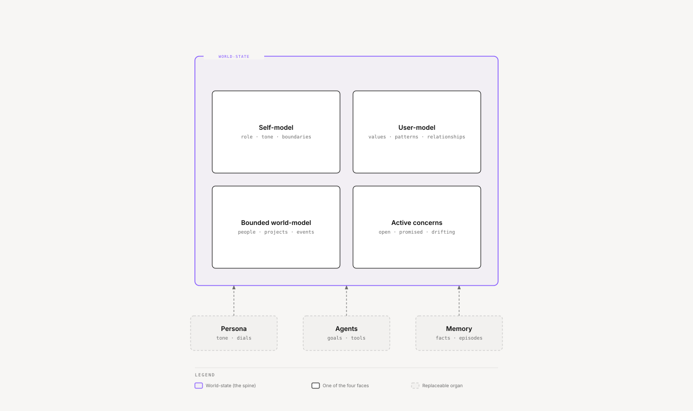

# Ze — Vision

Ze is a model of you. It is a personal AI built around a continuous, bounded model of one
person and their active concerns, not a chat bot with plugins.

Ze is pre-v1. One person uses it, self-hosted, and it is in active development. This page
states where it is going. The [README](README.md) states where it is today.

## The product

After any refactor, model swap, or agent churn, Ze must still know **who you are, what is
true, what is open, and what is drifting.** That continuity *is* the product.

The spine is the **world-state** — four faces, bounded to your neighborhood: self-model
(who Ze is to you), user-model (who you are), bounded world-model (the people, projects,
and events you care about), and active concerns (what is open, promised, planned, or
drifting).

[Interactive version](docs/diagrams/root/world-state-spine.html)

Everything else (persona, agents, goals, LLMs, memory tables, orchestration) is a
replaceable organ attached to that spine.

## How it thinks

Ze is one mind writing to one world-state — not a router over specialists. One agent,
companion, speaks to the user. Specialists are tools it calls. Read
[One mind, not a router](docs/engineering/one-mind-not-a-router.md).

Claims have kinds (identity, fact, inference, suspicion, priority), honest provenance, and
decaying confidence. A claim may only be surfaced with the posture its kind licenses. Ze
may hold a suspicion, but it never states one as a fact.

Small judgments are calibrated before they gate anything. A judgment ships off until a
held-out set shows it is safe, and the failures stay on the record. Read
[Calibrating a judgment model honestly](docs/engineering/calibrating-a-judgment-model-honestly.md).

Seven enduring functions structure the mind: perception, memory, executive, social
cognition, reflection, action, governance. Implementations churn; the functions do not.
Executive function was the primary gap. Ze now tracks lightweight open loops beside
heavyweight goals, and the work continues. Read
[Open loops](docs/engineering/open-loops-executive-function.md).

## Non-goals

- Not a general world model (unbounded = ungroundable)
- Not "autonomy = calling APIs without asking" (autonomy = self-maintained world-state
  plus governed initiative)
- Not goals-as-the-unit-of-meaning (goals are one kind of active concern)
- Not a chat loop as substrate (conversation is one input channel)

## Where the detail lives

| Doc | Role |
|---|---|
| [`specs/arch/ze-doctrine.md`](specs/arch/ze-doctrine.md) | Constitutional commitments — claim kinds, arbitration, contribution model |
| [`docs/cognitive-architecture.md`](docs/cognitive-architecture.md) | Functional map of the mind — maturity, gaps, sequencing |
| [`docs/engineering/`](docs/engineering/README.md) | Notes on real design decisions, with evidence |
