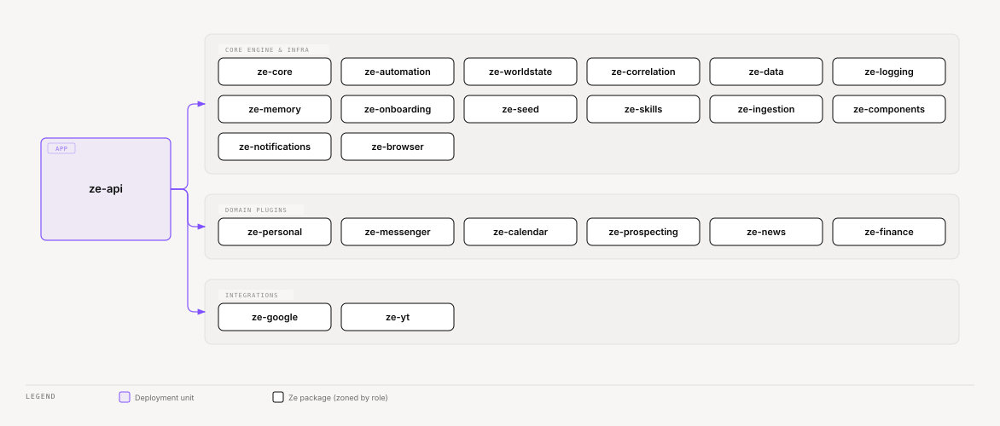

# ze-api

Deployment unit for Ze. Wires all packages together, exposes the WebSocket chat endpoint and REST management API, runs background jobs, and handles Google integrations.

## Role in Ze

`ze-api` is the only runnable backend. It is where every package meets: the LangGraph is built, plugins are discovered and started, Postgres migrations run, background jobs fire, and the WebSocket/REST interface serves `ze-web` and ntfy push clients.

### Key features

- WebSocket chat at `/ws` — primary user interface, with confirmation flow and message replay
- REST management API — memory inspection, costs, workflows, held writes, contacts
- `ZeContainer` — DI wiring for all plugins, integrations, and shared services
- Alembic meta-migrator — discovers and runs migrations from all owning packages
- Agent harness hooks — tool-call caps (`ze_agents`), component collection (`ze_components`); configured in `ze_core/bootstrap.py`
- NativeAppInterface — WebSocket delivery when connected, ntfy push when not

### Integration

Depends on every core package and all enabled plugins. Instantiates `ZeContainer` via
`build_container()` — plugin discovery through `ze_plugin.bootstrap`, agent registration
through `ze_agents.bootstrap`, domain stacks through package bootstrap modules — then
serves via uvicorn. Nothing in `core/` or `plugins/` runs standalone — `ze-api` is
always the entry point.

Collects plugin signal sources via `collect_plugin_signal_sources()` in `wiring/agents.py` — deduplicates by `source_key` and registers them with the correlation engine. Current emitters: `NewsSignalSource`, `CalendarSignalSource`.

## Responsibilities

| Module | What it provides |
|---|---|
| `main.py` | `create_app()` and `app` (`uvicorn ze_api.main:app`) |
| `lifespan.py` | Startup: migrate, check schema, build the container, dev seed, mount plugin routers |
| `api/v0/<domain>/` | One `router.py` and `schemas.py` per REST domain, all mounted under `/api/v0` |
| `api/ws/` | WebSocket endpoint (`/ws`), frame schemas, and the turn, confirmation and goal-action handlers |
| `api/eval/` | Eval chat and routing log; mounted only when `EVAL_MODE` is on |
| `api/shared_schemas.py` | Types shared by more than one router |
| `interface/native.py` | `NativeAppInterface` — WebSocket + ntfy delivery |
| `wiring/container.py` | `ZeContainer` and `build_container()`, the only place that joins packages |
| `wiring/stores.py`, `agents.py`, `hooks.py` | Phases of `build_container()`: stores, plugin and agent layer, cross-package hooks |
| `wiring/jobs.py` | `register_all_proactive_jobs()` — core + plugin cron registration |
| `wiring/plugin_routes.py` | Plugin router collection; the OpenAPI export and the runtime mount share it |
| `settings.py` | `ZeApiSettings` (Pydantic BaseSettings + YAML) |
| `cli/` | `migrate` (Alembic meta-migrator), `seed`, `openapi_export`, `gmail_push` |
| `migrations/env.py` | Alembic runner harness (no owned tables) |

Agents and proactive jobs live in plugin packages (`ze-personal`, `ze-messenger`, `ze-calendar`, etc.) — not in `ze-api`. Core package jobs (automation, memory, correlation) are registered via package bootstrap modules — see [specs/phases/076-ze-api-shell-cleanup/spec.md](../../specs/phases/076-ze-api-shell-cleanup/spec.md).

## Dependencies



<sub>[Interactive version](../../docs/diagrams/apps/ze-api/dependencies.html)</sub>

## Running

```bash
make dev          # uvicorn --reload on :8000
make dev-eval     # REST API without background jobs (for running evals)
make dev-full     # backend + React web app together
```

## WebSocket protocol

Connect at `ws://<host>:8000/ws` with `Authorization: Bearer <ZE_API_KEY>` header or `?token=<ZE_API_KEY>` query param.

**Send** (user turn):
```json
{"type": "message", "text": "What's on my calendar today?", "thread_id": "<uuid>"}
```

**Receive** (assistant response):
```json
{"type": "message", "message": {"role": "assistant", "text": "...", "components": [...]}}
```

**Receive** (confirmation request — Ze parked a write it cannot undo):
```json
{"type": "confirm_request", "id": "<uuid>", "thread_id": "<uuid>", "kind": "write", "round": 1, "title": "Ze needs your OK", "items": [{"item_id": "c1", "agent": "messenger", "tool": "send_email", "effect_phrase": "send an email", "summary": "to: ana@example.com"}], "actions": [{"label": "Approve all", "value": "approve", "style": "primary"}, {"label": "Deny all", "value": "deny", "style": "secondary"}], "expires_at": "..."}
```

**Send** (confirmation reply):
```json
{"type": "confirm", "id": "<request id>", "choice": "approve"}
```

**Send** (retry the latest reply; the server refuses it if a write ran):
```json
{"type": "retry", "message_id": "<uuid>", "thread_id": "<uuid>"}
```

A successful retry sends a `message` frame, then `message_superseded`. Errors carry a `code`.

Full protocol reference: [docs/native-interface.md](../../docs/native-interface.md).

## REST endpoints

| Route | Description |
|---|---|
| `GET /api/v0/messages` | Unread message list (WebSocket replay fallback). Hides retried replies unless `include_superseded=true` |
| `PUT /api/v0/messages/{message_id}/feedback` | Rate an assistant reply (`up`, `down`, `none`) |
| `GET /api/v0/messages/feedback` | Batch read of ratings and Retry eligibility |
| `GET /api/v0/held-writes` | List writes that unattended workflow and goal runs hold for approval |
| `POST /api/v0/held-writes/{request_id}/decision` | Approve or deny a held write |
| `GET /api/v0/memory/facts` | Inspect stored facts |
| `GET /api/v0/memory/profile` | Get current user profile |
| `GET /api/v0/routing/log` | Routing decision log |
| `GET /api/v0/costs/summary` | Token usage and cost breakdown |
| `GET /api/v0/workflows` | List workflows |

All routes require `Authorization: Bearer <ZE_API_KEY>`.

## Configuration

See the root [README](../../README.md#configuration) for all environment variables.

## Testing

From the repo root:

```bash
make test        # alias for test-api
make test-api
```

See [docs/testing.md](../../docs/testing.md).
