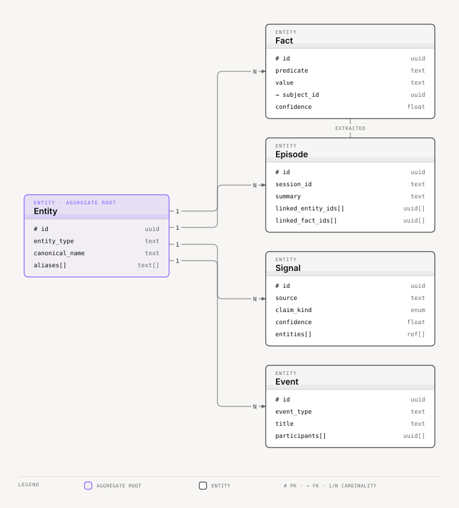
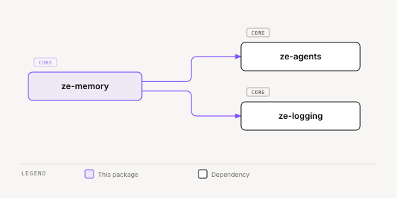

# ze-memory

Memory persistence and retrieval for Ze — facts, episodes, semantic search, graph traversal, and consolidation.

## Role in Ze

Memory is how Ze remembers the user across conversations. Facts and episodes are extracted after each turn, stored in Postgres with pgvector embeddings, and retrieved semantically before agent execution. A memory graph connects entities and supports the correlation engine's cross-domain reasoning.

### Key features

- Fact and episode storage with semantic retrieval (local embedding model, no API cost)
- Fact provenance: perception writes `prompt_supplied`, and only the dream writes `synthesized` (with a `dream_run_id`). Dream decay and expiry touch only facts with a `dream_run_id`. Migration `zm026` re-stamped the older perception facts `synthesized` → `prompt_supplied`. When nightly dedup merges two similar facts into a new one, it does so only when both have no `dream_run_id` and share provenance and claim kind, and the merged fact keeps them
- LLM-driven extraction and session-grouped episode consolidation
- Per-agent retrieval policies — plugins register domain-specific memory access rules
- Memory graph — entity linking, traversal, and neighbourhood expansion for correlation
- **Signal substrate** — `Signal` storage, relevance-scored admission gate, and graph ingestion for cross-domain correlation
- User profile synthesis from accumulated facts and episodes

### Integration

`PostgresMemoryStore` is constructed in `ze-api`'s container and injected into plugins and graph nodes. The `fetch_context` and `write_memory` graph nodes in `ze-core` call into `ze-memory`. Plugins extend retrieval via `ZePlugin.memory_policies()`.

Plugins emit candidate signals via `SignalSource` (defined in `ze-plugin`, type in `ze_memory.types`). The admission gate scores each signal for relevance; admitted signals are written to the memory graph and become seeds for `ze-correlation`.

`screen_resolvers.py` registers screen resolvers for `entity`, `fact` and `procedure`. A fact line carries its stored claim kind, source and confidence.

## Responsibilities

| Module | What it provides |
|---|---|
| `store.py` | `MemoryStore` and retrieval-policy protocols |
| `retriever.py` | `PostgresMemoryStore` — fact and episode CRUD; semantic retrieval with embedding similarity; signal ingest and pinning; `retract_fact_and_restore` retracts a fact and restores the facts it displaced, and raises `FactRestoreConflictError` when a restore is not safe |
| `extractor.py` | Haiku fact extraction from conversations, the fallback when the commitment intake skips |
| `fact_judge.py` | System One fact questions (family Choice, biography Noul), bars, and persist/hold rules the commitment intake reuses |
| `admin.py` | Read and review surface for the web app: the memory feed (with `claim_kind`), `search_entities`, `get_entity_detail` (claim fields, ordered neighbours, `neighbour_total`), the entity graph, `review_facts` |
| `consolidator.py` | Dedup, expiry, episode archival, and the profile synthesis step |
| `consolidation_store.py` | `PostgresConsolidationStore` — the database operations `MemoryConsolidator` uses |
| `session_summary.py` | `SessionSummariser` — eager narrative summary of each closed session |
| `bootstrap.py` | Schedules the nightly consolidation, session summary, and dream jobs |
| `contribution.py` | `submit_perception_facts` — the contribution-seam door for fact writes |
| `constraint_veto.py` | `ConstraintVetoHook` — checks reviewed constraint facts before a gated write tool runs |
| `fact_identity.py` | Normalizes a fact's predicate and value so a repeat write is recognized |
| `composite.py`, `entity_anchor.py`, `relevance_config.py` | Retrieval ranking: composite score, entity-anchored retrieval, and the relevance settings |
| `retrieval_rerank.py`, `retrieval_cache.py`, `nli_config.py` | Live and cached NLI re-rank of retrieved facts, and the NLI settings |
| `dream/` | The nightly dream phase: sleep pass, dream pass, critic, promoter, journal (see [docs/dreaming.md](../../../docs/dreaming.md)) |
| `procedures/` | Procedure candidates, admission, discovery, and activation |
| `action_records/` | `ActionRecord` — the append-only ledger of actions Ze took |
| `admission.py` | `AdmissionGate` — relevance-scored signal admit/watch/drop |
| `relevance.py` | `RelevanceModel` — cheap scoring for signal admission |
| `policies.py` | `MemoryRetrievalPolicy` implementations per agent domain |
| `feedback_records/` | Append-only `FeedbackRecord` evidence for thumbs and Retry requests on assistant replies, `FeedbackStore`, `submit_feedback_record`. Never read during a turn |
| `graph/` | Memory graph store, traversal, predicates, projection |
| `synthesizer.py` | `ProfileSynthesizer` — user profile from facts and episode summaries |
| `vectors.py` | `to_vector_literal` — pgvector text literal for embedding binds |
| `types.py` | Memory domain types (`Fact`, `Episode`, `Signal`, …). `FactAdmission` lists the facts a turn admitted and the path that admitted them (`system_one`, `haiku` or `none`); it carries no `Judgment`. The intake's record sits on `IntakeAdmission` in `ze-worldstate` |

`Entity` is the aggregate root every other type ultimately links back to — facts, episodes, signals, and events all reference one or more entities:



<sub>[Interactive version](../../../docs/diagrams/core/cognition/ze-memory/memory-domain-types.html)</sub>

## Dependencies



<sub>[Interactive version](../../../docs/diagrams/core/cognition/ze-memory/dependencies.html)</sub>

Third-party: `asyncpg`, `numpy`.

## Usage

Wired into the orchestration graph by `ze-core` and extended by plugins via `memory_policies()`:

```python
from ze_memory.retriever import PostgresMemoryStore
from ze_memory.policies import MemoryRetrievalPolicy
```

Plugin authors import policy types from `ze_sdk.memory`.

## Testing

From the repo root:

```bash
make test-memory
```

See [docs/testing.md](../../../docs/testing.md).
