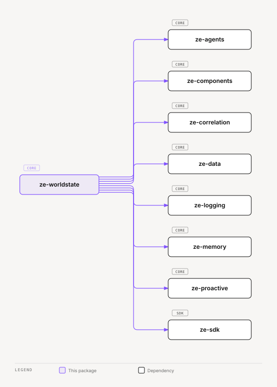

# ze-worldstate

Open-loop substrate for Ze — active concerns, honest provenance, evidence-linked confidence.

## Role in Ze

Goals are the heavyweight, explicitly-declared end of Ze's executive function. Most real commitments never get declared as a goal: a promise made in an email thread, a decision left pending, a project quietly stalling because a dependency didn't land. `ze-worldstate` tracks these as **open loops** — the lightweight, ambient half of executive function, and the shipped first slice of what `specs/arch/ze-doctrine.md` calls **active concerns**, the fourth face of Ze's world-state.

An open loop moves through `suspected → active → drifting → closed | dropped`. Confidence decays on its own; a contradiction pushes a loop's confidence down, and a missed deadline moves an `active` loop into `drifting`. Only an explicit user ask (`track_loop`) can move a `drifting` loop back to `active`. When the user says a loop is done, `LoopLifecycle.resolve` closes a `suspected`, `active` or `drifting` loop and links the resolving evidence in one transaction.

### One write surface: `LoopLifecycle`

`lifecycle/events.py` holds `LoopLifecycle`, the only code that writes `open_loops`, `open_loop_sources` or the loop rows in `memory_relationships`. Each public method is one domain event (`LoopEvent`) and runs as one transaction under a row lock. The method checks the state table in `lifecycle/rules.py` (`EVENT_RULES`), writes the row with one guarded `UPDATE`, and returns the loop as stored. The rules are pure data. The stamps (`DeclaredStamp`, `CONFIDENCE_STAMP`, the 0.3 suspected and 0.7 promoted levels) are defined once in `rules.py`. The callers decide what happened. They never set a state or a stamp.

| Event (method) | Moves | Notes |
|---|---|---|
| `create_suspected` | new → `suspected` | 0.3 confidence; links evidence, entities, and an origin source row |
| `create_declared` | new → `active` | declared stamp: 0.9 confidence, a 7-day drift deadline |
| `confirm` | `suspected` → `active` | declared stamp (the Needs you confirm) |
| `track` | `suspected` → `active`, `drifting` → `active`, or `active` stays | the user asked: `confirmed`, `revived`, or `reinforced` |
| `corroborate` | `suspected` stays | raises confidence, writes a `corroboration` source row |
| `promote` | `suspected` → `active` | confidence at least 0.7, a 7-day deadline; the source row is marked `promoted` only on a win |
| `resolve` | `suspected`, `active`, `drifting` → `closed` | resolving evidence; the rule also links the evidence |
| `close` | `active`, `drifting` → `closed` | the user closes the loop |
| `drop` | `suspected`, `active`, `drifting` → `dropped` | records the evidence fingerprint |
| `expire` | `suspected` → `dropped` | stale suspicion job |
| `drift` | `active` → `drifting` | the deadline passed; writes the absence rationale |
| `decay_from_evidence` | confidence only, except `active` → `drifting` | a contradicted evidence item lowers confidence |
| `note_evidence` | state kept | new evidence on a loop that is not `suspected` |
| `link` | state kept | sets the reminder or goal pointer, once; never overwrites |

An event with no legal move from a state either returns `None` or `False`, or raises `InvalidLoopTransitionError`, as the rule table says. `LoopLifecycle` never raises for a race that left nothing to do.

`PostgresLoopStore` (`store.py`) holds reads only: `get`, `list`, `list_by_evidence`, `count_evidence_links`, `list_evidence`, `list_drift_candidates`, `list_sources`, and `list_sources_for`. It has no write method. `review.py` and `decay.py` were deleted. Their work now runs through the lifecycle events above.

A loop's claim kind follows its state and is not stored: `suspicion` while `suspected`, `priority` once `active`, `drifting` or `closed`, and none for a `dropped` loop. `loop_claim_kind(state)` in `types.py` is the one table, and `OpenLoop.claim_kind` reads it. The loops REST `claim_kind` is null for dropped loops. Loops reuse `ze-memory`'s graph tables (`memory_relationships`, a dedicated `open_loop` bucket) for dedup and neighbourhood expansion rather than a parallel model — this package owns loop lifecycle and surfacing, not a second memory store.

### Key features

- `OpenLoop` / `LoopState` — the lifecycle type and its five states
- Loop inflows — the four inflows (conversation, email, calendar, and ingestion) reach the lifecycle through one commit path, `LoopInflow.commit` (`admission.py`). It takes a `CommitDecision` and dispatches it: `resolve`, `create_declared`, or `create_suspected`. `hold` and `fallback` write nothing. Each created loop links the evidence that triggered it: the conversation or email turn episode, or the ingestion ref. The calendar inflow passes no evidence, because its event has no UUID record. The 109 Haiku gate in `extraction.py` stays as the fallback. Its parse tolerates the code fence Haiku puts around JSON; before phase 168 it did not, so this extraction created no loops in production
- Commitment intake (`commitment_judge.py`, `intake.py`) — phase 173. One System One request per conversation turn asks a `commitment` Choice (`reminder`, `loop`, `goal`, `waiting_on`, `fact`, `forget`, `ingest`, `clarify`, `none`) plus the fact questions (`family`, `biography`) and the loop questions (`is_open_concern`, `explicit_declaration`, `resolves_existing`). A pure `decide()` merges the answers with what the turn already did: a turn that created a reminder or goal creates no loop and links to it instead, a `waiting_on` message writes nothing, and a `fact` follows the phase 163 rules. `CommitmentIntake.admit` returns the admitted facts and a loop commit to run after the episode exists. It replaces the phase 163 speech-act judge and the phase 168 conversation loop gate. Surface `system_one.surfaces.commitment_intake` is on in the shipped config (`choice_hold` 0.7, `family_hold` 0.7, `biography_hold` 0.55, `loop_hold` 0.6, `explicit_hold` 0.95, `resolves_hold` 0.8), after an `ENABLE` verdict for English and Portuguese on 147 blind held-out rows. Two earlier held-out sets had returned `KEEP OFF`.
- Loop gate (`loop_judge.py`, `admission.py`) — phase 168, for email, calendar, and ingestion. One System One request asks `is_open_concern` and `resolves_existing`; a pure `decide()` maps the answers to resolve, create-suspected, hold, or fallback. `LoopInflow` runs the gate, asks Haiku for a title (and an optional window in days) only after a positive gate, and commits. Surface `system_one.surfaces.loop_gate` is on in the shipped config (`loop_hold` 0.75, `resolves_hold` 0.8), after an `ENABLE` verdict on the held-out set for English and Portuguese
- Track tool (`tracking.py`, `agents/tools.py`) — phase 169. The `track_loop` tool, on the `loops` agent, starts tracking a concern the user asked Ze to keep in mind. `LoopTracker` matches existing loops. With no match it calls `create_declared` with no evidence and an origin source row; linking the turn episode is deferred. With a match it calls `track`, which returns one outcome: `created`, `confirmed`, `reinforced`, or `revived`. The reply may claim tracking only after a successful call
- Confirm — phase 171. A confirm, from World (the Needs you module) or the `confirm_loop` tool on the `loops` agent, calls `LoopLifecycle.confirm`, which stamps a suspected loop like a declaration: confidence 0.9 and a 7-day drift deadline. The `track_loop` result also reports whether tracking was earned (`tracking_earned`)
- Corroboration (`corroboration.py`, `corroboration_judge.py`) — phase 172. A second, independent source that matches a `suspected` loop is judged by one System One Noul, `same_concern`. The `Corroborator` calls `LoopLifecycle.corroborate`, or `promote` on a promotion. Code raises the loop's confidence and can promote it to `active`. The origin and every counted corroboration are recorded in `open_loop_sources` (`zw003`). See [Corroboration](#corroboration)
- Matching (`matching.py`) — entity-overlap + embedding-similarity dedup against existing loops
- Decay — `LoopLifecycle.decay_from_evidence` lowers the confidence of every loop that cites contradicted evidence. It runs on the evidence-writing path. The `decay.py` module is gone
- Drift (`drift.py`) — `is_drift_eligible` and the contradiction/absence rationale composers. The deadline comes from `DeclaredStamp` (on create, track, confirm, and promote) and from `note_evidence`. The move itself is `LoopLifecycle.drift`, run by the sweep for `active` loops whose `drift_deadline` has passed. New evidence on an active loop goes through `note_evidence`, which moves the deadline to at least 7 days from now (the default window is a code constant)
- `LoopSurfacer` (`surfacing.py`) — a push candidate source for `drifting` loops. It describes each loop as a hedged mention with a `OncePer` (`loop:<id>`, window `worldstate.push.repush_after_days`). It does not apply the bar and does not send on its own: `ze-priority`'s push bar screens the candidate (confidence, relevance, inline mention, novelty, grounding), and `AttentionArbitrationJob` sends it. `LoopSurfacer.send` re-checks that the loop is still drifting before it sends. The NLI client belongs to the push bar, not to the surfacer
- Review actions — confirm, close, and drop are `LoopLifecycle.confirm`, `close`, and `drop`. The `review.py` module is gone
- Jobs (`jobs/`) — `DriftSweepJob` and `StaleSuspicionJob`, scheduled via `ze-proactive`. `ze-priority`'s `AttentionArbitrationJob` replaced the old `PushSweepJob`

### Integration

`ze-api`'s container calls `build_worldstate_stack()` at startup, which wires `PostgresLoopStore` (reads) and `LoopLifecycle` (writes) against the shared `ze-memory` graph store. The commitment intake runs in the `write_memory` node and commits the loop fire-and-forget once the episode exists. A turn where `track_loop` or `confirm_loop` succeeded creates no second loop. The messenger, calendar, and ingestion inflows call a loop extractor (`ze_worldstate.inflow`) that runs the loop gate, can create suspected loops or resolve existing ones, logs its judgments, and writes no message-trace rows. When the intake or the gate is off, uncalibrated, or skips, the Haiku paths run: the Haiku fact extractor and the 109 Haiku loop gate (see the note above on its parse failure). `GET /api/v0/loops` and `POST /api/v0/loops/{id}/confirm|close|drop` (`rest.py`) expose review actions to the web app. World's Loops rail and Needs you module use them.

`screen_resolvers.py` registers the `loop` screen resolver: label, state, confidence and age of the loop the user is looking at.

## Corroboration

A `suspected` loop gains support when a second, independent source mentions the same matter. Phase 172 turns that second mention into a promotion. The path runs when a commit admits a text as a concern and `find_matching_loop` returns a `suspected` loop. `LoopInflow` routes that match to `Corroborator.on_suspected_match`, on both the suspected and the declared commit paths. A live match that is not suspected gets `note_evidence` instead.

### Independence (`corroboration.py`)

Code decides independence first. A non-independent match makes no System One request and keeps the 170 behavior. A text carries a source key `(inflow, source_ref)`: the conversation thread id, the Gmail thread id (the message id when there is none), the calendar event `external_ref`, or the ingestion id.

| Check, in order | Reason when it fails |
|---|---|
| The key is set and its ref is not empty | `no_key` |
| The key is on no source row of the loop | `same_source` |
| No evidence ref is already linked to the loop | `same_evidence` |
| The key is on no source row of a matching `dropped` loop | `dropped_source` |

When all four checks pass, the text is independent. These checks cover the repeats the user already saw: the same chat thread, the same email thread, a re-ingested document, and evidence recorded on a dropped loop.

### Same concern (`corroboration_judge.py`)

One System One Noul, `same_concern`, asks whether the text is about the same unfinished matter as the loop title. The same person, place, or topic alone is not enough. The state holds the loop title (capped at 200 characters), the new text's inflow, and the text capped with the 168 per-inflow caps. Ze makes one attempt. A pure `decide()` maps the score against two bars:

- At or above `corroborate_hold`: link the evidence, raise the confidence, stay `suspected`.
- At or above `promote_hold`: do the same, then move the loop to `active`.
- Below both, or a skip, an invalid answer, or a failure: the 170 behavior.

An answer exactly at a bar counts. The bars live in `system_one.surfaces.corroboration`.

### Effects and constants

The constants are code, not config, and never model output:

| Constant | Value | Meaning |
|---|---|---|
| `CORROBORATION_WEIGHT` | 0.5 | The score's weight in the noisy-OR |
| `CORROBORATED_CAP` | 0.6 | A corroborated loop stays below the promoted level until it is promoted |
| `PROMOTED_CONFIDENCE` | 0.7 (`lifecycle/rules.py`) | The confidence a promoted loop is set to, below the 0.9 of a user-confirmed loop |
| `DeclaredStamp.DEFAULT_WINDOW_DAYS` | 7 (`lifecycle/rules.py`) | The drift deadline after promotion |

`LoopLifecycle.corroborate` links evidence and entities, writes one `corroboration` source row with `promoted = false`, and sets the confidence to `min(0.6, 1 − (1 − c)(1 − 0.5·s))`, where `c` is the current confidence and `s` the score. `LoopLifecycle.promote` does the same in one transaction, then runs one update guarded by `state = 'suspected'`: it sets `state = 'active'`, `confidence = GREATEST(confidence, 0.7)`, `confirmed_at = now()`, and a 7-day drift deadline, and marks the source row `promoted = true` only when the update changed a row. If another inflow promoted first, the source row keeps `promoted = false` and nothing else changes. Promotion changes loop state only. It keeps the provenance and claim kind, writes no fact, and does not go through the contribution seam.

### Sources (`open_loop_sources`, `zw003`)

Every loop created with a source key gets an `origin` row (`create_suspected`, `create_declared`, and `track_loop` with a conversation key), whether the surface is on or off. Each counted corroboration adds a `corroboration` row with its score, model, and latency. `(loop_id, inflow, source_ref)` is unique, so a repeated key is a no-op and its judgment does not count. Rows are deleted with their loop. `GET /api/v0/loops` reports `promoted` and `source_inflows` for each loop. There is no per-loop route.

### Fail-open

The surface ships off with null bars. Off, uncalibrated, skipped, invalid, or failing, a suspected match behaves exactly as after phase 170: Ze links the evidence and changes nothing else. Every judged match is logged as `corroboration_judgment` (loop id, inflow, outcome, reason, score, latency, skip reason); a non-independent match logs `corroboration_skipped` with the reason. No exception from the surface reaches the commit's caller.

## Responsibilities

| Module | What it provides |
|---|---|
| `types.py` | `OpenLoop`, `LoopState`, `LoopProvenance`, `TrackOutcome`, `TrackResult` |
| `store.py` | `LoopStore` protocol, `PostgresLoopStore` — reads only |
| `lifecycle/events.py` | `LoopLifecycle`: one method per domain event, each one transaction; value types `LoopDraft`, `Corroboration`, `SourceWrite`, `Tracked` |
| `lifecycle/rules.py` | `LoopEvent`, `EVENT_RULES` (the state table), `DeclaredStamp`, the stamp SQL and the confidence constants — pure, no I/O |
| `lifecycle/__init__.py` | Exports `LoopLifecycle` and the value types |
| `decision.py` | `CommitDecision`, `CommitResult`, `CommitKind`, `CommitOutcome` — what an inflow decided and what came of it |
| `extraction.py` | The 109 Haiku gate (fallback), the Haiku title writer, and `resolve_entities` |
| `commitment_judge.py` | System One commitment questions, state, surface config, and the pure `decide()` decision table |
| `intake.py` | `CommitmentIntake`: the one request, facts, the loop commit, and linking a loop to a reminder or goal |
| `loop_judge.py` | System One loop gate for email, calendar, and ingestion: two Noul questions, bars, pure `decide()` |
| `admission.py` | `LoopInflow`: the gate, the Haiku title writer, and `commit`, which dispatches a decision to the lifecycle |
| `corroboration.py` | `Corroborator`: independence rule, confidence arithmetic, corroborate/promote through the lifecycle |
| `corroboration_judge.py` | System One same-concern Noul: state, surface config, pure `decide()` |
| `tracking.py` | `LoopTracker`: normalize, match, and create or track a user-asked loop through the lifecycle |
| `matching.py` | Entity-overlap + embedding dedup against existing loops |
| `drift.py` | `is_drift_eligible` and the rationale composers (contradiction, absence); the deadline is set by `DeclaredStamp` and `note_evidence` |
| `surfacing.py` | `LoopSurfacer` — push candidate source for drifting loops, with a hedged mention |
| `inflow.py` | Wiring helpers for the four inflows (conversation, email, calendar, ingestion) |
| `jobs/` | `DriftSweepJob`, `StaleSuspicionJob` |
| `bootstrap.py` | `build_worldstate_stack()` — DI wiring for `ze-api` |
| `agents/` | The `loops` agent and its tools (`list_open_loops`, `track_loop`, `confirm_loop`, `close_loop`, `drop_loop`) |
| `contribution.py` | Turns a loop candidate into a seam contribution |
| `push_kinds.py` | The `loop_drift` push kind |
| `screen_resolvers.py` | The `loop` screen resolver |
| `rest.py` | Handlers for the `/api/v0/loops` routes |
| `migrations/` | `zw001` (open_loops table), `zw002` (drift columns), `zw003` (open_loop_sources table), `zw004` (`reminder_id` on open_loops), `zw005` (`confidence_prior`, `confidence_changed_at`), `zw006` (drops `open_loops.claim_kind`). The phase 203 change has no migration |

Every `WRITE` tool in this package declares `reversibility` and an `effect_phrase`. Retry reads these declarations to decide if a reply can be regenerated.

## Dependencies



<sub>[Interactive version](../../../docs/diagrams/core/cognition/ze-worldstate/dependencies.html)</sub>

Third-party: `asyncpg`.

## Usage

```python
from ze_worldstate.bootstrap import build_worldstate_stack
from ze_worldstate.types import OpenLoop, LoopState

stack = build_worldstate_stack(shared, settings)
loops = await stack.loop_store.list(states=[LoopState.ACTIVE])
```

Wired by `ze-api`, not imported directly by plugin code — plugins that want to emit loop-relevant events use their existing `SignalSource` / inflow hooks, which `ze-worldstate` already listens to.

## Confidence movement (phase 185, `zw005`)

Loop confidence changes only on evidence: contradiction, corroboration, a `track_loop` reinforcement, a declaration or confirmation, or promotion. Each write that changes the value stamps `confidence_prior` (the value before the change) and `confidence_changed_at` in the same UPDATE. A write that leaves the value unchanged stamps nothing, and a loop that never changed has both as null. Nothing is back-filled. The loop REST rows carry both fields, plus `drift_deadline` and `confirmed_at`.

## Testing

From the repo root:

```bash
make test-worldstate
```

See [docs/testing.md](../../../docs/testing.md).
