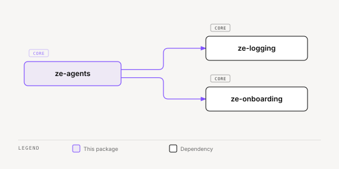

# ze-agents

Developer API for Ze — agent execution primitives, shared types, and harness hooks. Plugin authors reach this package through `ze-sdk`, not by importing `ze_agents` directly.

## Role in Ze

`ze-agents` defines how agents are authored and executed. Every agent in Ze subclasses `BaseAgent` and runs an LLM-driven ReAct tool loop. The `@agent` and `@tool` decorators register agents and tools into a shared registry that the orchestration graph resolves at runtime.

### Key features

- `BaseAgent` with the agentic tool loop, timeout handling, and progress reporting
- `@agent` / `@tool` decorators and the agent registry
- Harness hooks — step-level interception and tool-call caps
- `delegate_to_agent` — the conductor's way to hand a brief to a specialist
- Shared claim vocabulary (`ClaimKind`, `Provenance`, `Confidence`, `decay()`), reply honesty guards, and the `run_tool_script` contract
- One owner for child `AgentContext` derivation (`derive.py`): every subtask, delegate, goal milestone and undo or screen action builds its context through it
- Lifetime markers (`Turn`, `Input`, `Thread`, `Run`) that declare how long each graph-state field lives
- Shared protocols (`LLMClient`, `DBPool`) and the typed `ZeError` hierarchy
- `AppInterface` ABC — the outbound delivery contract implemented by `ze-api`

### Integration

Imported by nearly every other Ze package, including `ze-plugin`, `ze-core`, and `ze-onboarding`. Re-exported to plugin authors via `ze-sdk`. At startup, `ze-api` bootstrap imports each plugin's `agent_module_paths()` to fire decorator registration before the graph is built.

## Responsibilities

| Module | What it provides |
|---|---|
| `base_agent.py` | `BaseAgent` ABC with the agentic ReAct loop. `tool_deps()` returns the internal tool dependencies, and `run_undo()` runs one undo tool outside the model loop |
| `registry.py` | `@agent` decorator and the module-level agent registry (`get_registered_agents`, `get_enabled_agents`) |
| `bootstrap.py` | `bootstrap_agents` and `validate_registry` — import plugin agent modules and build agent instances |
| `tool.py` | `@tool` decorator, `ToolAccess`, and `validate_tool_declarations()`. Every `WRITE` tool declares `reversibility`, with `undo_tool`, `undo_note`, and `effect_phrase` |
| `rollback.py` | `RollbackScope` (a ContextVar that links action records written during an undo to the record they undo) and `is_error_result()` |
| `reversibility.py` | `ToolReversibility` enum (`REVERSIBLE`, `IRREVERSIBLE`) |
| `client.py` | `LLMClient` Protocol |
| `db.py` | `DBPool` Protocol |
| `settings.py` | `Settings` dataclass |
| `errors.py` | Full `ZeError` hierarchy |
| `hooks.py` | `HarnessHook` Protocol for agentic-loop interception |
| `tool_cap_hook.py` | Hook that aborts a tool call when the per-turn limit is exceeded |
| `interface/` | `AppInterface` ABC, `InputPreprocessor`, validation, types |
| `progress/` | `ProgressReporter`, locale-key translations |
| `delegate.py` | `delegate_to_agent` — the built-in harness tool the conductor uses to brief a specialist |
| `budget.py` | Conductor turn time budget — soft deadline, reserve, and partial answer |
| `model_resolution.py` | `resolve_model` — override, then declared model, then default |
| `tasks.py` | `fire_and_forget` — background task helper |
| `claims.py` | `ClaimKind`, `Provenance`, `Confidence`, and `decay()` — the shared claim vocabulary |
| `honesty.py` | Reply guards that hold tokens and check memory and action confirmations before a reply goes out |
| `nested_tools.py` | Helpers that read nested tool calls (delegate and subtask results) to decide what a turn earned |
| `system_one.py` | `SystemOneClient` Protocol — typed judgments (Noul, Choice, Score) |
| `screen.py` | `ScreenContext` and `ScreenRef` wire types, `ScreenResolver` Protocol, `sanitize_text` |
| `scripts.py`, `script_stub.py`, `script_step.py` | `run_tool_script` contract, stub builder, and step runner |
| `nli.py` | `NLIClient` Protocol |
| `types.py` | Shared domain types, including `AgentContext`, `WriteGateState`, `ConductorState`, `DelegateTally` and `ProcedureInvocation` |
| `derive.py` | `for_subtask`, `for_delegate`, `for_unattended` and `for_action` — the only builders of a child `AgentContext`. `DERIVATION` gives each field one rule per child-run kind, and `outcome_of` reads a child's `ChildRunOutcome` |
| `lifetime.py` | `Turn`, `Input`, `Thread` and `Run` lifetime markers for graph-state fields, `field_lifetimes()`, and `turn_reset()`, which builds the per-turn reset |
| `park.py` | Park types for irreversible writes that wait for the user: `ParkedWrite`, `ParkedLoop`, `ParkedSubtask`, `WriteDecision`, `WriteConfirmation` |
| `effects.py` | `effect_imperative` (the imperative form of an effect phrase) and `ensure_declined_lines` (the "Okay, I didn't …" line for denied writes) |

## Dependencies



<sub>[Interactive version](../../../docs/diagrams/core/contracts/ze-agents/dependencies.html)</sub>

Depends on `ze-logging` only. Third-party: `pyyaml`, `typing_extensions`.

## Usage

Consumed by `ze-plugin`, `ze-core`, and re-exported via `ze-sdk`. Engine and plugin bootstrap code import directly:

```python
from ze_agents.registry import agent
from ze_agents.base_agent import BaseAgent
from ze_agents.tool import tool
```

## Testing

From the repo root:

```bash
make test-agents
```

See [docs/testing.md](../../../docs/testing.md).
