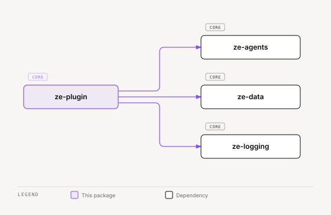

# ze-plugin

Plugin extension framework for Ze — `ZePlugin` ABC, signal sources, contribution seam, and integration protocol. Used by the engine and SDK; plugin code imports through `ze-sdk`.

## Role in Ze

`ze-plugin` is the extension seam between the engine and domain packages. Every plugin package implements `ZePlugin` and declares an entry point; `ze-api` discovers, topologically sorts, and instantiates them. Plugins contribute agents, jobs, graph nodes, memory policies, and signal sources without modifying `ze-core` internals. The channel abstraction (`Channel` ABC, `ChannelRegistry`) lives in `ze-communication`, and `DataDomain` lives in `ze-data` — both are separate packages `ze-plugin` does not own.

### Key features

- `ZePlugin` ABC — container-level hooks (agents, jobs, migrations) and graph-level hooks (nodes, edges, state extensions)
- `SignalSource` protocol — cross-plugin signal collection for the correlation engine
- `Contribution` seam — typed proposals (`validate_and_submit`) for perception, social cognition, and action producers
- `ZeIntegration` protocol — structural contract for third-party credential classes
- Plugin discovery, topological ordering, and UI manifest collection

### Integration

Plugins self-register via `[project.entry-points."ze.plugins"]`. `bootstrap.py` collects integration types, calls `from_settings`, wires DI, and merges graph contributions at build time. Plugin authors import `ZePlugin` and channel types from `ze-sdk`.

**Signal flow:** plugins implement `SignalSource` and register via `ZePlugin.signal_sources()` → `ze-api` collects and deduplicates by `source_key` → admission gate in `ze-memory` scores and ingests → `ze-correlation` uses admitted signals as graph seeds.

## Responsibilities

| Module | What it provides |
|---|---|
| `plugin.py` | `ZePlugin` ABC — container and graph extension seam |
| `registry.py` | Plugin class registry (`get_plugin_registry`) |
| `bootstrap.py` | Plugin discovery, topological sort, and DI wiring (`discover_and_instantiate_plugins`, `resolve`) |
| `contribution.py` | `Contribution` and `validate_and_submit`. Perception holds two claim-kind licenses: `FACT` and `FEEDBACK_RECORD` |
| `signals.py` | `SignalSource` protocol for cross-plugin signal collection |
| `integration.py` | `ZeIntegration` protocol for third-party credential classes |
| `ui.py` | `UiContribution`, `UiManifest`, `collect_ui_contributions` — plugin manifest of modules (bound to a slot), Ask presets, and settings sections. Plugins add no pages |
| `ui_validate.py` | `validate_plugin_tree` — checks a plugin module's component tree: tool actions, claim kinds, and provenance |
| `webhook.py` | `WebhookHandler` protocol for plugin-owned inbound webhooks |
| `api_auth.py` | `require_api_key` — shared FastAPI bearer-token dependency |

## Dependencies



<sub>[Interactive version](../../../docs/diagrams/core/contracts/ze-plugin/dependencies.html)</sub>

## Usage

Wired by `ze-api` bootstrap and `ze-core` graph builder. Plugin authors use the SDK re-exports:

```python
from ze_sdk import ZePlugin, DataDomain
from ze_sdk.channels import Channel, ChannelRegistry
```

Engine code may import directly:

```python
from ze_plugin.plugin import ZePlugin
from ze_plugin.registry import get_plugin_registry
```

## Testing

From the repo root:

```bash
make test-plugin
```

See [docs/testing.md](../../../docs/testing.md).
