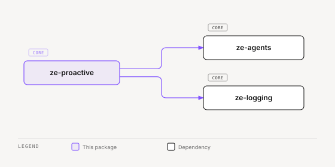

# ze-proactive

Job scheduling and push governance for Ze — background jobs, the interruption governor, and APScheduler wiring.

## Role in Ze

Proactive Ze runs on a schedule — morning briefings, calendar reminders, news fetches, goal checks, and correlation runs. `ze-proactive` provides the scheduler, job registration, and one send path for every proactive push.

### Key features

- `ProactiveScheduler` — APScheduler wrapper started at the `ze-api` lifespan, with cron catch-up after downtime
- `ProactiveJob` Protocol and the `@proactive_job` decorator, with cron and interval registration
- `ProactiveNotifier` — the single send path for proactive pushes; `push()` and `push_notification()` are gone
- Interruption governor — every push declares a class (`requested`, `accountability`, `discretionary`) and an urgency (`low`, `normal`, `high`), and one rule set decides deliver, hold, or suppress
- `OncePer` cooldowns — a push names the key it may send once per window; the claim is held here, in the private `push_log` store
- Quiet hours — a user setting; accountability and discretionary pushes are held silently and released together when quiet hours end
- Shared daily budget — only discretionary pushes claim it

### Integration

Plugins register jobs in `ZePlugin.register_proactive_jobs()`. `ze-api` starts the scheduler after all plugins have started. Re-exported to plugin authors via `ze_sdk.proactive`: the scheduler, job and notifier types, `PushKind`, `PushClass`, `Urgency`, `PushOutcome`, `OncePer`, `is_sent` and `NotificationStore`. The claim store (`PushLogStore`) is not exported.

`screen_resolvers.py` registers the `notification` screen resolver. It follows the notification's target one hop. `NotificationStore.get` reads one row.

## Interruption governor

`ProactiveNotifier.notify(kind, title, body, ...)` is the only proactive send path. Each `PushKind` names an event type and fixes its class, urgency, and source:

- `requested` — a reminder or calendar alert the user set. Always delivered, never budgeted, never held. Takes no `once_per`.
- `accountability` — a scheduled report or alert the user switched on. Never budgeted, held during quiet hours. May pass a `once_per`.
- `discretionary` — a nudge Ze chose to send. Claims the shared daily budget, is held during quiet hours, and must pass a `once_per`.

`ze_proactive.governor.decide` is a pure function. It applies the rule in order: deliver `requested`; hold while quiet hours are active; deliver `accountability`; deliver `discretionary` only when the budget claim was won, else suppress. The outcome is one of `delivered`, `held`, `suppressed_budget`, `deduped`, `failed`. `deduped` means the `once_per` key is still cooling, so nothing is sent.

A `once_per` claim holds only when the push is sent or held (`is_sent`). A push that fails releases its claim, so the next attempt can go out. The claim store is `PushLogStore`, and `OncePer` gives the key and its window.

Quiet hours come from the single-row `interruption_settings` table, read by `InterruptionSettingsStore` and evaluated by `is_active(setting, now_utc)`. When quiet hours end, `QuietHoursReleaseJob` (`job_id = "quiet_hours_release"`, default cron `*/5 * * * *`) delivers each held row in urgency order, then one summary. A read failure counts as not quiet.

Cron jobs catch up after downtime. `JobRunStore` records each run in `proactive_job_runs`. On `start()`, `ProactiveScheduler` runs a job once when its scheduled time passed since its last run, within `catch_up_max_age_hours`.

## Responsibilities

| Module | What it provides |
|---|---|
| `scheduler.py` | `ProactiveScheduler` — thin wrapper around APScheduler with catch-up |
| `job.py` | `ProactiveJob` Protocol, `@proactive_job` registration |
| `types.py` | `PushKind`, `PushClass`, `Urgency`, `PushOutcome`, `OncePer`, `is_sent`, `BudgetStatus`, `QuietHoursSetting`, `JobRun`, `Notification` |
| `candidates.py` | `PushCandidate` and `BarThresholds` — what a source describes to the push bar in `ze-priority`; a candidate carries its `OncePer` |
| `bootstrap.py` | `build_notifier`, `shared_push_budget` and `register_notification_jobs` (prune and quiet-hours release jobs) |
| `data_domain.py` | `proactive_data_domains` — export, import, and delete for the interruption tables |
| `staleness.py` | `is_stale` — the shared staleness helper |
| `screen_resolvers.py` | the `notification` screen resolver |
| `notifier.py` | `ProactiveNotifier` — the one send path; `notify`, `on_cooldown`, `remaining_budget`, `budget_status`, `deliver_held` |
| `governor.py` | `decide` — the pure deliver / hold / suppress rule |
| `push_kinds.py` | process-wide `PushKind` registry; `QUIET_HOURS_SUMMARY` |
| `quiet_hours.py` | `is_active` window check, `InterruptionSettingsStore` |
| `catchup.py` | `missed_fire_time` — the most recent missed cron fire time |
| `job_run_store.py` | `JobRunStore` — the last start and finish of each job |
| `notification_store.py` | `NotificationStore` — bell rows, held rows, unread counts |
| `push_log_store.py` | `PushLogStore`, `ClaimResult` — the private claim store behind `OncePer` cooldowns and the shared budget |
| `attention_budget.py` | `budget_status` — the one count of the rolling 24-hour window |
| `testing.py` | `InMemoryPushLog` — the claim store held in memory, for tests that want a real `ProactiveNotifier` |
| `jobs/prune_notifications.py` | `PruneNotificationsJob` — deletes old notification rows (default retention 90 days) |
| `jobs/release_held.py` | `QuietHoursReleaseJob` — releases held pushes when quiet hours end |

## Migrations

Branch `zpro`. `zpro001` creates `push_log`, `zpro002` creates `notifications`, `zpro003` adds the `push_log` idempotency key and its unique index, and `zpro005` adds `notifications.target_parent_id`. `zpro004_interruption_governor` adds the `notifications` columns (`push_class`, `urgency`, `format`, `actions`, `delivery`, `delivered_at`) and the `interruption_settings` and `proactive_job_runs` tables. `zpro006_push_claims` makes `push_log` the governor's claim table: it adds `claim_key` and `discretionary`, and deletes the rows that are not claims.

## Dependencies



<sub>[Interactive version](../../../docs/diagrams/core/contracts/ze-proactive/dependencies.html)</sub>

Third-party: `asyncpg`.

## Usage

Re-exported via `ze-sdk` for plugin job registration and push kinds:

```python
from ze_sdk.proactive import ProactiveScheduler, ProactiveJob, proactive_job, PushKind

MORNING_BRIEF = PushKind("morning_brief", "accountability", "normal", "personal")
```

Sites call `await notifier.notify(kind, title, body, once_per=OncePer(key, within=...))`. A `discretionary` push must pass `once_per`; a `requested` push must not. Plugins register jobs in `ZePlugin.register_proactive_jobs()`; `ze-api` starts the scheduler at startup.

## Attention budget

`budget_status(push_log, max_per_day)` is the one count of the rolling 24-hour window. `ProactiveNotifier.remaining_budget` and `ProactiveNotifier.budget_status` both call it, so the claim path and the REST route (`GET /api/v0/notifications/budget`) never disagree. `PushLogStore.window_sent_at` runs the one window query. `JobRunStore.list_runs` lists the last run of each job and raises on a store failure. `NotificationStore.list_page` filters by `delivery`, `push_class` and `since`.

## Testing

From the repo root:

```bash
make test-proactive
```

See [docs/testing.md](../../../docs/testing.md).
