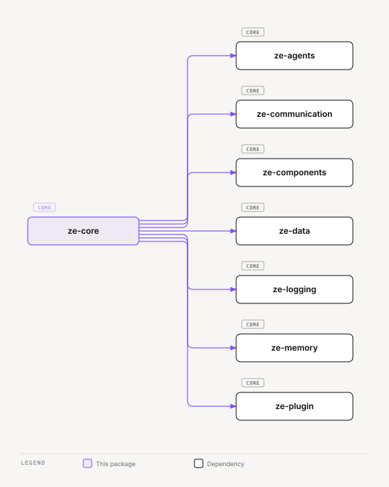

# ze-core

LangGraph orchestration engine for Ze. Pure infrastructure — routing, graph execution, write confirmation, OpenRouter client, telemetry, and DI container. Contains no personal-assistant domain logic.

## Role in Ze

Every user message flows through the LangGraph built by `ze-core`. The graph handles routing, context retrieval, preflight checks, agent execution, memory writes, and response synthesis. `ze-core` is the engine layer — it knows how to orchestrate agents but not what those agents do.

### Key features

- Embedding-based intent routing, a System One model-tier step, and compound-query decomposition
- LangGraph state machine with confirmation pauses, multimodal preprocessing, and checkpoint persistence
- Write confirmation — irreversible writes park until the user approves that exact call; one pause per turn
- Cost telemetry — per-flow and per-agent token tracking with automatic reconciliation
- OpenRouter client — all LLM, transcription, and vision calls go through a single gateway

### Integration

`ze-api` instantiates `ZeContainer` (subclass of `ze_core.container.Container`), builds the graph via `graph_builder`, and injects dependencies at invocation time. Plugins extend the graph through `ZePlugin` hooks in `ze-plugin` — `ze-core` merges their nodes, state fields, and configurable services at build time. Not imported directly from plugin packages.

The `ze_core/screen/` package holds the screen resolver registry and `build_screen_note`. The `resolve_screen` node runs before routing and writes the screen note (at most 1,200 characters) and its trace. Ze stores the context on the user message (`messages.screen_context`, `zc039`), so Retry replays it.

## Responsibilities

| Module | What it provides |
|---|---|
| `orchestration/` | `graph_builder`, `AgentState`, graph nodes and edges |
| `routing/` | `EmbeddingRouter`, `judge.py` (System One routing choice), `tier.py` (model tier), `PostgresRoutingStore`, fallback |
| `openrouter/` | `OpenRouterClient`, streaming, transcription. `audio.py` measures recordings with `ffprobe` and converts them with `ffmpeg` |
| `voice.py` | `transcribe_audio`: measures, limits and transcribes one recording for the voice route |
| `telemetry/` | `CostTracker`, `CostReconciler`, `PostgresCostStore`, context var, `TurnTelemetry` (`turn.py`, the per-turn recorder), `SpendBudgetChecker` (`budget.py`) and the static price table (`pricing.py`) |
| `conversation/` | Message/session/confirmation stores + graph turn helpers. `retry.py` decides Retry eligibility from the trace, `rewind.py` rewinds thread history for a retry, `rollback.py` (`run_rollback`) undoes the actions of a reply before a retry and records each undo on `messages.rollback`, and messages carry `replaces`/`replaced_by`/`rollback` |
| `container.py` | Base `Container` with DI wiring |
| `embeddings.py` | Shared `intfloat/multilingual-e5-base` singleton (enforces E5's `query:` / `passage:` prefixes) |
| `nli.py`, `torch_lock.py` | The NLI cross-encoder (`NLIClient` implementation) and the lock that serializes access to the shared PyTorch models |
| `screen/` | Screen resolver registry, owner map, and `build_screen_note` |
| `bootstrap.py` | `build_engine_stack()` — builds the embedder, NLI client, OpenRouter client, cost tracker, memory store, consolidator, and session summariser |
| `interface/cli.py` | `CLIInterface`, a terminal `AppInterface` implementation |
| `migrations/` | The `zc` chain for engine tables (routing log, cost log, messages, sessions, confirmations, checkpoints) |
| `checkpoint_serde.py` | LangGraph checkpoint serialisation for plugin types |

Agent execution (`BaseAgent`, `@agent`, `@tool`), plugin framework (`ZePlugin`, channels), and memory live in sibling packages — `ze-agents`, `ze-plugin`, and `ze-memory`.

## Dependencies



<sub>[Interactive version](../../../docs/diagrams/core/engine/ze-core/dependencies.html)</sub>

Third-party: `openrouter`, `httpx`, `numpy`, `scipy`, `sentence-transformers`.

## Usage

Consumed by `ze-api` and never imported directly from plugin packages:

```python
from ze_core.orchestration.graph import graph_builder
from ze_core.container import Container
from ze_core.routing.router import EmbeddingRouter
```

## Testing

From the repo root:

```bash
make test-core
```

Pass `SLOW=1` to include embedding model tests. See [docs/testing.md](../../../docs/testing.md).
