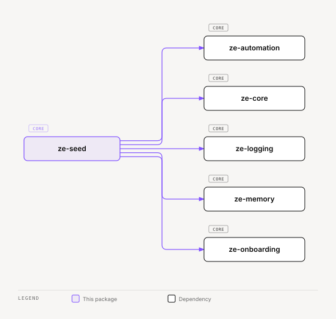

# ze-seed

Dev data seeder for Ze — curated narrative fixtures for local development.

## Role in Ze

A fresh `make db-up && make migrate` gives an empty database, which makes it hard to develop or demo anything that depends on history: memory, goals, contacts, the automation substrate. `ze-seed` populates a local database with a coherent, hand-written persona narrative instead of random fixtures, so a developer's first `make dev-full` looks like a real, weeks-old Ze instance.

It is a dev-only tool. `ze-api` imports it only to seed on startup when `AUTO_SEED_DEV_DATA=true` (`ze_api/lifespan.py`) and for the `ze_api.cli.seed` command. It ships no migrations of its own — it writes through the same stores every other package already owns.

### Key features

- `SeedDomain` — namespace-isolated `clear()` / `apply()` pair for one data slice, ordered by `seed_order`
- `DevDataSeeder` — runs domains in descending `seed_order`, clearing every domain first (ascending `seed_order`) when `force=True`
- `SeedContext` — bundles the stores a domain needs (`memory_store`, `goal_store`, `person_store`, …), built from the running `ze-api` container via `SeedContext.from_container()`
- A single persona narrative (`narrative/loader.py`) shared across domains, so seeded memory, goals, and engine state tell one consistent story

### Integration

Run from the `ze-api` workspace, where the full container (and its plugins) is importable:

```bash
cd apps/ze-api && uv run python -m ze_api.cli.seed apply
```

`collect_seed_domains()` gathers the memory, automation, and engine `SeedDomain`s plus the ones plugins return from `ZePlugin.seed_domains()` (ze-personal and ze-calendar). With `force=True`, `DevDataSeeder.apply()` clears every domain in ascending `seed_order`, then applies them in descending `seed_order`. A domain with a higher `seed_order` is applied before one with a lower value.

## Responsibilities

| Module | What it provides |
|---|---|
| `service.py` | `DevDataSeeder`, `collect_seed_domains()` |
| `domain.py` | `SeedDomain` — the clear/apply contract each data slice implements |
| `context.py` | `SeedContext` — store bundle passed to every domain, built from the running container |
| `domains/memory.py` | Seeds entities, relationships, episodes, facts, and profile facets |
| `domains/automation.py` | Seeds goals, milestones, gates, execution traces, goal learnings, action records, workflows, and workflow executions |
| `domains/engine.py` | Seeds a chat session, its messages and traces, and a completed onboarding session |
| `narrative/loader.py` | `load_persona()` — loads `narrative/persona.yaml`, the shared fixture narrative every domain seeds from |
| `narrative/ids.py` | Fixed IDs for the seeded rows |

## Dependencies



<sub>[Interactive version](../../../docs/diagrams/core/ops/ze-seed/dependencies.html)</sub>

Depends on `ze-core` and `ze-logging`. Third-party: `pyyaml`.

## Usage

```bash
cd apps/ze-api
uv run python -m ze_api.cli.seed apply
```

Requires a running Postgres (`make db-up`) with migrations applied (`make migrate`). Re-running `apply` clears and re-seeds every domain by default.

## Testing

From the repo root:

```bash
make test-seed
```

See [docs/testing.md](../../../docs/testing.md).
