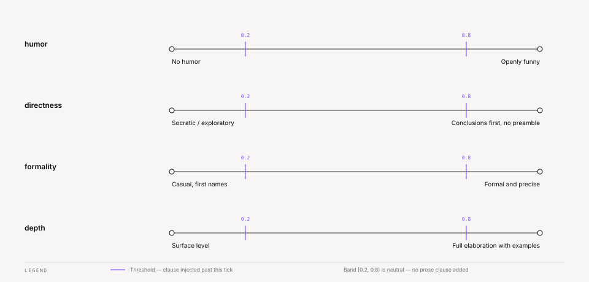

# Ze — Configuration Reference

Ze has three layers of configuration:

- **`.env`** — secrets and deployment-specific values. Never committed.
- **`config/config.yaml`** — all structural and behavioural settings. Committed.
- **`config/persona.yaml`** — persona profiles and dials. Committed.

All files live in `apps/ze-api/config/` (or the path set by `config_dir`).

---

## `.env`

Copy `.env.example` to `.env` and fill in every value before starting the server.

### API keys

| Variable | Required | Description |
|---|---|---|
| `OPENROUTER_API_KEY` | Yes | OpenRouter API key — all LLM calls and web search go through this |
| `ZE_API_KEY` | Yes | Static bearer token for REST endpoints and WebSocket auth |

### Database

| Variable | Default | Description |
|---|---|---|
| `DATABASE_URL` | `postgresql://ze:ze@localhost:5432/ze` | asyncpg connection URL (runtime) |
| `DATABASE_URL_SYNC` | `postgresql+psycopg2://ze:ze@localhost:5432/ze` | psycopg2 URL for Alembic CLI |

`make migrate`, `make migrate-down`, `make migrate-status`, `make migrate-history` and
`make db-reset` use `DATABASE_URL_SYNC` from your shell when it is set. Otherwise they
use the default above, the shared dev database `ze`. To work on a throwaway database,
export `DATABASE_URL_SYNC` first or pass `DB_SYNC_URL=...` to `make`. `make db-reset`
drops and recreates the database named in that URL, inside the Compose Postgres.
`make eval-clean` deletes eval rows from that same database.

### ntfy push notifications

| Variable | Default | Description |
|---|---|---|
| `NTFY_BASE_URL` | `https://ntfy.sh` | ntfy server base URL (use self-hosted URL if applicable) |
| `NTFY_TOPIC` | `""` | ntfy topic name. Leave empty to disable push notifications. |
| `NTFY_TOKEN` | `""` | ntfy authentication token (optional, for private topics) |

### Google (Calendar + Gmail)

Owned by `integrations/ze-google` — env vars stay in `.env` but are read by that package,
not `ZeApiSettings`.

| Variable | Required | Description |
|---|---|---|
| `GOOGLE_CLIENT_ID` | If using calendar/email | OAuth2 client ID from Google Cloud Console |
| `GOOGLE_CLIENT_SECRET` | If using calendar/email | OAuth2 client secret |
| `GOOGLE_REFRESH_TOKEN` | If using calendar/email | Long-lived refresh token. Obtained by running `scripts/google_auth.py` once locally. |
| `TIMEZONE` | No | IANA timezone string (default: `UTC`). Used for calendar/reminder agents via `config.timezone` YAML override. |

### Logging (`core/kernel/ze-logging`)

`LOG_*` vars are read by `ZeApiSettings` at startup and passed to `ze_logging.configure_logging()`.

| Variable | Default | Description |
|---|---|---|
| `LOG_LEVEL` | `INFO` | Structlog level: `DEBUG` / `INFO` / `WARNING` |
| `LOG_DEV` | `false` | Human-readable structlog console output (`true` = dev, `false` = JSON) |
| `LOG_FILE` | `""` | Tee logs to this file as well as stdout (empty = stdout only) |

### Runtime behaviour

| Variable | Default | Description |
|---|---|---|
| `CONFIRM_TIMEOUT_SECONDS` | `900` | How long (seconds) a write confirmation or budget pause waits. When it expires, the request counts as a deny |
| `SESSION_INACTIVITY_MINUTES` | `30` | Minutes of inactivity before a session is considered stale |
| `CONSOLIDATION_ENABLED` | `true` | Set to `false` to disable memory/contacts consolidation jobs (override via `config.yaml` `memory.consolidation.enabled`) |
| `SCHEDULER_ENABLED` | `true` | Set to `false` to disable the workflow scheduler (override via `config.yaml` `workflows.scheduler_enabled`) |

### Browser sidecar

See [browser.md](browser.md) for Docker Compose, health checks, and deployment.

| Variable | Default | Description |
|---|---|---|
| `BROWSER_SERVICE_URL` | `http://ze-browser.internal:8080` | URL of the browser sidecar service |
| `BROWSER_TIMEOUT_SECONDS` | `20` | HTTP timeout for browser requests |

### Workspace sidecar

See [workspace.md](workspace.md) for access, runs, isolation, Docker Compose, and deployment.

| Variable | Default | Description |
|---|---|---|
| `WORKSPACE_SERVICE_URL` | `http://ze-workspace.internal:8080` | URL of the workspace sidecar service |
| `WORKSPACE_API_TOKEN` | *(empty)* | Bearer token for the sidecar control API |
| `WORKSPACE_TIMEOUT_SECONDS` | `120` | HTTP timeout for workspace requests |
| `WORKSPACE_FOLLOW_THROUGH_SHORT_WAIT_SECONDS` | `25` | Seconds a turn waits for a command before it detaches |

### Prospecting

| Variable | Default | Description |
|---|---|---|
| `PROSPECTING_MAX_ITERATIONS` | `15` | Max ReAct loop iterations for the prospecting agent |
| `PROSPECTING_STALE_TIMEOUT_MINUTES` | `10` | Minutes before an in-progress campaign is considered stuck |

### Agent harness

| Variable | Default | Description |
|---|---|---|
| `MAX_TOOL_CALLS_PER_TURN` | `20` | Hard cap on tool calls per graph invocation (enforced by `ToolCallCapHook`) |

---

## `config/config.yaml`

Structural settings only: model aliases, memory graph, contacts consolidation, proactive
crons, news, and skills. Secrets and deployment values stay in `.env`. Persona profiles live in
`config/persona.yaml`. Agent metadata lives as class attributes on `@agent`
classes — there is no `agents:` block in YAML.

Optional `routing:` overrides (threshold, gap_threshold) use ze-core defaults when
omitted — see `ze_core.routing.types.RouterConfig`. The router's LLM-decomposition
fallback model is resolved via `models.overrides.router_fallback` / `models.default`
(see `models:` below), not a `routing.fallback_model` key.

### `models:`

```yaml
models:
  default: tencent/hy3:free     # REQUIRED — fleet-wide fallback for every resolvable key
  overrides: {}                 # OPTIONAL — per-key pins, e.g. {companion: anthropic/claude-sonnet-4-5}
  embedding:        intfloat/multilingual-e5-base   # capability-specific — never resolved via the chain
  whisper:          openai/gpt-audio                # capability-specific — never resolved via the chain
  vision_caption:   google/gemini-flash-1.5         # capability-specific — never resolved via the chain
```

Every general chat-completion call site — every `@agent`, plus the non-agent steps
`router_fallback`, `synthesis`, `session_title`, `workflow_verify`, `insights`, and
`reminders` — resolves its model through one shared resolver
(`ze_agents.model_resolution.resolve_model`) in this order:

1. **`models.overrides.<key>`** — if set, wins outright, regardless of the agent's own
   declared model.
2. **The call site's own declared default** — an agent's `model` class attribute, or the
   `MODEL_*` constant in
   `ze_agents/defaults.py` for a non-agent step.
3. **`models.default`** — used only when neither of the above applies.

To trial a new model everywhere with zero code changes and no restart, edit
`models.default` — config.yaml is re-read on every access, so the next request to any
non-overridden agent picks it up immediately. To revert, change `models.default` back;
that's a one-line edit.

To pin one agent or step to a specific model independent of the fleet-wide default, add
it under `models.overrides`:

```yaml
models:
  default: tencent/hy3:free
  overrides:
    companion: anthropic/claude-sonnet-4-5
```

**Fail-fast validation** — startup raises `AgentConfigError` if `models.default` is
missing/empty, or if any `models.overrides` key isn't a recognized agent name or step
key (`router_fallback`, `synthesis`, `session_title`, `workflow_verify`, `insights`,
`reminders`). Startup catches a typo'd override key immediately at boot, instead of
ignoring it silently.

**Known limitation**: the `RemindersAgent` (per-turn model) and the calendar reminder
interval assessor (`ze_calendar/reminders/calendar.py::_assess_intervals`) share the
`reminders` key — they're different call sites but use the same override key today, so
pinning one pins both. Ze doesn't split them into distinct keys yet, since both
reasonably want the same behavior; a future spec can split them if that assumption
proves wrong.

`models.embedding`, `models.whisper`, and `models.vision_caption` are capability-specific
pins, entirely outside the default/override resolution chain — changing `models.default`
never affects them. The voice transcription route uses `whisper` to convert a recording to
text before the turn runs. The server needs `ffmpeg` and `ffprobe` on its `PATH`; the
Docker image installs both. Without them, the route answers "Voice input is not available
on this server." Preprocessing calls `vision_caption` when a photo arrives without a text
caption, so the embedding router has text to score. OpenRouter serves all three, except
`embedding`, which runs as a local model.

### `conductor:`

Time limit for a companion turn that delegates to specialists.

```yaml
conductor:
  budget_seconds: 110
  reserve_seconds: 25
```

Companion stops starting work at `budget_seconds - reserve_seconds`. It then answers with
what it finished, what it did not, and an offer to continue. A delegate that runs past that
point is cut off. If the turn still hits `budget_seconds`, Ze answers from the list of
specialists it called instead of failing in silence. Both keys are optional. Keep `budget_seconds` below the web app's delivery watchdog (120 s of silence); a test pins this.

### `memory:`

```yaml
memory:
  graph:
    enabled: true          # Enable the graph relationship layer
    max_hops: 1            # Expansion hops during retrieval augmentation
    max_relationships: 20  # Max graph neighbours fetched per expansion

  # Optional consolidation overrides — defaults defined in ze_memory/defaults.py
  consolidation:
    merge_silent_threshold: 0.95
    merge_llm_threshold: 0.85
    contradicted_ttl_days: 30
    unreviewed_ttl_days: 90
    expiry_grace_days: 7
    episode_archive_days: 7
    episode_min_archive_batch: 10
    nightly_cron: "0 2 * * *"

  # Idle-session summaries — defaults shown (ze_memory/defaults.py)
  session_summary:
    enabled: true
    check_interval_minutes: 10
    min_episodes: 2
    max_sessions_per_run: 5
    max_transcript_tokens: 6000

  profile:
    min_facts: 3       # Skip profile synthesis below this many reviewed facts
    episode_limit: 50  # Max episodes fed into the synthesis prompt

  # NLI cross-encoder (Phase 79) — contradiction, grounding, retrieval re-rank
  nli_contradiction_threshold: 0.60  # min contradiction prob to mark contradicted
  nli_entailment_threshold: 0.70     # min entailment prob to confirm paraphrase merge
  nli_lower_cosine_bound: 0.60       # skip NLI below this cosine (dedup + write path)
  nli_write_time_check: true         # false → write-time NLI off (nightly dedup only)
  nli_grounding_threshold: 0.30      # correlation push grounding gate
  nli_retrieval_rerank: true         # session-cached retrieve() re-rank
  nli_rerank_candidate_multiplier: 2 # fetch K×2 before NLI trim
  nli_rerank_min_candidates: 5       # skip rerank when pool smaller than this
```

### `worldstate:`

Controls the open-loop substrate: the drift sweep and the push switch for drifting
loops.

```yaml
worldstate:
  drift:
    enabled: true
    cron: "0 5 * * *"          # When the drift sweep runs (cron, UTC)

  push:
    enabled: true              # false → no open-loop push candidates
    inline_cooldown_hours: 12  # Min hours after an inline mention before a push
    thresholds:
      tau_confidence: 0.5
      tau_relevance: 0.5
      novelty_similarity_max: 0.85
      grounding_threshold: 0.3

  stale_suspicion:             # Optional; defaults shown
    enabled: true
    window_days: 14            # Days a suspected loop waits for evidence before expiry
    cron: "0 4 * * *"
```

The drift window — how long an `active` loop waits before it drifts — is a code
constant (7 days), not config. New evidence on an active loop moves the deadline to at
least 7 days from now. See [scheduled-jobs.md](scheduled-jobs.md#open-loop-upkeep).

### `correlation:`

`correlation.push` controls proactive hypothesis pushes:

```yaml
correlation:
  push:
    enabled: false   # false → no hypothesis push candidates
    dry_run: true    # true → log would-be pushes and send none
```

The attention-arbitration job reads both keys. With `enabled: false` Ze prepares no
hypothesis push candidates. With `enabled: true` and `dry_run: true` Ze logs each
would-be push under `correlation_push_dry_run` and sends nothing. Only `enabled: true`
with `dry_run: false` sends a push. The shipped config is `enabled: false`.

`correlation.hypothesis_decay.schedule` (default `"0 3 * * *"`) sets when the job that
decays hypothesis confidence runs.

### `contacts:`

```yaml
contacts:
  consolidation:
    episode_batch_size: 10
    max_episodes_per_run: 50
    nightly_cron: "0 3 * * *"
    review_cron: "30 8 * * *"
```

### `proactive:`

Controls all proactive push behaviours.

```yaml
proactive:
  briefing:
    enabled: true
    cron: "0 8 * * *"               # When to send the morning briefing (cron, UTC)
    unreviewed_nudge_threshold: 5   # Include a review nudge if unreviewed facts >= this
    catch_up_max_age_hours: 6       # A briefing missed by more than this is skipped

  alerts:
    workflow_failure_enabled: true
    workflow_failure_cooldown_hours: 1  # Min hours between repeated alerts for the same workflow

  calendar:
    sync_enabled: true
    sync_cron: "45 7 * * *"   # When to sync Google Calendar for reminders (before briefing)
    sync_days_ahead: 7        # How many days ahead to pull events

  insights:
    enabled: true
    cron: "0 7 * * 0"           # When to run insight generation (Sunday 7 AM UTC)
    lookback_days: 7
    min_evidence: 3
    max_per_run: 3
    category_cooldown_days: 7   # Suppress same insight category within this window

  goal_narrative:
    enabled: true
    cron: "0 18 * * 0"

  goal_suggestion:
    enabled: true
    cron: "0 19 * * 0"

  stuck_goals:
    enabled: true
    cron: "0 9 * * 2"

  accountability:
    enabled: true
    schedule: "0 9 * * 1"          # Monday 09:00 — weekly activity narrative
    cost_anomaly_schedule: "0 */6 * * *"  # every 6 h — per-agent cost outlier scan
    anomaly_threshold: 4.0          # multiplier above baseline to trigger an alert
    anomaly_min_samples: 5          # min historical runs needed before alerting
    anomaly_retention_days: 30      # prune anomaly records older than N days
    stall_days: 3                   # milestone idle days before counted as stalled

  budget:
    max_pushes_per_day: 5           # shared by every discretionary push (phase 177)

  notifications:
    prune_cron: "0 4 * * *"         # delete read notifications older than retention_days
    retention_days: 90
    release_cron: "*/5 * * * *"     # release pushes held during quiet hours

  inbound_poll_interval_seconds: 300  # messenger inbound poll; rounded down to whole minutes, minimum 1
```

Disable any proactive feature by setting `enabled: false` or toggling the relevant flag.

`proactive.budget.max_pushes_per_day` (default 5) is the one shared budget for every discretionary push, counted over a rolling 24 hours. Ze sends a discretionary nudge only while a slot remains. Once the budget is spent, further nudges enter the notification bell with delivery `suppressed`. Accountability and requested pushes never claim the budget.

`proactive.briefing.catch_up_max_age_hours` (default 6) sets how late a missed briefing may be and still run at startup. After downtime, the scheduler runs each missed cron job once, within this age.

`proactive.notifications.release_cron` (default `*/5 * * * *`) sets how often Ze checks whether quiet hours have ended and releases the pushes it held.

Quiet hours are not a YAML value. The user sets them in Settings › Notifications. Ze stores them in the `interruption_settings` table and exposes them over REST at `/api/v0/notifications/quiet-hours`. Quiet hours ship off.

### `finance:`

The shipped `config.yaml` sets `snapshot_schedule`, `large_transaction_threshold`,
`llm_categorization` and the `nli_merchant_*` keys. The recurring-expense detector reads
five more keys. Each has a default, so you only set one to change it:

```yaml
finance:
  recurring_detection_enabled: false        # true → run the detector job
  recurring_detection_schedule: "0 9 1 * *"
  recurring_staleness_days: 35              # days without a charge before a recurring item is stale
  recurring_nudge_cooldown_days: 14         # min days between nudges for the same item
  recurring_price_change_threshold: 0.10    # relative change that counts as a price change
```

### `prospecting:`

The prospecting agent reads its limits from the environment (`PROSPECTING_MAX_ITERATIONS`,
`PROSPECTING_MAX_LOOP_TOKENS`, `PROSPECTING_STALE_TIMEOUT_MINUTES`, `BROWSER_DELAY_MS`,
`BROWSER_MAX_TEXT_CHARS`). The shipped `config.yaml` has no `prospecting:` block. If you
add a non-empty block, it replaces the environment values entirely, so set all five keys:

```yaml
prospecting:
  max_iterations: 15
  max_loop_tokens: 24000
  stale_timeout_minutes: 10
  browser_delay_ms: 2000
  browser_max_text_chars: 8000
```

### `messaging:`

```yaml
messaging:
  automated_senders: []   # regexes matched, case-insensitive, against the sender address
```

A match makes the inbound processor treat the mail as automated. The processor already
skips common no-reply prefixes and bulk-mail headers.

### `workspace:`

```yaml
workspace:
  run_timeout_seconds: 120   # timeout for a single workspace run
```

The wait before a turn detaches a long run is the environment variable
`WORKSPACE_FOLLOW_THROUGH_SHORT_WAIT_SECONDS`, not a YAML key.

### `news:`

Controls the `ze-news` plugin. The plugin is loaded when `news.enabled: true` and at
least one source is configured.

```yaml
news:
  enabled: true
  fetch_schedule: "*/30 * * * *"   # Cron for the RSS fetch job
  retention_days: 7                 # Hard-delete articles older than N days
  model: "openai/gpt-4o-mini"      # Model used by the news agent
  briefing_limit: 8                 # Total headlines in the morning briefing

  personalization:
    enabled: true
    explore_ratio: 0.2             # Fraction reserved for off-profile discovery
    candidate_multiplier: 3        # Over-fetch multiplier before filtering
    briefing_limit: 8
    min_facts: 5                   # Min user facts required for interest ranking

  credibility:
    enabled: true
    llm_scoring: true
    model: "openai/gpt-4o-mini"
    flag_in_briefing: true
    briefing_summary: true

  sources:
    - key: bbc_world
      type: rss
      url: "https://feeds.bbci.co.uk/news/world/rss.xml"
      tags: [global, general]
```

**Source tags** are arbitrary strings used by the `get_headlines` tool and the briefing
for filtering. Useful conventions: `global`, `local`, `tech`, `pt`, `hacker-news`.

### `skills:`

Controls Agent Skills matching and the daily source-content recheck. See
[skills.md](skills.md).

```yaml
skills:
  match_threshold: 0.5   # cosine floor for automatic matching
  recheck:
    enabled: true
    cron: "0 6 * * *"    # daily origin-URL recheck
```

`match_threshold` is the relevance floor for automatic matching (embedding similarity
of the message against each active skill's name and description). Explicit `/skill-name`
invocation ignores this floor.

An optional System One gate can narrow automatic matches to one skill. It lives under
[`system_one.surfaces.skills`](#surfacesskills). It is on in the shipped config.

Set `recheck.enabled: false` to stop the daily job. Manual
`POST /api/v0/skills/{id}/refresh` still works.

---

### `system_one:`

System One returns typed judgments (labels and probabilities, never text). Ze uses it behind OpenRouter. In the shipped `config.yaml`, the master switch and the `commitment_intake`, `routing`, `skills` and `loop_gate` surfaces are on with calibrated bars. The `corroboration` surface is off; it ships off with null bars until a held-out `ENABLE`. The code defaults are off, and without a `system_one:` block everything is off.

```yaml
system_one:
  enabled: true                   # Master switch. Off → every call skips with reason "disabled"
  model: typesafe/jev-1.13
  timeout_ms: 2000                # Per attempt
  surfaces:
    commitment_intake:            # Post-turn conversation intake: facts and loops (Phase 173)
      enabled: false              # the shipped config.yaml sets true (calibrated 2026-10-16)
      choice_hold: null           # shipped: 0.7 — set from make calibrate-commitment-intake
      family_hold: null           # shipped: 0.7
      biography_hold: null        # shipped: 0.55
      loop_hold: null             # shipped: 0.6
      explicit_hold: null         # shipped: 0.95
      resolves_hold: null         # shipped: 0.8
    routing:                      # Agent choice after E5 (Phases 164, 167)
      enabled: false              # the shipped config.yaml sets true (calibrated 2026-10-12)
      choice_trust: null          # shipped: 0.5 — set from make calibrate-routing
      multi_specialist_hold: null # shipped: 0.5 — set from make calibrate-routing
      shortlist_k: 5              # shipped: 9
      screen_hint: false          # true adds one screen subject line to the routing request (Phase 195); ships off
    skills:                       # Skill gating after E5 (Phase 166)
      enabled: false              # the shipped config.yaml sets true
      choice_trust: null          # shipped: 0.75 — set from make calibrate-skills
      needs_skill_hold: null      # shipped: 0.6 — set from make calibrate-skills
      shortlist_k: 5
      shortlist_floor: 0.35
    loop_gate:                    # Open-loop extraction gate for email, calendar, ingestion (Phase 168)
      enabled: false              # the shipped config.yaml sets true (calibrated 2026-10-12)
      loop_hold: null             # shipped: 0.75 — set from make calibrate-loop-gate
      resolves_hold: null         # shipped: 0.8
    corroboration:                # Suspected-loop corroboration (Phase 172)
      enabled: false              # ships false — make calibrate-corroboration returned KEEP OFF on 2026-10-15
      corroborate_hold: null      # candidate 0.6 — the ENG lead's choice on the 2026-10-15 run
      promote_hold: null          # candidate 0.8 — same run
    complexity:                   # Light-model tier for one agent turn (Phase 182)
      enabled: true               # shipped on — enabled 2026-10-16 after a held-out ENABLE in EN and PT
      simple_max: 0.40            # shipped 0.40 — the frozen bar; set from make calibrate-complexity
```

#### `surfaces.commitment_intake`

After each non-trivial conversation turn, one System One request asks what the message committed the user to. It replaces the phase 163 speech-act request and the phase 168 conversation loop-gate request. Ze makes one attempt, with no retries. Code reads the turn's tool calls and decides:

- A high `resolves_existing` closes the matching open loop. A message that says the user is waiting on someone never resolves a loop.
- A turn that already created a reminder or a goal creates no loop and persists no fact. Ze links a matching loop to the reminder or goal instead.
- A `fact` commitment follows the phase 163 rules. The `family` and `biography` answers must clear their bars. A Haiku call then writes the fact text.
- A `loop` commitment needs `is_open_concern` at or above `loop_hold`. A high `explicit_declaration` creates an active, user-declared loop. Anything else creates a suspected loop. A Haiku call writes the title. The intake holds the loop on a turn where the `track_loop` or `confirm_loop` tool succeeded.
- A `waiting_on` commitment, and a confident `reminder` or `goal` that the turn did not create, are held. Ze creates nothing. An unsure `reminder` or `goal` goes to the loop rules.
- `forget`, `ingest`, `clarify` and `none` are held.
- A System One skip, an invalid answer, an unset bar, or a surface that is off runs the older paths: the Haiku fact extractor and the Haiku loop gate.

The keys:

- `choice_hold` is the minimum peakedness for the commitment answer.
- `family_hold` is the minimum peakedness for the fact family answer.
- `biography_hold` is the minimum yes-probability that the message states a durable fact about the user.
- `loop_hold` is the minimum probability for `is_open_concern`.
- `explicit_hold` is the minimum probability for `explicit_declaration`. It applies to conversation only.
- `resolves_hold` is the minimum probability for `resolves_existing`.

Each bar is a number from 0 to 1. At the bar counts as positive. The surface needs all six bars set. If you enable it and leave any bar `null`, Ze logs `commitment_intake_uncalibrated` and uses the older paths. An out-of-range or non-numeric value becomes `null`, with a warning.

The shipped bars (0.7, 0.7, 0.55, 0.6, 0.95 and 0.8) were chosen on the 160-row tuned set on 2026-10-16 and frozen. One verdict run on 147 blind held-out rows (73 English, 74 Portuguese) returned `ENABLE` in both languages. Per language, the intake made zero duplicate bookings and zero false loop creates, where the old two-request pipeline made 5 and 3 duplicates and 3 and 3 false creates. Fact precision was 1.00. Fact recall was 0.81 and 0.76 (old pipeline: 0.71 and 0.57). Loop precision was 1.00 (old: 0.73 and 0.79), and loop recall was 22 of 22. Choice accuracy was 1.00, and the intake wrote nothing on any of the 7 waiting-on rows. Two earlier held-out sets returned `KEEP OFF`. The wording was fixed on the tuned set after each, and each earlier set is spent.

On the held-out set, about half of the implied conversation loops were created as active, user-declared loops instead of suspected ones (10 of 21 in English, 13 of 21 in Portuguese, fewer than the old gate made), so they skip the suspected path. A follow-up will narrow declarations.

To measure your own bars, run `OPENROUTER_API_KEY=... make calibrate-commitment-intake`. This run is live and costs credits. It tunes on `eval/calibration/commitment_intake.jsonl` and replays the old pipeline on the same rows as the baseline. Copy the suggested values into the file. Run it again when you change the model. A verdict run needs a blind held-out set that nobody has tuned on: `--set holdout3` ran the 2026-10-16 verdict. Ze never reuses a set after its verdict, and the script refuses a live run on all three spent sets (`--replay` still works for reference). Write a fresh blind set for the next verdict. Set `surfaces.commitment_intake.enabled` to `true` only when the verdict is `ENABLE` for English and Portuguese. `--check-sets` validates the files offline.

#### `surfaces.routing`

E5 stays the shortlist. When `routing` is on, one System One request asks two questions about the message: which of the top agents should handle it (or `none`), and whether it needs more than one specialist. Ze makes one attempt, with no retries. Code then decides:

- A confident choice of one agent routes straight to that agent.
- A `none` answer, or a high multi-specialist probability, sends the turn to the Haiku decompose step.
- An unsure choice or a System One skip falls back to the E5 threshold and gap rules (`routing.threshold`, `routing.gap_threshold`).

The two bars are separate numbers:

- `choice_trust` is the minimum peakedness of the agent choice for Ze to trust one agent.
- `multi_specialist_hold` is the minimum probability that the message needs more than one specialist.

`shortlist_k` sets how many E5-ranked agents the choice sees. The code default is 5. Values below 2 fall back to 5. The shipped `config.yaml` sets 9. E5 cosines on the agent roster are flat, so on a fresh held-out set the right agent fell outside the top 6 for 43% of rows (recall 0.571 at k=5 and k=6, 1.0 at k=9). Phase 167 picked the smallest k with recall of at least 0.95 on all three calibration sets. With 10 enabled agents, the choice sees nearly the whole roster. E5 then filters little for the choice; it still drives the cosine skip path. With fewer than two enabled agents, Ze makes no call.

Each agent can declare an optional `routing_criteria` attribute: "use for" and "not for" text that the choice reads in place of the agent's `description`. When an agent omits it, the choice reads the `description`. E5 always embeds the `description`. The choice instructions tell the model to prefer an agent that can search the web or use tools over one that would answer from its own knowledge. They also define `none` as the answer when no listed agent can do the job alone, when Ze has no capability for it, or when the request needs more than one agent. See [Adding an agent](adding-an-agent.md).

Shipped state: the routing surface is on with `choice_trust: 0.5`, `multi_specialist_hold: 0.5` and `shortlist_k: 9`. Calibration on 2026-10-12 used 52 held-out EN and PT rows. It found zero research-to-companion misses, zero harmful trusts at this bar and an ECE of 0.080 and 0.013. After the loops and companion criteria were refined (an undecided matter the user asks Ze to keep on their radar is a loop), both held-out sets scored 1.000 in English and Portuguese on one run, with ECE of 0.041 and 0.014 and zero harmful trusts. Before that change, a loops question went to companion at confidence 0.29, and the bar kept Ze from trusting it. `make calibrate-routing` measures only the tuning set. To re-measure the held-out sets, run `OPENROUTER_API_KEY=... uv run python eval/calibration/routing.py --dataset eval/calibration/routing_holdout.jsonl --dataset eval/calibration/routing_holdout2.jsonl --k 9`. This run is live and costs credits. Both sets pass the acceptance rule.

The surface needs `choice_trust` and `multi_specialist_hold` both set. If you enable it and leave either `null`, Ze logs `routing_surface_uncalibrated` and routes by E5 alone. The code ships no default bars; the shipped `config.yaml` sets the bars above. To re-measure them, run `OPENROUTER_API_KEY=... make calibrate-routing`. This run is live and costs credits. Copy the suggested values into the file, then set `surfaces.routing.enabled` to `true`.

When System One routes a turn, `routing_log.confidence` holds the peakedness of the agent choice instead of the E5 cosine score. Turns that fall back to E5 keep the cosine score.

#### `surfaces.complexity`

Routing always gives the agent its full model. This surface can swap in the agent's `model_simple` for one turn. It asks one System One Noul, `needs_deep_reasoning`, about the task. Ze makes one attempt, with no retries. The request holds six fields: the task, the recent conversation, the resume recap, memory, focus and the active skill. Each field has a length cap.

Ze makes the request only when all of these hold:

- The turn has exactly one subtask, and it is not a compound turn.
- The turn has no conductor hint.
- The agent declares a `model_simple` that differs from its `model`.

Ze uses `model_simple` only when the Noul is at or below `simple_max`. Every other outcome keeps the full model. That covers the surface off, an uncalibrated surface, a skip, a timeout, a malformed answer and an error.

- `enabled` turns the surface on. The shipped config sets `true`. The code default without a `complexity` block is off.
- `simple_max` is the bar, from 0 to 1. The shipped config sets `0.40`. While it is `null`, the surface stays off. Ze logs a warning once per process and records `uncalibrated` on the trace.

What off means: when `enabled` is `false` or `simple_max` is `null`, every agent runs its full model, and Ze makes no System One request. If you pin an agent's model in `models.overrides`, both tiers resolve to that model, so no tiering happens.

The shipped bar of 0.40 passed the held-out verdict in English and Portuguese on 2026-10-16. In the held-out Portuguese set, the lowest `full` row sat between 0.40 and 0.50, so the margin there is thinner than on the tuning set (where the lowest `full` row was 0.56).

Pick the bar on the tuned set only. Three rules apply. No tuned row whose gold tier is `full` is judged light. The bar sits at least 0.15 below the lowest such Noul. Light-model recall on the tuned set is at least 0.8 in each language. Among the bars that meet all three, the larger margin wins. Freeze the bar before the held-out run.

To re-measure the surface or choose a new bar:

1. Run `make calibrate-complexity ARGS="--check-sets"`. This check is offline. It tests the file shape and the quotas.
2. Run the held-out verdict once: `OPENROUTER_API_KEY=... make calibrate-complexity ARGS="--set holdout --simple-max X"`. Use your frozen bar for `X`. This run is live and costs credits.
3. Keep `enabled: true` and `simple_max: X` only when the verdict is ENABLE in English and in Portuguese.

Per language, the verdict needs zero false downgrades, light-model recall of at least 0.5, and at most 10% of rows skipped or invalid. The runner refuses a second held-out scoring unless you pass `--rerun`. Changing the bar or the wording after a verdict voids the held-out set.

#### `surfaces.skills`

E5 stays the shortlist. When `skills` is on, Ze embeds the message once and keeps the
skills that score at or above `shortlist_floor`, best first, up to `shortlist_k`. Skills named with `/skill-name` skip this step. One System One request then asks two questions. A choice picks one shortlisted skill, or `none`. A second question asks whether the request needs a skill at all. Ze makes one attempt, with no retries. Code then decides:

- A confident choice of one skill, plus a high enough need score, applies that skill. It is the only automatic skill for the turn.
- A confident `none`, or a low need score, applies no automatic skill.
- An unsure choice, a System One skip, or an invalid answer falls back to the default rule. Every skill at or above `skills.match_threshold` applies.

Explicit `/skill-name` skills always apply and stack with the chosen skill.

The keys:

- `choice_trust` is the minimum peakedness of the skill choice.
- `needs_skill_hold` is the minimum probability that the request needs a skill.
- `shortlist_k` sets how many skills the choice sees. Values below 1 fall back to 5.
- `shortlist_floor` is the lowest cosine score that can enter the shortlist. It can sit below `skills.match_threshold`, so a paraphrase can apply when both answers clear their bars. The trace panel marks such a skill **below floor**. A value above `match_threshold` is clamped to it, with a warning.

The surface needs `choice_trust` and `needs_skill_hold` both set. If you enable it and leave either `null`, Ze logs `skills_surface_uncalibrated` and matches by similarity alone. An out-of-range or non-numeric value becomes `null` (bars) or the default (`shortlist_k`, `shortlist_floor`), with a warning. The code ships no default bars; the shipped `config.yaml` sets 0.75 and 0.6 (calibrated 2026-10-12). To re-measure them, run `OPENROUTER_API_KEY=... make calibrate-skills`. This run is live and costs credits. Copy the suggested values into the file, then set `surfaces.skills.enabled` to `true`.

`shortlist_k` and `shortlist_floor` come from the shortlist recall table in the calibration report. That table needs no credits: pass `--recall` to the script (`uv run python eval/calibration/skills.py --recall`). The shipped values, `shortlist_k: 5` and `shortlist_floor: 0.35`, come from that table. On the 84-row English and Portuguese set, the gold skill appears in the shortlist at a rate of 0.955, 0.970, 0.985, 0.985, 0.985 and 0.985 for k = 3 to 8. English holds at 0.974 for every k. Portuguese rises from 0.926 to 1.0 at k = 5. The floor does not bind: E5 cosines run from 0.71 to 0.89, even for messages that need no skill, so every skill already clears `skills.match_threshold`. The floor matters only if your skills or model score lower.

#### `surfaces.loop_gate`

Ze extracts open loops from email, calendar events, and ingested content. Conversation turns use [`commitment_intake`](#surfacescommitment_intake) instead. When `loop_gate` is on, one System One request asks two yes/no questions before any Haiku call. Ze makes one attempt, with no retries. Code then decides:

- A high `resolves_existing` closes the matching open loop.
- A low `is_open_concern` holds. Ze creates nothing and calls no Haiku.
- Anything else creates a suspected loop. Only a user can declare a loop, so these inflows never create declared loops.
- A System One skip, an invalid answer, or an unset bar runs the older Haiku gate unchanged. That gate now strips the code fence Haiku wraps around its JSON.

After a positive answer, a Haiku call writes the loop title and may suggest a window in days. Haiku never decides whether a loop exists. Email, calendar, and ingestion can create suspected loops or resolve existing ones, log their judgments, and write no message-trace rows.

The keys:

- `loop_hold` is the minimum probability for `is_open_concern`.
- `resolves_hold` is the minimum probability for `resolves_existing`.

Each bar is a number from 0 to 1. At the bar counts as positive. The surface needs both bars set. If you enable it and leave either `null`, Ze logs a warning and uses the Haiku gate. An out-of-range or non-numeric value becomes `null`, with a warning. The code ships no default bars; the shipped `config.yaml` sets 0.75 and 0.8 (calibrated 2026-10-12).

To measure the bars, run `OPENROUTER_API_KEY=... make calibrate-loop-gate`. This run is live and costs credits. It tunes on `eval/calibration/loop_gate.jsonl` by default and measures the Haiku gate on the same rows. Copy the suggested values into the file. Then run the script once on the held-out set (`--set holdout`). Set `surfaces.loop_gate.enabled` to `true` only when the verdict is `ENABLE` for English and Portuguese: zero false creates on negatives, recall no more than 0.05 below Haiku's, and precision at least Haiku's. `--check-sets` validates both files offline.

#### `surfaces.corroboration`

A `suspected` loop moves closer to active when a second, independent source mentions the same matter. When the surface is on and calibrated, one System One Noul, `same_concern`, judges an independent match, and code decides:

- At or above `corroborate_hold`, Ze links the evidence and raises the loop's confidence, capped at 0.6. The loop stays `suspected`.
- At or above `promote_hold`, Ze does the same, then promotes the loop to `active` at confidence 0.7 with a 7-day drift deadline.
- Below both, a skip, an invalid answer, or an unset bar, the earlier behavior stands: Ze links the evidence and changes nothing else.

Independence is code, not a model. The source key must be new to the loop, the evidence must not already be linked, and the key must not be on a matching dropped loop. A non-independent match makes no request.

The keys:

- `corroborate_hold` is the minimum probability that the text is about the same unfinished matter.
- `promote_hold` is the stricter bar that also promotes the loop.

Each bar is a number from 0 to 1. At the bar counts as positive. `corroborate_hold` must be at or below `promote_hold`; otherwise Ze logs a warning and makes no request. An out-of-range or non-numeric value becomes `null`, with a warning.

To measure the bars, run `OPENROUTER_API_KEY=... make calibrate-corroboration`. This run is live and costs credits. It tunes on `eval/calibration/corroboration.jsonl` and compares each row with the E5 title-cosine baseline at 0.75. Copy the suggested values into the file. Then run the script once on the held-out set (`--set holdout --bars C,P`). Set `surfaces.corroboration.enabled` to `true` only when the verdict is `ENABLE` for English and Portuguese: zero false promotions, corroborate precision at least 0.9 and at least the E5 baseline, and recall no more than 0.05 below the E5 baseline. `--check-sets` validates both files offline. On the 2026-10-15 run the script's arithmetic suggested 0.55 and 0.55, which collapses the two tiers; the ENG lead chose candidate bars 0.6 and 0.8. English passed on the held-out set, Portuguese missed one recall clause, and the surface ships off.

## `config/persona.yaml`

Controls Ze's tone and personality across all agent responses via named profiles and
continuous dials.

```yaml
profile: default   # Active profile name. Overridden at runtime by DB value.
locale: en         # BCP 47 locale for progress message translations (en | pt)

profiles:
  default:
    traits: [direct, warm, concise]
    verbosity: concise        # concise | balanced | detailed
    custom_instructions: ""   # Free-form text appended after traits, before memory context
    dials:
      humor:       0.3        # 0 = none → 1 = freely witty
      directness:  0.9        # 0 = Socratic → 1 = blunt conclusions-first
      formality:   0.2        # 0 = casual → 1 = formal
      depth:       0.5        # 0 = surface → 1 = full elaboration

  stoic:
    traits: [precise, measured]
    verbosity: concise
    custom_instructions: ""
    dials:
      humor: 0.05
      directness: 1.0
      formality: 0.7
      depth: 0.4

  playful:
    traits: [warm, curious, witty]
    verbosity: balanced
    custom_instructions: ""
    dials:
      humor: 0.85
      directness: 0.4
      formality: 0.1
      depth: 0.6
```

**Profiles** are named personality presets. Add as many as you like under `profiles:`.
The `profile:` key sets the YAML default; the DB value in `persona_state` (set
conversationally) overrides the active profile at runtime and survives restarts.

**Dials** are continuous `[0.0, 1.0]` values. Each dial maps to a prose clause injected
into the identity block only at the extremes (below `0.2` or above `0.8`). The neutral
band `[0.2, 0.8)` adds no clause.



<sub>[Interactive version](diagrams/docs/persona-dials.html)</sub>

<details>
<summary>Table</summary>

| Dial | Low (< 0.2) effect | High (≥ 0.8) effect |
|---|---|---|
| `humor` | No humor | Openly funny |
| `directness` | Socratic / exploratory | Conclusions first, no preamble |
| `formality` | Casual, first names | Formal and precise |
| `depth` | Surface level | Full elaboration with examples |

</details>

**`custom_instructions`** is free-form text appended to every system prompt for that
profile — useful for "Always respond in European Portuguese" or "Use my name João."

Ze persists profile switches and dial overrides in the `persona_state` DB table, and
they survive restarts. The YAML values serve as defaults when no DB override exists.

---

## Enabling calendar and email

Both require Google OAuth2 credentials.

1. Create a Google Cloud project, enable Calendar and Gmail APIs.
2. Create an OAuth2 client ID (Desktop application type).
3. Set `GOOGLE_CLIENT_ID` and `GOOGLE_CLIENT_SECRET` in `.env`.
4. Run the one-time auth script locally:
   ```bash
   python scripts/google_auth.py
   ```
   This opens a browser, completes the OAuth flow, and prints the refresh token.
5. Set `GOOGLE_REFRESH_TOKEN` in `.env` (locally) or as a Fly secret (production).

Ze enables calendar and email agents automatically whenever `GOOGLE_REFRESH_TOKEN`
is set — there are no `calendar.enabled` / `email.enabled` YAML flags.

---

## Hot-reloading

Send `SIGHUP` to the running process to reload YAML config
without restarting:

```bash
kill -HUP <pid>
# or on Fly.io:
fly ssh console -C "kill -HUP 1"
```

Model assignments and plugin configuration require a full restart.
