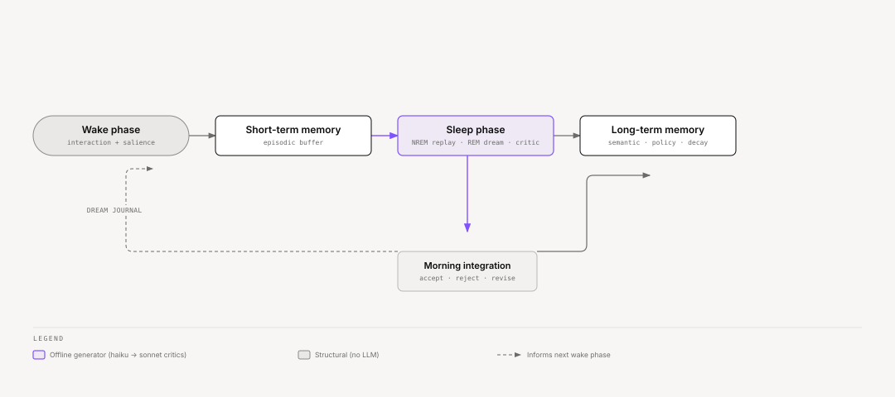

# Ze — Dreaming

Ze runs an offline **dream phase** when it is not in active use. The phase replays
recent experience, compresses it, tests abstractions, and promotes only validated
changes into stable memory. The point is not random generation — it is a controlled
learning loop that improves retention, abstraction, and robustness.

**Package:** `core/cognition/ze-memory/ze_memory/dream/`
**Architecture:** [specs/arch/dream-memory.md](../specs/arch/dream-memory.md)
**Implementation spec:** [specs/phases/078-dream-memory/spec.md](../specs/phases/078-dream-memory/spec.md)

---

## Overview



<sub>[Interactive version](diagrams/docs/dream-pipeline.html)</sub>

---

## How it works

1. **Wake** — Ze captures experiences with provenance. Ze tags every new episode
   asynchronously with `replay_score`, `source` (`ze_observed` or `user_asserted`), and
   a sensitive-entity flag. Tagging does not block the conversation write path.

2. **Sleep (NREM)** — The nightly job replays high-priority episodes, compresses old
   sessions, deduplicates facts, decays stale traces, and detects schema and policy
   clusters. No LLM calls in this phase.

3. **Dream (REM)** — For each cluster candidate, a generator synthesizes insights,
   procedures, hindsight facts, or plan stress-tests. All outputs land in a staging
   buffer (`memory_dream_artifacts`) with `status=pending`.

4. **Critic** — Each staged artifact passes three cheap pre-gates (NLI groundedness,
   embedding novelty, retrievability) and two adversarial LLM critic calls. Both critics
   must pass.

5. **Morning integration** — Well-supported artifacts auto-promote to `memory_facts` or
   the procedure lifecycle (`procedure_candidates`) with full lineage. Borderline cases go to a review queue. Rejected
   artifacts trigger forgetting on their source episodes. A dream journal entry surfaces
   what changed.

Nothing synthetic writes directly to live memory. Every promoted fact carries
`provenance=synthesized`, `dream_run_id`, and `derived_from` lineage for rollback.

---

## What this achieves

- Better memory retention through targeted replay and decay.
- Better abstraction via schema and policy cluster synthesis.
- Better self-correction via hindsight relabeling and plan stress-tests.
- Lower risk of stale or duplicated memory through dedup and novelty gates.
- A visible dream journal that explains what changed and why.

---

## Phase split

| Sub-phase | Status | What ships |
|-----------|--------|------------|
| **78a** | Done | Sleep pass, wake hook, migration, dream journal API, retrieval weight enforcement |
| **78b** | Done | Dream synthesis, NLI gates, two-critic pipeline, auto-promotion, confidence decay, `valid_until` expiry |

**NLI model (Phase 79, done):** `cross-encoder/nli-deberta-v3-small` loads as a shared
singleton in `ze_core/nli.py` via `NLIClient` — used for write-time contradiction, nightly dedup,
session-cached retrieval re-rank, and correlation grounding. `ScoringGates.gate1_nli` in `gates.py`
imports from the same module (no second download).

### What ships across both sub-phases

- Nightly sleep pass: compresses sessions, deduplicates facts, decays stale episodes, detects schema and policy clusters.
- LLM synthesis (haiku): insights, procedures, hindsight facts, plan stress-tests.
- Full scoring pipeline: NLI groundedness gate + embedding novelty gate + retrievability gate + two adversarial LLM critic calls (sonnet). Both critics must pass.
- Auto-promotion with `valid_until`, `dream_run_id`, `derived_from` lineage, so a run's
  promoted facts stay traceable even though no rollback query uses that lineage yet.
- Dream insight confidence decay: non-corroborated dream insights lose 0.03 confidence per run after 30 days; contradicted at < 0.25. A dream insight is a fact with a `dream_run_id`. Facts without one never decay.
- `valid_until` hard expiry: dream insights past their 90-day window that have not been corroborated by a raw episode are contradicted on each morning integration.
- Morning briefing: a "Ze dreamed" section with processed-episode count, insights
  promoted, plan risks surfaced, and items pending review (skipped only when both
  insights promoted and items pending review are zero).

---

## Key tables

| Table | Purpose |
|-------|---------|
| `memory_episode_metadata` | Mutable dream fields for episodes (replay score, retrieval weight, source, sensitive flag) |
| `memory_dream_runs` | One row per nightly job execution |
| `memory_dream_artifacts` | Staging buffer for all synthetic outputs pre-promotion |
| `memory_dream_journal` | Per-run summary for morning briefing and user review |
| `memory_retrieval_cache` | Session-scoped NLI rerank order for facts/summaries (Phase 79; expired nightly by `DreamJob`) |

Source episode content in `memory_episodes` stays immutable. All dream-phase mutable
fields live on the metadata side table.

---

## Artifact types


<sub>[Interactive version](diagrams/docs/dream-artifact-routing.html)</sub>

<details>
<summary>Table</summary>

| Type | Auto-promote? | Destination |
|------|---------------|-------------|
| `schema_candidate` | No (input to synthesis) | Staging only |
| `policy_candidate` | No (input to synthesis) | Staging only |
| `synthesized_insight` | Yes, if gates + support pass | `memory_facts` |
| `synthesized_procedure` | Yes, if gates + support pass | `procedure_candidates` (lifecycle admission decides) |
| `hindsight_fact` | Never — always `needs_review` | User decision |
| `plan_stress_test` | Yes, if gates + support pass | `procedure_candidates` (risk heuristic) |

</details>

Counterfactual and perturbation artifact types are reserved in the enum but not invoked
until 78c.

---

## Configuration

```yaml
# config/config.yaml
dream:
  enabled: true
  cron: "0 3 * * *"
  max_replay_episodes: 100
  max_synthesis_per_run: 20
  max_stress_tests_per_goal: 2
  max_schema_candidates_per_run: 30
  auto_promote_min_support: 3
  auto_promote_min_distinct_sessions: 2
  auto_promote_min_temporal_spread_days: 7
  auto_promote_max_user_asserted: 1
  nli_groundedness_threshold: 0.75
  novelty_similarity_threshold: 0.92
  decay_cycles: 5
  decay_rate: 0.1
  forgetting_weight_threshold: 0.1
  synthesis_model: "anthropic/claude-haiku-4-5"
  critic_model: "anthropic/claude-sonnet-4-6"
  synthetic_fact_valid_days: 90      # dream insights contradicted after this many days without corroboration
  job_timeout_seconds: 1800
  inactivity_trigger_enabled: false    # fire dream job when user goes idle
  inactivity_threshold_hours: 6        # hours of silence before triggering
  inactivity_check_interval_minutes: 30
```

**Inactivity trigger** (`inactivity_trigger_enabled`) — when enabled, a watcher runs every `inactivity_check_interval_minutes` and fires the dream job if `MAX(sessions.last_active_at)` is older than `inactivity_threshold_hours` AND no successful dream run has completed since that last session. This means Ze dreams when you take a long break rather than waiting for the 3 AM cron. Disabled by default — the fixed cron is sufficient for v1.

See [configuration.md](configuration.md) for the full key reference.

---

## REST API

No REST surface exists yet. `PostgresDreamStore` (`ze_memory/dream/store.py`) holds the
journal, the artifact queue, and `update_artifact_status`, but no route in `ze-api`
calls them. Review a `needs_review` artifact or the journal through the database
directly until a review route and a `ze-web` page ship.

---

## Safety model

- **Staging buffer** — no synthetic output touches live memory until all gates pass.
- **Provenance** — Ze hedges `provenance=synthesized` facts in retrieval context
  ("Ze inferred this from a pattern"). Only the dream writes `synthesized` facts. Facts that
  Ze reads from what you say, or from your own email and files, are `prompt_supplied`.
- **Source tagging** — Ze classifies episodes as `ze_observed` or `user_asserted` at write
  time. Classification uses three layers: (1) agent-name allowlist (email, calendar,
  workflow, reminders, news, prospecting, finance, goal, automation); (2) tool-result
  markers in the stored prompt/response; (3) response-phrase detection for research
  summaries. `user_asserted` episodes score lower and cap at 1 toward `support_count`.
- **Sensitive exclusion** — episodes linked to sensitive entities skip all dream passes.
- **Session contamination** — `_record_session_contamination` sets
  `memory_session_summaries.dream_influenced = true` on any session that fetched
  synthesized facts, and the schema- and policy-candidate detectors exclude those
  sessions from the dream source pool. Nothing clears the flag once set.
- **Synthetic expiry** — the next morning integration run contradicts dream insights
  (facts with a `dream_run_id`) past `valid_until` (default 90 days) that no raw episode has corroborated.
- **Rollback** — every promoted fact carries `dream_run_id` and `derived_from` lineage, so a
  run's output is traceable, but no code yet bulk-contradicts a run or re-summarizes the
  session summaries it contaminated (see REST API above).

---

## Research basis

Dreaming in Ze draws on both neuroscience and ML literature:

- Experience replay and generative replay for continual learning.
- Wake/sleep consolidated learning architectures.
- Constitutional AI-style critic filtering of synthetic outputs.
- Sleep consolidation research on replay ordering and context reinstatement.

Full bibliography and architectural rationale:
[specs/arch/dream-memory.md](../specs/arch/dream-memory.md#research-foundation).

---

## Related docs

| Doc | What it covers |
|-----|----------------|
| [memory.md](memory.md) | Base memory layers — facts, episodes, retrieval |
| [scheduled-jobs.md](scheduled-jobs.md) | Proactive job scheduler and nightly job pipeline |
| [specs/phases/079-nli-model/spec.md](../specs/phases/079-nli-model/spec.md) | NLI cross-encoder — shared singleton, contradiction, retrieval cache |
