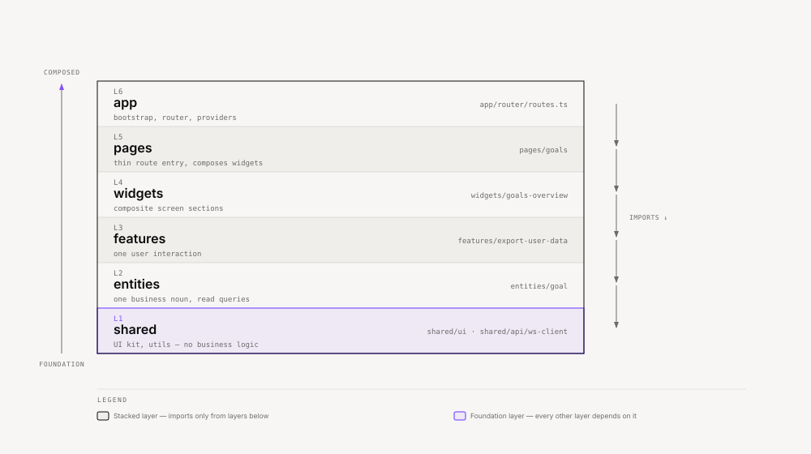

# ze-web frontend architecture

The React web client (`apps/ze-web`) uses [Feature-Sliced Design](https://feature-sliced.design/) (FSD). Spec: [specs/phases/082-ze-web-fsd/spec.md](../specs/phases/082-ze-web-fsd/spec.md).

## Layers



<sub>[Interactive version](diagrams/docs/frontend-layers.html)</sub>

<details>
<summary>Table</summary>

| Layer | Purpose | Name by | Example |
|-------|---------|---------|---------|
| `shared` | UI kit, utilities, API wiring — no business logic | — | `shared/ui` (primitives + layout), `shared/api/ws-client` |
| `entities` | One business noun: display + read queries | singular noun | `entities/goal` → `GoalCard`, `useGoalsQuery` |
| `features` | One user interaction | verb phrase | `features/export-user-data` |
| `widgets` | Composite screen sections | UI block role | `widgets/goals-overview` |
| `pages` | Thin route entry — composes widgets | route segment | `pages/goals` |
| `app` | Bootstrap, router, providers | — | `app/router/routes.tsx` |

</details>

**Import rule:** a slice imports only from layers below it, via public `index.ts` exports. Enforced by `make lint-web` (`@feature-sliced/eslint-config`).

## The shell and the five places

The app has five places: World, Ask, Doing, Mind and Governance. `shared/config/places.ts` lists them in order, maps a path to its place (`placeOf`), and holds the path helpers (`goalPath`, `workflowPath`, `askPath`, `settingsDataPath`).

`widgets/app-shell` draws the frame around every place:

- **Top bar:** the dot-matrix brand, the five place tabs, the notification bell and a connection dot.
- **Strip:** the claim legend, today's date and a dot-matrix clock.
- **Left rail:** the Presence module with the orb. The place fills the column beside it.
- **Ask bar:** sticky at the bottom of every place except Ask. Typing there opens the Ask overlay (see [native-interface.md](native-interface.md#ask-from-any-screen)).
- **Phone width (1023 px and below):** one column, a compact Presence, and a bottom bar with the five places as icons and labels. The Ask bar sits above it.

Tokens, type and every shell class live in `shared/styles/ze.css`. Fonts (Saira, Michroma, JetBrains Mono) are self-hosted under `public/fonts/`. The HUD building blocks (`Module`, `Meter`, `Control`, `CommandChip`, `DotMatrix`, `SectionTabs`, and the orb under `hud/presence/`) live in `shared/ui/hud/`. The palette (Orchid, Ultraviolet, Amethyst) is a user setting in Governance. `main.tsx` applies the stored choice before the first render. [DESIGN.md](../DESIGN.md) is the design source of truth.

### Presence

`entities/presence` holds a pure reducer, `nextPresence(state, event, now)`, and `usePresence(activeThreadId)`. The orb follows only real signals for the thread selected in Ask:

| Orb state | Signal |
|-----------|--------|
| `idle` | Connected, nothing in flight. The idle orb watches the pointer and keyboard focus like a curious pet: it follows, peers, glances at new things, startles on a fast flick, blinks when it switches target, and dozes after a minute. Reduced motion turns the gaze off. |
| `listening` | The Ask bar has focus and text |
| `thinking` | A `typing` frame, or the thread is marked thinking, until the first token |
| `speaking` | `token` frames for the thread |
| `done` | The `message` frame that closes the turn, for one second |
| `error` | The WebSocket is closed. The phrase reads "Offline". |

Replayed messages, other threads and frames with no thread never move the orb. `attention`, `acting` and `assembling` exist in the reducer (`set_world_signal`), but no place sends them yet.

### Old routes and interim places

Old paths redirect to their place and keep params, query and hash. The table is `redirects` in `places.ts`.

| Old path | New path |
|----------|----------|
| `/loops` | `/` |
| `/priority`, `/reminders`, `/world` | `/` |
| `/goals`, `/goals/:id` | `/doing/goals`, `/doing/goals/:id` |
| `/workflows`, `/workflows/:id` | `/doing/workflows`, `/doing/workflows/:id` |
| `/skills` | `/doing/skills` |
| `/brain-memory`, `/brain-graph`, `/mind/graph`, `/procedures`, `/doing/procedures`, `/contacts` | `/mind` |
| `/costs` | `/governance` |
| `/data`, `/governance/data` | `/governance#data` |
| `/settings`, `/governance/settings` | `/governance#connections` |
| `/workspace`, `/doing/workspace` | `/governance#files` |

A redirect entry can carry a `hint`. `RedirectTo` then replaces the incoming hash with the hint and keeps the query. An entry can also carry a `hintMap`, which lets an old hash win (`#your-data` becomes `#data`).

### World

World is the home at `/` (`pages/world`, phase 186). It shows what Ze holds, what it does about it, and what it needs from you. Every value comes from an API field. A value the API lacks is absent: a goal, a person or a reminder has no confidence, so it never gets a made-up one, and the decay trail draws only from a recorded `confidence_prior`.

`useWorld` (`pages/world/model`) joins the queries the page needs: the priority snapshot, loops (open and closed), goals, workflows with their latest runs, held writes, reminders, hypotheses, notifications and job runs since the last visit, the attention budget, and the confirmations pending in chat. It hands each widget its data by props. A query that fails sets the error state of its own module only. The page prints "N sources down" when the priority snapshot names failed sources.

| Module | Widget | Shows |
|--------|--------|-------|
| The Field | `widgets/world-field` | Time left across, how sure up. Marks by claim kind, a coral Slipped band, a NOW line, a dotted trail from the prior confidence, a readout with "Why this order", and drag or keyboard reorder and pin. On a phone it is a ranked list by band. |
| Needs you | `widgets/needs-you` | Held writes, goal checkpoints (Proceed, Stop, Redirect), suspected loops and confirmations waiting in a chat, each with its action. Cream, never coral. |
| Doing now | `widgets/doing-now` | Active goals with progress, the next run, runs this week, a running run and a failed run's summary. |
| Loops · confidence | `widgets/loops-rail` | Open loops with a sparkline, a readout and Close and Drop. |
| Touched · 7 d | `widgets/touched` | Loops, goals and workflows changed in the last seven days. |
| While you were away | `widgets/away` | Notifications and job runs since your last visit, and the push budget. |

- **Slipped** wins over the deadline: a drifting loop, a stuck goal, an overdue reminder and a loop whose linked reminder is overdue all sit in the Slipped band. The orb holds `attention` while anything slipped or a run failed, and the leader line ends on the most overdue mark (desktop, motion allowed).
- **Last visit.** `localStorage` key `ze.world.lastSeenAt` holds the last time World was in front of you. "While you were away" counts from the start of the visit: a hide of five minutes or more starts a new one.
- **Gates** have no REST route. `features/answer-gate` sends `goal:approve|stop|redirect:<gate_id>` as an `action` frame on the session thread and waits for the goals data to drop the gate, or for an `error` frame within 15 seconds. Another payload family can use the same sender.
- **Held writes** use one `HeldWriteCard` (`features/respond-to-confirmation`). A write with an editable field opens the full confirmation card.
- **Links.** `/?focus=<kind>:<id>` selects one item (`loop`, `goal`, `hypothesis`, `reminder`, `held_write`). `focusHref` and `notificationHref` in `shared/lib` build them.
- **Refresh.** A `message` frame invalidates the World queries. A `notification` frame also invalidates the budget and the key of its target. A `refresh` frame for `goals` invalidates goals, the priority snapshot and workflow executions.
- **Screen context.** The page publishes the focused module, the selected mark and the visible rows. Marks, loop rows, Needs-you rows and Away rows offer "Chat about this".

The notification bell no longer lists held writes. A `held_write` notification opens World with the item selected.

### Mind

Mind shows what Ze believes. `/mind` holds four modules: Beliefs, People, Find an entity and Procedures. `/mind/:entityId` shows one entity.

- **Beliefs** (`widgets/beliefs-feed`): each fact is a `BeliefRow` with a glyph for its claim kind, a plain sentence, confidence, source and age. Keep, Edit and Drop review it in place. An "As of" date shows the feed as it stood then; kind and confidence stay current.
- **People** (`widgets/people`): the Contacts plugin page, rendered through `ConnectedPrimitiveTree`.
- **Find an entity** (`widgets/entity-search`): a server search by name or alias (`searchEntities`). There is no whole-graph view.
- **Entity page**: a small radial field of up to 20 neighbours (`widgets/entity-neighbourhood`), an activity chart, the entity's facts, and an "I suspect…" list of hypotheses with Useful, Not relevant and Mute.
- **Procedures** (`widgets/procedures`): candidates to review first, then the library.

The claim posture table (glyph, chip word, plain words per state) lives in `shared/lib/claim-posture.ts`. Beliefs publish their visible and selected rows to screen context, the entity page publishes its entity as the subject, and rows carry "Chat about this".

Until each place has its own design, it hosts the old pages as sections behind a row of tabs. One file per place holds the sections: `pages/world/ui/WorldInterim.tsx` (phase 186 replaces it), `pages/ask/ui/AskInterim.tsx` (187), `pages/doing/ui/DoingInterim.tsx` (188). A page cannot import another page, so `app/router/routes.tsx` passes each interim file the loaders for its sections. Plugin pages still use `/:pluginPath` (phase 191 places them).

## Governance

`/governance` answers "is Ze behaving?" on one page (`pages/governance`, phase 190). Each module is a widget, labelled by the question it answers:

| Module | Widget | Shows |
|--------|--------|-------|
| Am I spending normally? | `widgets/spend` | Last 7 days' daily average against the 30-day average, the anomaly count, per-flow totals and a `SeriesSpark` over 30 days |
| What can interrupt me? | `widgets/attention` | Pushes used of the daily maximum, the next slot, held pushes, recent push outcomes and the quiet-hours form |
| What does Ze hold, and can I take it? | `widgets/data` | Data domains in plain words, export, import and delete-all behind a typed confirmation |
| How do I reach Ze? | `widgets/connections` | Server URL and key with a test, plugin settings, the palette and "Forget this server" |
| What is in Ze's workspace? | `widgets/files` | A read-only file tree and the workspace status |

On a phone the modules stack as Attention, Spend, Connections, Data, Files. The page publishes the focused module for screen context. It keeps the last focused module until another takes focus, and a click on plain text does not change it.

Spend averages divide by the days since the first spend inside the 30-day window, up to 30, so a new install does not read as a spike. Today's partial day counts as a whole day. The connection test calls the public `/version` route, then one authenticated route, so it can tell "reachable" from "key rejected". `SeriesSpark` (`shared/ui/hud`) draws a series; `Spark` draws a two-point change.

## Adding a new screen

Example: finance overview at `/finance`. Plugin screens normally arrive through the UI manifest. A core screen belongs to one of the five places.

1. **`entities/transaction/`** — `TransactionRow`, `useTransactionsQuery` wrapping `@myguyze/ze-client`
2. **`widgets/finance-overview/`** — composes the entity list
3. **`pages/finance/`** — `FinancePage` that renders `<FinanceOverview />`
4. **`app/router/routes.tsx`** — add the route under its place, or add a section to that place's interim file
5. **`shared/config/places.ts`** — add a path helper if other screens link to it

To ask Ze about a screen, call `askAbout({ text, context })` from `features/ask-bar`. To tell Ze what the page shows, call `useScreenPublisher` from `entities/screen-context` with the page's subject, selection and visible refs. The store builds the snapshot that every send attaches. To let the user chat about a record, pass `onChatAbout` to `Module`, or place a `ChatAboutChip` on a component without a frame. A widget calls `useChatAbout` and passes the callback down by props, because features and entities never import `features/ask-bar` from each other.

Each slice exposes a public API through `index.ts`. Internal `ui/`, `api/`, `model/` folders are private to the slice.

Core-owned screens include `/skills` (`pages/skills` + `widgets/skill-management`). The workspace file map lives in Governance. See [skills.md](skills.md) and [workspace.md](workspace.md).

## Extending an existing domain

Example: goal detail view at `/doing/goals/:goalId`.

1. Add `entities/goal/ui/GoalDetail.tsx` and optionally `useGoalQuery(id)`
2. Add `widgets/goal-detail/` composing the entity + any action features
3. Add `pages/goal-detail/` thin page
4. Register the nested route in `app/router/routes.tsx` (no nav entry needed if reached from a list)

Do not put route-specific logic in entities — entities are reusable across screens.

## Adding a user action

Example: confirm recurring expense.

1. Create `features/confirm-recurring/` with hook or handler in `api/`
2. Use it from the widget that owns the UI (e.g. `widgets/finance-overview`)
3. Export through `features/confirm-recurring/index.ts`

Features import from `entities` and `shared` only — never from `widgets` or `pages`.

## Reply feedback and Retry

Three slices serve the thumbs up, thumbs down, and Retry controls on assistant replies:

- **`entities/message-feedback/`** — `useMessageFeedbackQuery` (one batch call for the visible assistant ids) and `useSetMessageFeedbackMutation` (optimistic, reverts on error, sends a client UUID idempotency key).
- **`features/reply-feedback/`** — `ReplyActions`: the thumb buttons with `aria-pressed` and accessible names.
- **`features/retry-reply/`** — `RetryButton` and `useRetryReply`: send the `retry` WebSocket frame and handle `message_superseded` and the `error` codes. A disabled Retry shows its reason as visible text.

`entities/message` cannot import a feature. `MessageBubble` therefore takes an `actions` slot, and `widgets/chat-workspace` mounts `ReplyActions` and `RetryButton` into it for stored assistant messages only. `widgets/trace-panel/ui/FeedbackSection.tsx` shows the rating history and the retry links. See [native-interface.md](native-interface.md#reply-feedback-and-retry).

## Quiet hours and the notification bell

`widgets/quiet-hours-settings/` renders the quiet-hours form under Settings › Notifications. It reads `entities/quiet-hours/` (`useQuietHoursQuery`, `useUpdateQuietHoursMutation` over the generated `getQuietHours` / `updateQuietHours`) and the nudge cap and held count from `entities/notification/` (`useAttentionBudgetQuery` over `getAttentionBudget`), prefills the timezone from `Intl.DateTimeFormat().resolvedOptions().timeZone` when the server value is null, and places each 422 field error from `detail[].loc` under the matching input.

`widgets/notification-bell/ui/NotificationBell.tsx` labels a held item "Held for quiet hours" and a suppressed one "Not pushed: daily limit", and shows no label for any other delivery.

## Shared abstractions

- **`shared/ui/layout/ListPage`** — standard list screen shell (header, skeleton, error, empty, children)
- **`shared/lib/query-keys.ts`** — TanStack Query key factory; extend when adding REST resources
- **`shared/config/places.ts`** — the five places, the old-route redirect table and the path helpers; `app/router/routes.tsx` builds the routes from it
- **Plugin routes** — plugins add nav items, settings sections, and pages at runtime through `GET /api/v0/ui/manifest` (`entities/ui-manifest`, rendered by `pages/plugin-page`)

## API and types

- REST and WebSocket types: `@myguyze/ze-client` (generated — never raw URL strings)
- Server-driven UI: `@myguyze/ze-ui`, `@myguyze/ze-ui/react`
- Entity query hooks wrap `@myguyze/ze-client` + `shared/lib/queryKeys`

## Shared UI

`shared/ui/` is the single UI slice:

| Subfolder | Contents |
|-----------|----------|
| `primitives/` | Generic building blocks (shadcn-style `Button`, `Input`, `Sheet`) |
| `layout/` | Ze screen patterns (`ListPage`, `PageHeader`, `EmptyState`, …) |

Import from the public API: `import { Button, ListPage } from "@/shared/ui"`.

## Configuration

`shared/config/app-config.ts` stores the server URL and API key in `localStorage`. Set them during onboarding or in Settings. No `VITE_*` env vars.

## Commands

```bash
make web          # dev server :5173
make web-build    # production build
make test-web     # vitest
make lint-web     # ESLint (FSD boundaries)
```

## Testing

Colocated `*.test.tsx` next to the module. Run from repo root: `make test-web`.
