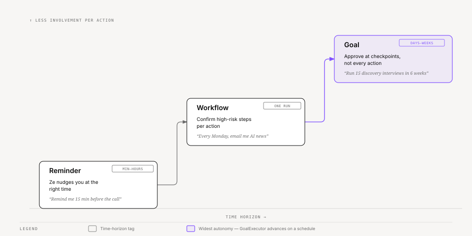
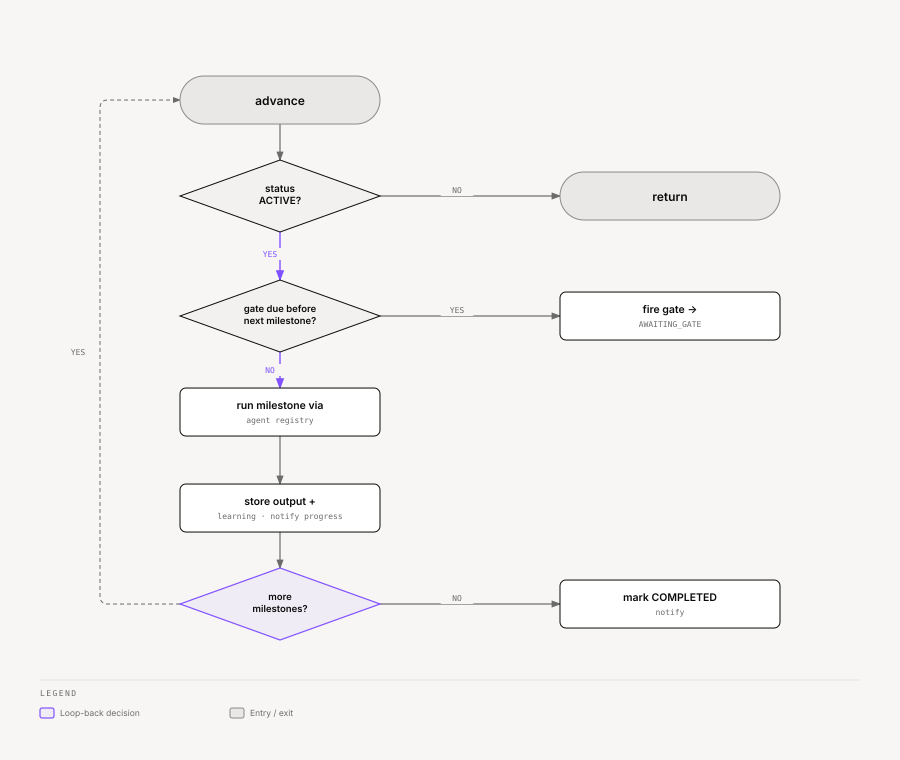

# Ze — Goals

Goals let Ze work on multi-week objectives autonomously — decomposing them into
milestones, executing work in the background, and pausing at **verification gates**
for your approval before continuing. A single workflow run handles one batch of
steps; a goal spans days or weeks with meaningful check-ins in between.

See the spec series for implementation detail: [28-goal-engine](../specs/phases/028-goal-engine/spec.md) · [31-goal-engine-v2](../specs/phases/031-goal-engine-v2/spec.md) · [32-goal-collaboration](../specs/phases/032-goal-collaboration/spec.md) · [33-goal-suggestions](../specs/phases/033-goal-suggestions/spec.md) · [34-stuck-goal-detection](../specs/phases/034-stuck-goal-detection/spec.md) · [35-cross-goal-output-reuse](../specs/phases/035-cross-goal-output-reuse/spec.md) · [36-cross-goal-learning-promotion](../specs/phases/036-cross-goal-learning-promotion/spec.md). See [docs/architecture.md](architecture.md#goal-engine) for how goals connect to workflows and the scheduler.

---

## Goals vs workflows vs reminders



<sub>[Interactive version](diagrams/docs/goals-primitives-spectrum.html)</sub>

<details>
<summary>Table</summary>

| Primitive | Time horizon | User involvement | Example |
|---|---|---|---|
| **Reminder** | Minutes to hours | Ze nudges you at the right time | "Remind me 15 min before the call" |
| **Workflow** | One run (minutes) | Confirm high-risk steps per action | "Every Monday, email me AI news" |
| **Goal** | Days to weeks | Approve at checkpoints (gates), not every action | "Run 15 discovery interviews in 6 weeks" |

</details>

Workflows execute a fixed step list in one session. Goals sit above them: Ze plans
milestones once (with gates between batches), then `GoalExecutor` advances work on a
schedule until the success condition is met or you stop.

---

## Starting a goal (conversational)

Describe the objective with a time horizon. The `goals` agent routes here when the
request sounds multi-week rather than one-shot:

> *"Over the next 6 weeks, find 10 charter operators in the Med, draft outreach, and track who responds."*

Ze will:

1. Create a `Goal` record (title, objective, success condition, time horizon).
2. Run `GoalPlanner` to produce milestones and verification gates.
3. Send the plan via the native app / WebSocket with **Start goal** / **Cancel** options.
4. On approval, set status to `ACTIVE` and begin the advance loop.

You can also manage goals conversationally:

| What to say | Action |
|---|---|
| *"List my goals"* | Active and awaiting-gate goals with one-line summaries |
| *"What's the status of goal X?"* | Milestone progress, pending gate, latest learnings |
| *"Steer my prospecting goal towards warm leads only"* | Re-plan remaining milestones with new instructions |
| *"Pause my prospecting goal"* | Stop advancing until you resume |
| *"Abandon the conference prep goal"* | Mark abandoned; no further work |

`GoalAgent` handles create / inspect / steer / pause / resume / abandon. It does **not**
execute milestones — that is `GoalExecutor`'s job.

Reading goals never pauses a turn. Each write tool (`create_goal`, `steer_goal`, `pause_goal`, `resume_goal`, `abandon_goal`) asks for your confirmation before it acts. On a single-agent turn the agent runs as a read, so the question comes from the tool. In a multi-step turn, the write intents keep their per-step confirmation, so the question comes first and no sibling step runs twice.

**Steering** (`steer_goal` tool) enqueues a free-text instruction that is applied before the next milestone runs: Ze re-plans the remaining milestones around the instruction and continues. Steering only works while the goal is `ACTIVE`; if the goal is `AWAITING_GATE`, resolve the gate first.

### Goal overview

Ask Ze conversationally for a goals overview:

> *"What are my active goals?"*

Ze returns a summary of active and awaiting-gate goals with milestone progress and what comes next. Completed goals are listed at the bottom.

---

## Verification gates

Gates are the multi-step equivalent of the per-action capability gate. Ze batches
meaningful work, then surfaces a checkpoint message:

- What Ze has completed (summarized milestone outputs).
- What Ze plans next (milestones up to the next gate).

Options: **Proceed** · **Stop** · **Redirect**.

| Action | Effect |
|---|---|
| **Proceed** | Gate approved; execution resumes |
| **Stop** | Goal abandoned |
| **Redirect** | You send free-text instructions; Ze re-plans remaining milestones and continues |

The user responds to gates conversationally — replying via the app or by typing in
the chat. Redirect instructions follow as a message after the user chooses to
redirect.

Gate placement (enforced by the planner prompt):

- Before the first irreversible outreach action.
- After milestones that produce irreversible output (sent email, published post).
- Roughly every three milestones on long goals.
- At least one gate, even for short goals.

---

## How execution works

### Advance loop

`GoalExecutor.advance(goal_id)` is the core loop. It runs when:

- The scheduler fires `goal_advance_sweep` (every 15 minutes for all active goals).
- You approve a gate or finish a redirect.
- You approve the initial plan after creation.



<sub>[Interactive version](diagrams/docs/goal-milestone-loop.html)</sub>

`GoalExecutor` dispatches each milestone through the normal agent registry (like
workflow steps): natural-language `description` + optional `agent_hint`. Completed
milestones feed gate context summaries; Ze extracts and stores learnings per
milestone.

### Progress notifications

After each milestone completes, Ze sends a short line as an `accountability` push
(kind `goal_milestone_done`) via `ProactiveNotifier` (WebSocket if connected, ntfy
otherwise), e.g. *"✅ Draft target list done (2/8)."* Gate checkpoints use a richer
format (kind `goal_gate`, `accountability`; title, done list, planned list, options).

---

## On completion

When all milestones finish, `GoalExecutor` runs these steps automatically:

1. **Retrospective** — `GoalPlanner.synthesize_retrospective()` produces a short narrative of what Ze accomplished and what was learned. Ze sends it as an `accountability` push (kind `goal_completed`) through `ProactiveNotifier` as the completion message.
2. **Retrospective stored** — Ze saves the narrative to `goals.retrospective_text`. The weekly goal narrative job and future goal suggestions read it.
3. **Procedure candidate** — Ze extracts a reusable procedure from the goal and submits it as a procedure candidate (`submit_procedure_candidate`). The governed procedure lifecycle in `ze-memory` decides whether to admit it. See [memory.md](memory.md). If a procedure was provisional while the goal ran, Ze resolves it at completion.

Completion does not promote learnings to memory. Ze keeps them as evidence-backed claims, as the next section describes.

### Goal learnings

After each milestone, Ze extracts a learning and stores it as a `GoalLearning` claim in `goal_learning_claims`. A claim has a kind (`FACT` or `INFERENCE`), a provenance, a confidence, and a status (`pending_review`, `active`, `review_needed`, `retracted`, or `superseded`). Evidence rows in `goal_learning_evidence` link a claim to the action records that support or contradict it, or to your confirmation or correction. Ze checks new claims against existing ones with the NLI model and flags contradictions for review.

A redirect at a gate creates a learning too. Ze approves it at once, because you wrote it.

Ze promotes a learning to user memory only when it is eligible:

- You confirmed it, or
- At least two distinct supporting action records exist, and they come from at least two independent execution contexts.

A learning with an unresolved contradiction is never eligible. Promotion goes through `submit_perception_facts` as a synthesized fact with `reviewed = false`. It then follows the normal memory pipeline, including nightly dedup, and appears at `GET /api/v0/memory/facts`. A confirmed learning can become a `FACT`. Any other learning stays an `INFERENCE`.

You review and promote learnings through the REST API:

| Route | Action |
|---|---|
| `GET /api/v0/goals/{goal_id}/learnings` | List a goal's learnings |
| `GET /api/v0/goals/{goal_id}/learnings/{learning_id}` | Learning detail with evidence |
| `POST /api/v0/goals/{goal_id}/learnings/{learning_id}/review` | Approve, reject, correct, defer, or retain |
| `POST /api/v0/goals/{goal_id}/learnings/{learning_id}/promote` | Promote an eligible learning |

Later milestones and replans see the eligible learnings of their goal. Ze labels each one `FACT` or `INFERENCE (tentative)`.

---

## Proactive goal features

### Weekly goal narrative (Sunday 6 PM UTC)

Ze sends a one-paragraph update per active goal (kind `goal_narrative`, `accountability`) summarizing what was completed that week, any pending gate, and what comes next. `GoalNarrativeJob` (`ze_automation/jobs/goal_narrative.py`) drives this.

### Weekly goal suggestions (Sunday 7 PM UTC)

Ze analyzes recent memory facts, episodes, and retrospectives to propose one new goal. Ze sends it as a `discretionary` push (kind `goal_suggestion`) with **Accept** / **Dismiss** options. Accepted suggestions pre-fill a goal creation flow. `GoalSuggestionJob` (`ze_automation/jobs/goal_suggestion.py`) drives this.

### Stuck goal detection (Tuesday 9 AM UTC)

Ze checks for active goals with no milestone progress, and for goals waiting at a gate, for 7 days or more. The window is fixed in code. For a goal at a gate, Ze counts the first open gate that has fired and ignores gates it has not reached, so each goal appears once. After an alert, Ze waits 14 days before it alerts about the same goal again. One `discretionary` push (kind `stuck_goal`) lists the stuck goals. An idle active goal offers **Redirect**, **Pause**, and **Abandon**. A goal at a gate offers **Approve**, **Redirect**, and **Stop**. `StuckGoalJob` (`ze_automation/jobs/stuck_goals.py`) drives this.

---

## Cross-goal awareness

### Output reuse

When planning a new goal (or replanning after a redirect), `GoalPlanner.plan()` receives a window of recently completed milestone outputs across all other goals. If the planner identifies genuine overlap, it sets a `reuse_hint` on the affected milestone. At execution time the agent sees the hint and can call `get_milestone_trace` to retrieve the prior output before re-running the work. The reuse decision is always advisory — the agent decides whether the prior output is fresh enough to use.

### Learning promotion

See [Goal learnings](#goal-learnings) above. A learning that you confirm, or that independent action records support, can enter user memory. Then every future agent can use it, not just the goal engine.

### Procedure reuse within an active goal

Procedure extraction is not limited to goal completion. As Ze learns a repeatable method during an active goal, it should be able to surface that procedure back into later milestones and replans for the same goal.

The contract is:

1. Ze may extract a provisional procedure once a milestone cluster looks stable enough to generalize.
2. That procedure is available to later milestones in the same goal and to `GoalPlanner.replan_remaining()`.
3. On goal completion, Ze submits the procedure as a candidate to the governed procedure lifecycle, so future goals can reuse it too. If the goal ends abandoned, Ze discards the provisional procedure.

This closes the gap between "Ze learned a procedure" and "Ze can use it again before the goal ends".

---

## Data model

```
goals
  id, title, objective, success_condition, status, type, time_horizon,
  retrospective_text, last_stuck_alert_at, ...

goal_milestones
  id, goal_id, sequence, title, description, intent, agent_hint,
  status, output, reuse_hint, completed_at, ...

goal_gates
  id, goal_id, after_sequence, status, context_summary, plan_summary,
  user_feedback, fired_at, resolved_at, ...

goal_learning_claims
  id, goal_id, content, claim_kind, provenance, confidence, status,
  activated_at, retracted_at, superseded_by_id, ...

goal_learning_evidence, goal_learning_reviews,
goal_learning_relationships, goal_learning_promotions
  evidence links, review decisions, claim relations, promotion records

goal_execution_traces
  id, goal_id, milestone_id, seq, tool_name, args, result,
  duration_ms, success, error, created_at

goal_suggestions
  id, title, objective, rationale, source_type, source_ref,
  status, suggested_at, resolved_at, created_goal_id
```

Statuses: `planning` → (approve) → `active` ↔ `awaiting_gate` / `paused` → `completed` | `abandoned`.

The planner sets `reuse_hint` on milestones when a prior goal's output may be reusable; empty string means no hint.

---

## Configuration

The `@agent` class in `ze_automation/agents/goals/agent.py` declares goal capabilities.
Intent capabilities default to `confirm` for create, update, and delete; read is autonomous.

`ze_automation/bootstrap.py` fixes the advance sweep cron (`*/15 * * * *`, job id
`goal_advance_sweep`). Proactive job crons are configurable via `proactive.*` in
`config/config.yaml`. See [docs/scheduled-jobs.md](scheduled-jobs.md).

---

## Caveats

- Milestones run **sequentially** within a goal; the sweep processes one advance per goal per tick.
- Goals do not replace workflows — use workflows for recurring or one-shot automation.
- Success is not auto-detected; Ze marks complete when all milestones finish; you confirm at gates along the way.
- Steering only applies to remaining pending milestones; Ze never re-runs completed milestones.
- Promoted facts from learning promotion enter memory as `reviewed=False` and go through the normal consolidation cycle before being treated as canonical.
- Procedures can be reused within the same goal once extracted.
