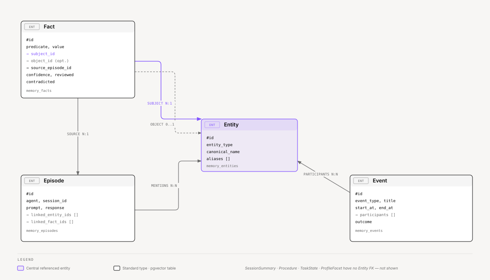
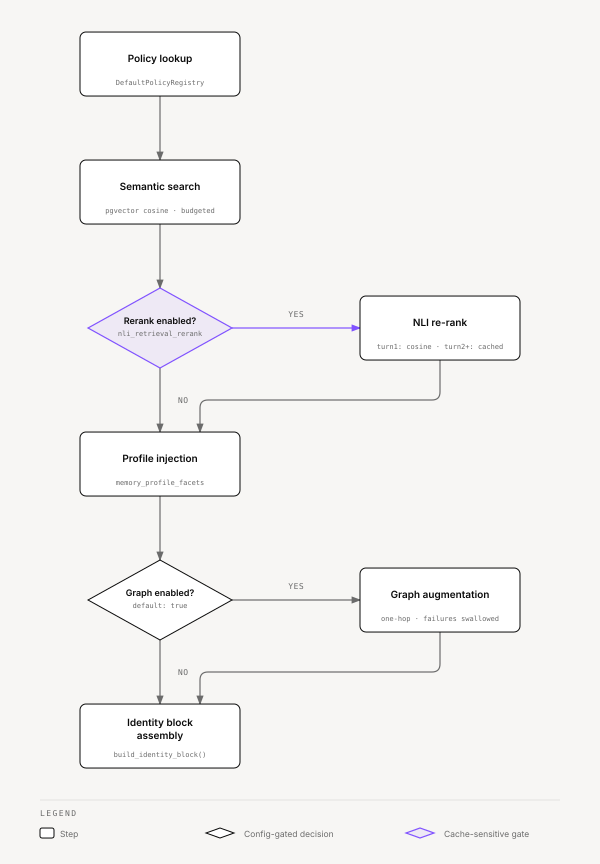

# Ze — Memory System

Ze maintains persistent, multi-layered memory through the `ze-memory` package
(`ze_memory`). Memory is backed by Postgres + pgvector and comprises five
complementary layers. An optional graph layer adds typed relationships between
memory objects for richer context retrieval.

**Package:** `core/cognition/ze-memory/ze_memory/`  
**Main store:** `ze_memory.retriever.PostgresMemoryStore`

---

## Data types

All types are plain dataclasses defined in `ze_memory/types.py`. The four types below
carry real foreign keys into `Entity`; the diagram shows how they relate before the
full field listing for each type follows.



<sub>[Interactive version](diagrams/docs/memory-types-er.html)</sub>

### `Fact`

Short declarative statements extracted from conversation or inferred from events.

```python
@dataclass
class Fact:
    predicate: str           # snake_case label, e.g. "communication_preference"
    value: str               # e.g. "prefers async over meetings"
    id: UUID | None = None
    subject_id: UUID | None = None   # linked Entity, if any
    object_text: str | None = None   # free-text object, if any
    object_id: UUID | None = None    # linked Entity for the object, if any
    confidence: float = 1.0
    reviewed: bool = False
    contradicted: bool = False
    source_episode_id: UUID | None = None
    source_refs: list[UUID] = ...
    provenance: Provenance = Provenance.PROMPT_SUPPLIED
    claim_kind: ClaimKind | None = None
```

**Table:** `memory_facts` — pgvector embedding on `value`.

**Provenance.** Perception writes `prompt_supplied`: conversation facts, ingested files and inbound messages. Only the dream writes `synthesized`, and those facts carry a `dream_run_id`. Confidence decay and expiry apply to facts with a `dream_run_id` only. `live_search` means a web search. When nightly dedup merges two similar facts into one new fact, it does so only when both have no `dream_run_id` and share the same provenance and claim kind. The merged fact keeps that provenance and claim kind.

### `Episode`

Raw per-turn records of individual conversation exchanges.

```python
@dataclass
class Episode:
    agent: str
    prompt: str
    response: str
    id: UUID | None = None
    session_id: str = ""
    summary: str | None = None
    relevance: float = 0.0
    created_at: datetime | None = None
    linked_entity_ids: list[UUID] = ...
    linked_fact_ids: list[UUID] = ...
```

**Table:** `memory_episodes` — pgvector embedding on `prompt + response`.

### `SessionSummary`

Narrative summary of a closed conversation session, generated eagerly by
`SessionSummariser` once the session becomes inactive. Replaces per-turn episodes as
the retrieval unit for closed sessions.

```python
@dataclass
class SessionSummary:
    id: UUID
    session_id: str
    summary: str
    episode_count: int
    last_turn_at: datetime
    created_at: datetime
    summary_updated_at: datetime   # updated if the user reopens the session
```

**Table:** `memory_session_summaries` — pgvector embedding on `summary` text.

### `Event`

Discrete real-world occurrences (meetings, calls, milestones).

```python
@dataclass
class Event:
    id: UUID | None
    event_type: str       # e.g. "meeting", "call", "calendar_event"
    title: str
    start_at: datetime | None = None
    end_at: datetime | None = None
    participant_names: list[str] = ...   # unresolved names from extraction
    participants: list[UUID] = ...        # resolved Entity ids
    summary: str | None = None
    outcome: str | None = None
```

**Table:** `memory_events` — pgvector embedding on `title`.

When an event has an `outcome`, the store automatically extracts generalizable facts
via LLM and writes them with `PROMOTES_TO` graph edges to the extracted facts.

### `Procedure`

Reusable step-by-step instructions captured when Ze successfully executes a multi-step task.

```python
@dataclass
class Procedure:
    id: UUID | None
    name: str
    trigger: str           # When to apply this procedure
    preconditions: list[str] = ...
    steps: list[str] = ...
    success_criteria: list[str] = ...
    version: int = 1
    source_refs: list[UUID] = ...
```

**Tables:** `procedure_candidates`, `procedure_versions` — pgvector embedding on `trigger + name` of admitted versions. Direct writes to a procedure table are hard-cut; sources submit candidates through `ProcedureAdmissionService`. `ProcedureDiscovery.match` returns ready or blocked guidance for agents and planners. Invocation is explicit (`invoke_procedure`) and never grants tools. A `tool_script` candidate (source kind added in phase 197) holds one tool script; after approval, `run_tool_script(procedure_id=...)` reruns it.

### `TaskState`

Live progress snapshot for a goal or workflow execution.

```python
@dataclass
class TaskState:
    id: UUID | None
    task_id: UUID | None
    goal_id: UUID | None
    status: str
    open_steps: list[str] = ...
    blocked_by: list[str] = ...
    last_action: str | None = None
    next_action: str | None = None
    tool_cursors: dict[str, str] = ...
```

**Table:** `memory_task_state`

### `ProfileFacet`

A single structured dimension of the user portrait, synthesized nightly.

```python
@dataclass
class ProfileFacet:
    key: str           # e.g. "communication_preference", "work_style"
    value: str         # e.g. "prefers async; avoids long meetings"
    stability: str     # "stable" | "dynamic" | "transient"
    confidence: float = 1.0
    source_refs: list[UUID] = ...
```

**Table:** `memory_profile_facets` — upserted by key.

### `Entity`

Named entities (people, projects, tools, organizations) referenced in memory.

```python
@dataclass
class Entity:
    id: UUID | None
    entity_type: str        # e.g. "person", "project", "tool"
    canonical_name: str
    aliases: list[str] = ...
    attrs: dict[str, str] = ...
```

**Table:** `memory_entities` — pgvector embedding on `canonical_name`.

### `MemoryContext`

Assembled retrieval result injected into every agent's system prompt.

```python
@dataclass
class MemoryContext:
    facts: list[Fact] = ...
    episodes: list[Episode] = ...            # raw turns — current session excluded
    session_summaries: list[SessionSummary] = ...  # closed-session narratives
    events: list[Event] = ...
    procedures: list[Procedure] = ...
    task_state: TaskState | None = None
    profile: list[ProfileFacet] = ...
    entities: list[Entity] = ...
    token_estimate: int = 0
```

---

## How memory is written

### Facts (explicit tools + gated extraction)

Two write doors, both through `submit_perception_facts` (contribution seam + NLI).
There is no `AgentResult.memory_proposals` persist path and no public
`propose_facts()`.

**Explicit remember.** Companion runs `agentic_loop` with `remember_fact` /
`forget_fact`. A successful `remember_fact` writes `PROMPT_SUPPLIED`,
`reviewed=true`. Companion may confirm remembered or forgotten only after that
tool returns `ok: true` on this turn. The turn path enforces that: it strips
unearned confirmation sentences and holds `token_sink` until the gated reply
is ready. Post-turn extraction does not license “I’ll remember.”
`forget_fact` marks matching rows `contradicted=true`. Match is precise: exact
predicate or value, the stored value named in the query, a long query phrase
inside the value, or one unique high-similarity embedding. A short substring
or a batch of loose neighbors is a miss (`ok: false`), not a retract. Do not
use `forget_fact` to cancel reminders, close loops, or abandon goals.
Cancel speech (“forget the dentist”) is `delegate_to_agent` to `reminders`,
`loops`, or `goals`. Nested `delegate_to_agent` results are
`{response, tool_calls}` so earned cancel/close/abandon (and forgotten-fact)
claims can see the inner payload. Domain agents list pending items, run
`precise_label_match`, and write at most once on a unique label. A domain
success may confirm cancelled/closed/abandoned; it does not earn “I forgot”
a fact.

**Loop tracking.** The `loops` agent confirms tracking (“it's on your radar”)
only after `track_loop` or `confirm_loop` returns `ok: true` on this turn. The same turn-path
guard strips an unearned tracking claim, in English and Portuguese, and the
reply becomes “I could not track that.” when nothing else remains. Offers and
questions (“Want me to keep this on your radar?”) are never stripped. Only the
`loops` agent turns this guard on.

**Open-loop questions.** `OpenQueryDetector` (`ze_priority/open_query.py`) decides
whether the user asks what is open. It compares the message to English and
Portuguese example questions by E5 similarity, with a threshold of 0.88. It
replaced a regex. Inline mentions and the recap list at most 5 loops. An
explicit "what's open" answer lists at most 10: ranked items first, then
suspected loops, each marked unconfirmed. Suspected loops never join the ranking
or the push budget. After a session gap, Ze also
asks about up to 3 suspected loops. A loop it offered stays quiet for 7 days,
tracked in `push_log`. The detector ships under an amended bar: Portuguese
recall is lower than English, and no false positives were measured. See
`specs/phases/171-loop-confirmation/research.md`.

**Post-turn extraction.** After each agent run, `write_memory` runs the commitment
intake (`ze_worldstate/intake.py`, Phase 173). One System One request asks what the
message committed the user to. Ze keeps a fact only when the commitment is `fact`,
the family is one of `identity`, `preference`, `relationship`, `constraint`,
`contact_detail`, and the biography answer clears its bar
(`ze_memory/fact_judge.py` holds the family and biography questions). A Haiku call
then writes the fact text. Every other commitment (reminder, loop, goal,
waiting_on, forget, ingest, clarify, none) yields no fact, and a turn that already
created a reminder or a goal persists none. When System One skips or the surface is
off, `gather_fact_proposals` (`ze_memory/extractor.py`) runs the Haiku extractor
instead. It labels the message `speech_act` as `fact`, `forget`, `ingest`,
`clarify`, or `none`, and keeps facts only for `fact`. See
[system-one.md](system-one.md#commitment-intake). Predicates
already written this turn by `remember_fact` (`ok` true, same predicate+value
identity after normalize) are dropped. Kept rows are
`PROMPT_SUPPLIED`, `reviewed=false`. Eval threads (`eval-*`) skip this path.

- Before insert, the store marks every active fact with the same predicate and subject
  `contradicted = true`. It then runs the NLI contradiction check
  (`nli_write_time_check`, default `true`) on the 10 nearest same-subject facts with
  cosine ≥ `nli_lower_cosine_bound` (0.60). A fact whose contradiction score reaches
  `nli_contradiction_threshold` is marked `contradicted = true`. Controlled by
  `memory.nli_*` keys in `config.yaml`.
- `POST /api/v0/memory/facts/review` exposes review/edit/reject for the native app.

**Reviewed facts are never auto-merged or auto-expired.**

### Constraint-gated writes

Reviewed `constraint` facts also sit on a **write gate**, not a mail-only if-list.
Plugins mark a tool `constraint_gate=True` (optional `constraint_describe`). One
harness hook in `ze_memory.constraint_veto` runs before those tools execute: it
loads reviewed, non-contradicted constraint rows and allows, confirms, or refuses.
Refuse and confirm-hold do not call the tool body. The first adopters are
`send_email`, calendar create/update/delete, and reminder set/cancel. Prospecting
outreach send is the same `send_email` tool; `add_prospect` stays unmarked.
`remember_fact` is unmarked. User-visible “I won’t send because of your constraint”
is earned only when a this-turn tool payload has `veto: true`.

### Episodes (automatic, no approval)

After every agent run, `write_memory` calls `store.write_episode()`, which embeds the
episode and writes it to `memory_episodes`. The graph layer asynchronously scans the
episode text for known entity names and creates `MENTIONS` edges.

### Session summaries (automatic, near-real-time)

`SessionSummariser` runs every 10 minutes (configurable). For each session that has
been inactive for ≥ the top-level `session_inactivity_minutes` setting (default: 30) and has no up-to-date
summary, Haiku generates a single narrative covering the full session and writes it to
`memory_session_summaries`. If the user reopens the session and adds new turns, the
summary is regenerated on the next job tick. Raw episode rows are kept until the nightly
consolidation deletes them (after 7 days), at which point it skips the LLM call since
the eager summary already exists.

### Events

Agents write events explicitly (e.g. the calendar agent writes events when syncing).
Events with `outcome` text automatically trigger LLM-based fact promotion with
`PROMOTES_TO` graph edges.

### Procedures

Sources submit procedure candidates to `ProcedureAdmissionService`. Admitted versions
become retrievable playbooks (see [`Procedure`](#procedure)). The graph defines a
`USES_PROCEDURE` predicate, but no code writes that edge today.

### Task state

`GoalExecutor` and the workflow graph (`ze_personal/graph/workflow.py`) upsert task state to
track in-flight progress. A task state that has a goal links to it via a
`BELONGS_TO_GOAL` graph edge.

### Feedback records (evidence, not facts)

When the person rates an assistant reply with a thumbs up or thumbs down, Ze appends a
`FeedbackRecord` to the `feedback_records` table (`ze_memory/feedback_records/`). A
Retry request appends a `retry_requested` record. Each record cites the message id and
the thread id, and carries provenance and confidence from the shared claim vocabulary.
It holds no free text and no message content.

A rating is a reaction to Ze's output. It is not a fact about the user. Feedback never
enters `memory_facts`, fact embeddings, retrieval, profile synthesis, contradiction
detection, the memory feed, or fact review. Ze never says "you liked that" because of
a thumb.

The records reach the table through the contribution seam: the claim kind
`FEEDBACK_RECORD` is licensed to the Perception function only. The table is
append-only. The current rating is the latest rating record for the message, and
earlier records stay as history. A record links to the message's `MessageTrace` by
message id, so the routing envelope, System One judgments, memory chunks, and tool calls
are reachable from it. Ze does not copy the trace into the record.

In v1 nothing reads feedback during a turn. Routing, admission, prompts, and ranking
ignore it. The trace panel is the only reader. See
[native-interface.md](native-interface.md#reply-feedback-and-retry) for the user-facing
flow.

---

## How memory is retrieved

Before every agent execution, `fetch_context` runs:



<sub>[Interactive version](diagrams/docs/memory-retrieval.html)</sub>

1. **Policy lookup** — `DefaultPolicyRegistry.for_module(request.module)` returns the
   appropriate retrieval policy for the calling context.
2. **Semantic search** — pgvector cosine similarity over `memory_facts`,
   `memory_episodes` (raw turns, current session excluded), and
   `memory_session_summaries` (closed-session narratives) against the current prompt
   embedding. A subquery excludes sessions with a summary row from the raw episode query
   so the caller never receives both fragments and summary for the same session.
   Each policy then drops candidates below the relevance floor
   (`memory.relevance_floor`, default 0.35; `relevance_floor_overrides` sets a floor per
   memory type, and `episode` ships at 0.30). It orders the rest by a composite score:
   a weighted sum of similarity, recency (30-day half-life), and confidence, set by
   `memory.composite_weights` (0.6 / 0.25 / 0.15). With `memory.entity_anchor.enabled` (default `true`), entities
   named in the query add their one-hop graph neighbors as a second entry point
   (`ze_memory/entity_anchor.py`). `budget_facts` and `budget_episodes` project the
   token-budgeted results.
3. **NLI re-rank** — two parts. First, a live re-rank (`memory.live_rerank.enabled`,
   default `true`) NLI-scores up to `candidate_limit` (20) fact candidates in the
   current turn and reorders them. It has a timeout (`timeout_ms`, 120). On timeout or
   error it keeps the original order. Second, the cached re-rank (when
   `memory.nli_retrieval_rerank: true`): the first request in a session returns the
   order from step 2 with no added latency. A background
   task (`build_retrieval_cache`) fetches `K × nli_rerank_candidate_multiplier`
   fact/summary candidates, NLI-reranks them, and writes ranked ID lists to
   `memory_retrieval_cache` keyed by `(session_id, query_hash)`. On turn 2+ with the
   same query in the same session, Ze re-fetches facts and session summaries by cached
   ID order and re-budgets them. Episodes, profile, entities, events, and task state
   stay as the policy returned them, unchanged. Mid-execution modules (`planner`,
   `tool_executor`) and introspection modules (`profile`, `memory_ui`) skip the cache.
   See `ze_memory/retrieval_rerank.py` and `ze_core/nli.py` (`NLIClient`).
4. **Profile injection** — Ze fetches all `memory_profile_facets` rows (highest
   confidence first) and includes them in the context.
5. **Graph augmentation** — when `memory.graph.enabled: true` (default),
   `BoundedExpansionPolicy` expands entity and fact seed IDs from the retrieved
   context one hop. It appends neighbor entities, facts, episodes, and procedures
   to the context. Failures are silently swallowed — the base context is
   always returned.
6. **Prompt assembly** — `build_identity_block()` from `ze_personal.persona` renders
   persona traits. `BaseAgent._build_system_prompt()` puts constitution and the agent
   job before the retrieved biography. `_format_memory` prints origin, confidence,
   and recency. Companion retrieval pins reviewed facts always-on (`CompanionPolicy`).
   Calendar, messenger, and news share that assembler (no second builder) and the
   same silent-use / no unsolicited “I remember that you…” job family. They do not
   list `remember_fact` / `forget_fact`; they import companion `enforce_memory_confirmations`
   so they cannot claim those tools succeeded. Constraint write veto is a separate
   gate (144). Recitation stripping as its own product is 145.
   `TurnSurfacing` still owns unsolicited open-item mentions.

Agents never query memory themselves. They receive `MemoryContext` on
`AgentContext` and see it through `_build_system_prompt()`.

### `RetrievalRequest`

```python
@dataclass
class RetrievalRequest:
    module: str            # e.g. "companion", "workflow", "goals"
    agent: str
    query_text: str
    query_embedding: Any   # must be set — InvalidRetrievalRequestError otherwise
    intent: str | None = None
    task_id: UUID | None = None
    goal_id: UUID | None = None
    max_tokens: int = 2000
    current_session_id: str | None = None  # used for retrieval-cache keying
```

---

## Graph layer

**Module:** `ze_memory.graph`  
**Config:** `memory.graph.*` in `config/config.yaml` (default: enabled)

The graph layer stores typed relationships between memory objects in the
`memory_relationships` table. Relationships have a `source_id`, `source_type`,
`predicate`, `target_id`, `target_type`, `confidence`, and `creation_method`.

### Predicates


<sub>[Interactive version](diagrams/docs/memory-graph-predicates.html)</sub>

<details>
<summary>Table</summary>

| Predicate | Meaning |
|---|---|
| `DESCRIBES` | Entity → Fact |
| `SOURCED_FROM` | Fact → Episode |
| `MENTIONS` | Episode → Entity |
| `PARTICIPATES_IN` | Event → Entity |
| `PROMOTES_TO` | Event → Fact (from outcome extraction) |
| `BELONGS_TO_GOAL` | TaskState → Goal |
| `USES_PROCEDURE` | Procedure → TaskState (defined; no code writes it today) |
| `WORKS_ON` | Person → Project (written by `ze-personal`: the contacts consolidator and extractors, and the promotion of social hypotheses) |
| `COLLABORATES_WITH` | Person ↔ Person (written by `ze-personal`: the contacts consolidator and extractors, and the promotion of social hypotheses) |

</details>

### Traversal

`BoundedExpansionPolicy` expands from seed IDs up to `max_hops` hops (default: 1),
returning at most `max_relationships` (default: 20) neighbors. `enrich_context()`
merges the results into the base `MemoryContext`.

```yaml
memory:
  graph:
    enabled: true
    max_hops: 1
    max_relationships: 20
```

---

## Nightly consolidation (2 AM UTC)

**Module:** `ze_memory/consolidator.py`  
**Scheduled in:** `ze_memory/bootstrap.py` (job id `memory_consolidation`, gated by `consolidation_enabled`), called from `ze_api/wiring/jobs.py`

`MemoryConsolidator.run()` executes four passes in sequence:

### 1. Fact deduplication

Scans all unreviewed facts, computes pairwise cosine similarity, then applies NLI
classification for pairs in the `0.60 ≤ cosine < 0.95` gap (and confirms paraphrases
before LLM merge in the `0.85–0.95` band):


<sub>[Interactive version](diagrams/docs/dedup-threshold-ladder.html)</sub>

<details>
<summary>Table</summary>

| Similarity | Action |
|---|---|
| ≥ 0.95 | Silent merge — keep the fact with the higher confidence, mark the other `contradicted = true`. No LLM call. |
| 0.85–0.95 | NLI entailment ≥ `nli_entailment_threshold` → LLM merge (Haiku synthesizes one value, marks both `contradicted = true`), only for two facts without a `dream_run_id` that share provenance and claim kind. NLI contradiction → mark older `contradicted`. Otherwise skip. |
| 0.60–0.85 | NLI contradiction ≥ `nli_contradiction_threshold` → mark older `contradicted` (`max(created_at)` wins). Otherwise skip. |
| < 0.60 | No action — unrelated enough to skip NLI. |

</details>

Reviewed facts are **never** touched by consolidation.

### 2. Fact expiry

| Rule | Condition | Action |
|---|---|---|
| Grace delete | `expires_at` elapsed | Hard-delete |
| Contradicted cleanup | `contradicted = true` + older than `contradicted_ttl_days` (30d default) | Hard-delete |
| Stale unreviewed | `reviewed = false` + no activity for `unreviewed_ttl_days` (90d default) | Soft-expire: set `expires_at = NOW() + expiry_grace_days` |

### 3. Episode archival

Episodes older than `episode_archive_days` (7d default) are candidates for archival.
Two steps run in order.

1. **Session archival** (`session_grouping_enabled`, default `true`). The consolidator
   picks up to `max_sessions_per_run` (10) sessions that have at least
   `min_session_episodes` (3) old raw episodes. A session that already has an entry in
   `memory_session_summaries` skips the LLM call — the consolidator deletes its raw rows
   directly. For any other session, Haiku writes one summary, stored as an archive
   episode, and the consolidator deletes the raw rows.
2. **Batch archival.** The remaining old raw episodes (up to `episode_archive_batch`,
   20 in code, 50 in the shipped config) are archived together: when at least `episode_min_archive_batch`
   (10 default) exist, Haiku summarizes the batch into one archive row and the
   consolidator deletes the originals. With fewer, it deletes archive summaries older
   than twice `episode_archive_days`.

### 4. Profile facet synthesis

After the three cleanup passes, Haiku reads up to 100 recent facts that are not
contradicted (reviewed or not) and up to 20 recent episode summaries. It produces a
structured list of `ProfileFacet` objects, upserted into `memory_profile_facets` by key.
Facets with an unknown `stability` or an empty key or value are dropped.

Synthesis is skipped when there are no facts and no episode summaries, or when the model
returns no valid facet.

---

## Inspecting memory

### REST API

| Endpoint | Description |
|----------|-------------|
| `GET /api/v0/memory/feed` | Facts and episodes, newest first — query params: `limit`, `before`, `type`, `agent`, `as_of`, `include_totals` |
| `GET /api/v0/memory/timeline-bounds` | The earliest memory timestamp and the current time, for the date scrubber |
| `GET /api/v0/memory/activity` | Per-day counts of facts and episodes between `start` and `end` |
| `POST /api/v0/memory/facts/review` | Confirm, reject, or edit a fact (reject deletes the row) |
| `GET /api/v0/memory/graph` | Top entities by relationship count with the edges between them |
| `GET /api/v0/memory/entities` | Search entities by name or alias (`q`, `entity_type`, `limit`) |
| `GET /api/v0/memory/graph/entity/{entity_id}` | Facts, episodes, and one-hop neighbors for one entity |

The action ledger has its own read: `GET /api/v0/actions` lists records newest first, for one goal, workflow, workflow run or workspace run, with keyset paging on `(occurred_at, id)`. A record belongs to a subject when its context holds that subject's id. Goal, workflow and workspace records carry one. The workflow-finished record carries both the workflow id and the run id, so a workflow's list shows each run's outcome. Calendar, reminder and prospecting records do not. See [Accountability surfaces](native-interface.md#accountability-surfaces).

There is no REST route that starts a consolidation run. The `memory_consolidation`
job runs on the `nightly_cron` schedule.

---

## Configuration

Graph settings live in `config/config.yaml` under `memory.graph.*`.
Consolidation thresholds have code defaults in `ze_memory/defaults.py`; they can be
overridden in `config.yaml` under `memory.consolidation.*`:

```yaml
memory:
  graph:
    enabled: true
    max_hops: 1
    max_relationships: 20

  # Optional consolidation overrides (defaults defined in ze_memory/defaults.py):
  consolidation:
    enabled: true
    merge_silent_threshold: 0.95
    merge_llm_threshold: 0.85
    contradicted_ttl_days: 30
    unreviewed_ttl_days: 90
    expiry_grace_days: 7
    episode_archive_days: 7
    episode_archive_batch: 50
    episode_min_archive_batch: 10
    session_grouping_enabled: true
    min_session_episodes: 3
    max_sessions_per_run: 10
    nightly_cron: "0 2 * * *"

  session_summary:
    enabled: true
    check_interval_minutes: 10     # how often the job polls for closed sessions
    min_episodes: 2                # sessions shorter than this are skipped
    max_sessions_per_run: 5        # cap LLM calls per job execution
    max_transcript_tokens: 6000    # oldest turns dropped first when exceeded
    model: anthropic/claude-haiku-4-5

  # Retrieval relevance (phase 106) — defaults in ze_memory/defaults.py
  relevance_floor: 0.35
  relevance_floor_overrides:
    episode: 0.30
  composite_weights:
    similarity: 0.6
    recency: 0.25
    confidence: 0.15
  entity_anchor:
    enabled: true
    match_constant: 0.75
  live_rerank:
    enabled: true
    candidate_limit: 20
    timeout_ms: 120

  # NLI cross-encoder (Phase 79) — defaults in ze_memory/defaults.py
  nli_contradiction_threshold: 0.60
  nli_entailment_threshold: 0.70
  nli_lower_cosine_bound: 0.60
  nli_write_time_check: true
  nli_grounding_threshold: 0.30   # correlation push path (ze-correlation)
  nli_retrieval_rerank: true
  nli_rerank_candidate_multiplier: 2
  nli_rerank_min_candidates: 5
```

---

## Database tables

| Table | Purpose |
|-------|---------|
| `memory_facts` | Facts with pgvector embeddings, review/contradicted status, expiry |
| `memory_episodes` | Raw per-turn records with pgvector embeddings |
| `memory_session_summaries` | Eager per-session narrative summaries with pgvector embeddings (`SessionSummariser`) |
| `memory_entities` | Named entities with canonical names, aliases, pgvector embeddings |
| `memory_relationships` | Typed graph edges between memory objects |
| `memory_events` | Discrete real-world events with participants and outcomes |
| `procedure_versions` | Admitted reusable playbooks with pgvector embeddings |
| `memory_task_state` | Goal/workflow in-flight progress checkpoints |
| `memory_profile_facets` | Structured user portrait — key/value facets with confidence |
| `feedback_records` | Append-only ratings and retry requests on assistant replies (`zm024`). Evidence about replies, never read back into a turn |
| `memory_retrieval_cache` | Session-scoped NLI rerank order for facts/summaries (`zm010`; 1-day TTL) |
| `memory_signals` | Cross-domain signals from plugins (`zm006`) |
| `action_records` | Append-only ledger of actions Ze took (`zm021`) |
| `procedure_candidates` | Procedure candidates awaiting admission (`zm022`) |

Migrations: `core/cognition/ze-memory/ze_memory/migrations/versions/` (raw SQL, Alembic meta-runner in `ze_api/cli/migrate.py`).

---

## Key invariants

- **Reviewed facts are never auto-merged or auto-expired.** Only the user can modify them.
- **Embeddings are stored at write time only.** At query time they are dropped from context
  objects so `AgentState` stays JSON-serializable for the LangGraph checkpointer.
- **Graph augmentation is best-effort.** Failures silently fall back to the base context
  — the store always returns something useful.
- **Memory is editorial, not automatic.** Extracted facts start unreviewed and expire
  if the user never reviews them (`unreviewed_ttl_days`). Facts the user asks Ze to
  remember start reviewed. Episodes are automatic because they archive away after
  about a week.

---

## Reviewing beliefs in Mind

The web app's Mind place is where you review what Ze believes. The memory feed returns each fact's `claim_kind`, so a row can show whether Ze holds it as an identity, a fact, an inference or a suspicion. `reviewFacts` keeps, edits or drops a fact. `searchEntities` finds an entity by name or alias, and `getEntityDetail` returns its facts, up to 20 neighbours ordered by connections, and `neighbour_total` for the rest. The "As of" control filters by `created_at`; kind, confidence and review state are always current.

---

## Dreaming

Ze's offline dream phase (wake → sleep → dream → morning integration) extends the memory
system with a staging buffer, critic-gated promotion, and synthetic fact lineage. See
[dreaming.md](dreaming.md) for the full pipeline, and
[specs/arch/dream-memory.md](../specs/arch/dream-memory.md) for architectural decisions.
