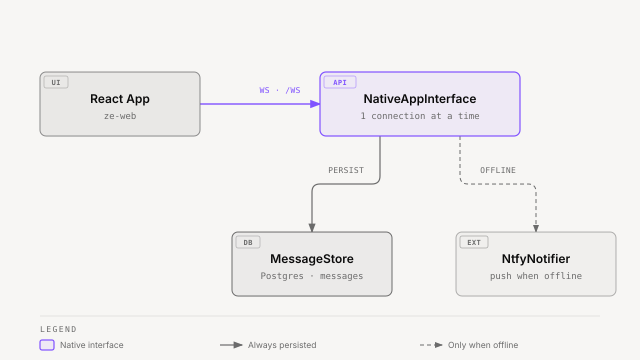

# Ze — Native App Interface

Ze's native interface connects the React web app (`ze-web`) to the backend (`ze-api`)
over a persistent WebSocket. When the app is not connected, Ze falls back to
**ntfy push notifications**.

**Module:** `ze_api/interface/native.py` · `ze_api/api/ws.py`  
**WebSocket endpoint:** `GET /ws`

---

## Overview



<sub>[Interactive version](diagrams/docs/native-interface.html)</sub>

`NativeAppInterface` is the `AppInterface` implementation for the native client. It
saves every outbound message to `MessageStore` (for unread replay on reconnect), pushes
it to the active WebSocket connection if one exists, and falls back to ntfy if the
client is offline.

**One connection at a time.** A new WebSocket connection displaces the previous one
with close code `4000`.

---

## Authentication

Pass the API key either as a bearer header or a query parameter:

```
Authorization: Bearer <ZE_API_KEY>
# or
GET /ws?token=<ZE_API_KEY>
```

The server closes connections without a valid key with code `4001`.

---

## Connection sequence

On connect, the server:

1. Closes any previous connection with code `4000`.
2. Fetches all unread messages from `MessageStore` and replays them as
   `{"type": "message", ...}` frames.
3. If a confirmation was pending when the client disconnected, replays the
   `confirm_request` frame so the user can still approve or cancel (see
   [Confirmation flow](#confirmation-flow)).
4. Begins forwarding new messages in real time.

The client should send `{"type": "ack", "ids": [...]}` frames to mark messages as read.

---

## Frame types

### Client → Server

| Frame | When to send | Description |
|---|---|---|
| `{"type": "ping"}` | Heartbeat | Server replies with `{"type": "pong"}` |
| `{"type": "ack", "ids": ["<uuid>", ...]}` | After displaying messages | Marks messages as read in `MessageStore` |
| `{"type": "message", "text": "...", "thread_id": "...", "context": {...}}` | User sends a message | `thread_id` is optional; `context` is optional screen context. `context.voice` marks a voice turn (see [Voice input](#voice-input)) |
| `{"type": "retry", "message_id": "<uuid>", "thread_id": "...", "confirmed_plan": ["<entry id>", ...]}` | User presses Retry on the latest reply | Undoes what the reply did, then regenerates it. `confirmed_plan` lists the undo entry ids the person confirmed. Omit it or send `null` when the plan is empty. See [Reply feedback and Retry](#reply-feedback-and-retry). |
| `{"type": "confirm", "id": "<request id>", "choice": "approve" \| "deny", "edits": {...}}` | Answer a `confirm_request` | Approves or denies the parked writes in that request. `edits` is optional (see [Confirmation flow](#confirmation-flow)) |
| `{"type": "action", "payload": "<action value>", "thread_id": "..."}` | User presses a prompt button that is not approve or deny | Runs the action named by the button value, e.g. a goal gate's `goal_plan:yes:<id>` (see [Confirmation flow](#confirmation-flow)) |
| `{"type": "command", "name": "cancel"}` | Cancel pending confirmation | Aborts the awaited graph turn |
| `{"type": "command", "name": "costs"}` | Introspection | Returns a 7-day cost summary message |
| `{"type": "command", "name": "status", "period_days": 1}` | Accountability | Returns an activity narrative (default: past 24 h; set `period_days: 7` for the weekly view) |
| `{"type": "command", "name": "onboarding"}` | Setup | Starts or resumes onboarding |
| `{"type": "component_submit", "session_id": "...", "step_id": "...", "component_id": "...", "values": {...}}` | Interactive component | Submits structured onboarding form/button values |

### Server → Client

| Frame | Description |
|---|---|
| `{"type": "pong"}` | Heartbeat reply |
| `{"type": "typing"}` | Sent immediately after receiving a user message while Ze is processing. May include an optional `"text"` field with a localized progress string (e.g. `"📡 Fetching the latest news..."`). Re-sent mid-turn by agents to update the status and reset the client's 3-second display timer. |
| `{"type": "message", "message": Message}` | Outbound message from Ze (see Message shape below) |
| `{"type": "confirm_request", "id": "...", "kind": "write" \| "budget" \| "held" \| "prompt", "round": 1, "title": "...", "items": [...], "actions": [...], "expires_at": "..."}` | Asks the user to approve one or more parked writes, a spend-budget pause, a held unattended write, or a prompt (goal gate, goal suggestion, workspace reset) |
| `{"type": "confirm_cancel", "id": "...", "thread_id": "...", "reason": "answered"}` | Closes the card for that `id`. `reason` is `answered` when the user approved or denied it, on any client. Ze sends the frame without `reason` when it supersedes or expires a request. |
| `{"type": "message_superseded", "message_id": "...", "replaced_by": "...", "thread_id": "..."}` | A retry replaced `message_id` with `replaced_by`. Sent after the new `message` frame. |
| `{"type": "message_rollback", "message_id": "...", "thread_id": "...", "rollback": {...}}` | The stored rollback record of `message_id` changed. Sent on each state change of a retry. |
| `{"type": "notification", "id": "...", "event_type": "...", "target_parent_id": "...", "push_class": "...", "urgency": "...", "delivery": "..."}` | A proactive push entered the notification bell. `push_class` is `requested`, `accountability`, or `discretionary`. `delivery` is `delivered`, `held`, `suppressed`, `released`, or `failed`. A `held` or `suppressed` row arrives with no chat message and no ntfy. |
| `{"type": "error", "detail": "...", "code": "..."}` | Error from the server (e.g. "busy"). `code` is optional; see [Error codes](#error-codes). |

### Progress messages

The `typing` frame carries an optional `text` field with a localized human-readable
status string. The server sends an initial `{ "type": "typing" }` (no text) as soon
as a user message is received; agents then emit keyed progress messages mid-turn that
re-send the frame with text.

```json
{ "type": "typing", "text": "📡 Fetching the latest news..." }
```

Each `typing` frame resets the client's display timer (default 3 seconds). Long-running
operations (e.g. RSS fetches, web searches) emit multiple frames to keep the indicator
alive.

Clients should render `text` when present and fall back to a generic spinner when absent.
`typingText` is exposed from `useChatSession` for this purpose.

### Message shape

```json
{
  "id": "uuid",
  "role": "assistant",
  "text": "string",
  "components": [],
  "read": false,
  "thread_id": "string or null",
  "created_at": "ISO8601",
  "replaces": "uuid or null",
  "replaced_by": "uuid or null"
}
```

`replaces` is set on a reply that a retry produced. `replaced_by` is set on a reply that a
retry replaced. `rollback` is the stored rollback record of a reply whose retry undid
actions, or `null`. See [Rollback record](#rollback-record).

`components` is a list of server-driven UI component descriptors (from `ze-components`).
The web app renders them below the message text.

Onboarding messages also include an `onboarding` metadata object beside `message`:

```json
{
  "type": "message",
  "message": { "role": "assistant", "text": "Setup", "components": [] },
  "onboarding": { "session_id": "uuid", "completed": false }
}
```

The web app stores this metadata on the message and uses it when form/confirm
components submit `component_submit` frames.

---

## Voice input

Voice takes two steps. The app first uploads the recording, then sends the text as a
message.

1. **Transcribe.** The app sends the recording as a `multipart/form-data` field named
   `file` to `POST /api/v0/voice/transcriptions` (`transcribeVoice`). The response holds
   the transcript, the measured duration and a `transcription_id`:

   ```json
   { "transcript": "remind me to call Ana", "duration_s": 3.4, "transcription_id": "9f2c…" }
   ```

   The limits are 10 MB and 120 seconds. Accepted types are WebM, Ogg, MP4/M4A and WAV.
   The route keeps no audio. A request with no `Authorization` header gets a 401 before
   the body is read; a wrong key is only checked after the upload arrives, which can be up
   to 10 MB plus 64 KB.

2. **Send.** The user checks the transcript, edits it if needed, and sends the message.
   The frame names the id:

   ```json
   { "type": "message", "text": "remind me to call Ana tomorrow", "thread_id": "…",
     "context": { "voice": { "transcription_id": "9f2c…" } } }
   ```

   A live id makes the turn a voice turn. The server reads the transcript and duration
   from its registry, so the client's text does not decide the modality. An unknown or
   expired id runs the turn as text. Ids last 10 minutes and do not survive a server
   restart.

A voice turn's trace shows `input`: `{ "modality": "voice", "duration_s": 3.4, "edited": true }`.
`edited` is true when the sent text differs from the transcript. Text turns have no `input`.

Failures return `{ "detail": "<plain line>" }`. The main cases are:

| Status | Cause | Detail |
|---|---|---|
| 413 | Over 10 MB, or over 120 seconds | "That recording is too large…" or "That recording is too long…" |
| 415 | Other file type | "Unsupported recording type. Use WebM, Ogg, MP4 or WAV." |
| 422 | Length cannot be read | "I couldn't make out the recording." |
| 422 | No `file` part | "Send the recording as a file named file." |
| 502 | Speech model failed | "I couldn't make out the recording." |
| 503 | `ffmpeg` missing on the server | "Voice input is not available on this server." |

---

## Confirmation flow

A turn pauses for approval at most once per pause. Each pause sends one `confirm_request`.
Its `kind` says why Ze pauses:

| `kind` | Why | Items |
|---|---|---|
| `write` | Ze parked one or more irreversible writes. A turn has at most 3 rounds. `round` counts the pause. | One item per parked write |
| `budget` | The turn may take today's spend past the limit (113). | One item, `tool: null` |
| `held` | An unattended workflow or goal run wants a write it may not run on its own. `source` names the run. | One item per held write |
| `prompt` | A goal gate, a goal suggestion, or a workspace reset asks a question. `title` holds the question and `actions` hold its buttons. The client sends an `approve` or `deny` value as a `confirm` frame and any other value as an `action` frame. | None |

The server sends:

```json
{
  "type": "confirm_request",
  "id": "8d0f…",
  "thread_id": "…",
  "kind": "write",
  "round": 1,
  "title": "Ze needs your OK",
  "items": [
    {
      "item_id": "c1",
      "agent": "calendar",
      "tool": "delete_event",
      "effect_phrase": "delete a calendar event",
      "summary": "Dentist — today 15:00",
      "conflict": null,
      "editable_field": null,
      "proposed_text": null
    }
  ],
  "source": null,
  "expires_at": "2026-10-15T20:15:00Z",
  "actions": [
    {"label": "Approve all", "value": "approve", "style": "primary"},
    {"label": "Deny all", "value": "deny", "style": "secondary"}
  ]
}
```

- `conflict` holds the constraint text when a reviewed constraint needs the user's OK.
- `editable_field` and `proposed_text` appear only for items whose tool allows an edit, such as the body of an email.
- `source` is set only for `kind: "held"`.

The client shows one card for the whole request. It shows each item in the imperative
form, for example "delete a calendar event". The user answers with a `confirm` frame:

```json
{"type": "confirm", "id": "8d0f…", "choice": "approve"}
{"type": "confirm", "id": "8d0f…", "choice": "approve", "edits": {"c2": "new body text"}}
{"type": "confirm", "id": "8d0f…", "choice": "deny"}
```

- `edits` keys must name an item with an `editable_field`. Ze rejects any other key with an
  `error` frame, and nothing runs.
- An answer for an unknown, expired or superseded `id` returns an `error` frame with the
  detail "No pending confirmation." Nothing runs.
- When Ze accepts an approve or deny, it sends `confirm_cancel` for that `id` with
  `reason: "answered"`, before the turn resumes. Every open client closes the card.
- When Ze supersedes or expires a request, or a held write is answered elsewhere, it sends
  `confirm_cancel` for that `id`.
- A client closes the card when it receives `confirm_cancel` for the card's `id`.

Approval runs exactly the approved calls with the approved arguments. Each parked turn
then resumes with the real results, and the model writes the reply. Denial runs nothing.
Ze adds an "Okay, I didn't <effect>." line for each denied item, so the reply does not
claim that the write happened.

One turn can propose the same call twice, for example when two subtasks send the same
email. The card shows each distinct call (the same tool with the same arguments) once.
Approval runs that write once. The repeat's loop learns that the call ran elsewhere, and
its trace entry shows gate `duplicate`. Denial declines every copy.

### Persistence across disconnects

The server saves the `confirm_request` payload to the `pending_confirmations` Postgres
table at the moment it sends the frame. On the next WebSocket reconnect, after
replaying unread messages, the server checks `pending_confirmations` for any
non-expired row and re-sends the `confirm_request` frame. The user can approve or
cancel even if they closed and reopened the app.

Ze clears the row when:
- The user responds (approve or cancel).
- The timeout elapses (see below).

### ntfy push on background

When the app is not connected and a confirmation is required, Ze also pushes an ntfy
notification with the request title (urgency `high`) so the user is alerted even with
the app closed. Ze skips this buzz during quiet hours; the frame is still sent, and
the request stays in chat.

### Timeout

A `CONFIRM_TIMEOUT_SECONDS` (default: 900 s / 15 min) watchdog runs in the background
from the moment the server sends the `confirm_request`. If the window elapses with no
user response, Ze counts the request as a deny. Each parked call returns a declined
result, and Ze gives the "Okay, I didn't <effect>." line for each item. Held writes in
unattended runs expire after 24 hours and count as a deny too.

If the turn still has unfinished conductor work, Ze appends an offer to continue that
job as a goal or as a workflow. Ze does not create either until the user accepts.

Ze deletes the `pending_confirmations` row. If the app is still connected the message
appears in-chat; otherwise it goes via ntfy (urgency `low`).

---

## Busy guard

Only one graph invocation runs at a time. If the client sends a second `message` frame
while a previous invocation is still in flight, the server responds:

```json
{"type": "error", "detail": "busy", "code": "busy"}
```

The client shows "Ze is still working on the last one" with a Cancel control (`command` frame, name `cancel`). A `retry` frame uses the same
guard, so Retry cannot start while a turn runs on the thread.

### Which client slice handles each frame

Each inbound frame has one state owner in ze-web. `features/turn-stream/model/frame-registry.ts` lists them, and a test fails when a call site is missing.

| Frame | State owner |
|---|---|
| `typing`, `token`, `message`, `edit`, `error`, `message_superseded`, `message_rollback` | `entities/conversation`, fed by `TurnFrameHandler` |
| `confirm_request`, `confirm_cancel` | the pending-confirmation store (`features/respond-to-confirmation`) |
| `trace_update` | `features/trace-state` |
| `refresh`, `notification` | query invalidation (`features/invalidate-on-ws-refresh`) |
| `pong` | none |

A `confirm_request` for a busy thread pauses the delivery watchdog, and an approve or deny restarts it. A confirmation is placed in the canvas under the latest exchange, in `/ask` and in the overlay. A prompt-kind confirmation shows its actions as command chips that send `action`.

Close code `4000` means another window took the connection. The client does not reconnect on its own. It shows "Ze is open in another window" with a Use here control, which reconnects at once.

### Error codes

The `error` frame has an optional `code` field.

| `code` | Meaning |
|---|---|
| `busy` | A turn or retry already runs on this thread. |
| `retry_unavailable` | Ze refused the retry before any graph run. The frame also carries `reason_code` and `reason_text`. |
| `retry_partial` | Ze could not undo every action, so it did not regenerate. The frame carries `rolled_back: true` and the `rollback` record. The original reply stays. |
| `retry_failed` | The retry started but did not produce a reply. The frame carries `rolled_back` (`true` when Ze already undid actions) and, when `true`, the `rollback` record. The original reply stays. |

Retry error frames also carry the `message_id` of the reply the person tried to retry.
A `retry_unavailable` frame with `reason_code: "plan_changed"` also carries `plan`, the
recomputed plan, so the client can ask the person again.

---

## Reply feedback and Retry

Each stored assistant reply shows thumbs up, thumbs down, and Retry. The controls appear
on hover and on keyboard focus. On touch screens they are reachable without hover.
Command replies, progress text, and typing frames are not stored messages and get no
controls.

### Rating a reply

Ratings use REST, so they work when the socket is down.

| Route | Purpose |
|---|---|
| `PUT /api/v0/messages/{message_id}/feedback` | Body `{"rating": "up" \| "down" \| "none", "idempotency_key": "<client uuid>"}`. Returns the reply's `FeedbackView`. `none` clears the rating. Repeating a key appends nothing. Returns 404 for an unknown message or a user message. |
| `GET /api/v0/messages/feedback?ids=...` | Up to 100 ids. Returns, per assistant message: `current` rating, `history`, `retry` eligibility, `replaces`, `replaced_by`, and `trace_present`. |

Each change appends one record to the `feedback_records` table. The current rating is the
latest record. Earlier ratings stay as history, and the trace panel shows them. A rating
is evidence about the reply. It is never a fact about the user, and no turn reads it back.

### Retry

Retry regenerates the reply to the same user message. It never repeats a side effect.
The server decides whether Retry is allowed. The client cannot override the decision.

Retry is available for the latest assistant reply of a thread when every write the turn
made can be undone, and no approved confirmation or workspace run happened. A reply that
only read data has an empty plan, and one press retries it. A reply that wrote
something has a plan: the list of undos Retry will run first. Retry then regenerates
the reply and skips memory admission. One policy applies to the new run: irreversible
write tools are refused, and reversible write tools run under the normal gates. If the
model wants an irreversible write, the reply says so in words and offers to do it as a
normal request.

Each plan entry has an `entry_id`, the `tool`, an `effect_phrase`, and an `undo_note`
that says what the undo cannot restore. The `retry` field of the feedback view carries
the plan. The web app shows the plan and asks the person to confirm before it sends
`confirmed_plan`.

When Retry is unavailable, the response carries a `reason_code` and a plain-words
`reason_text` that names what the turn did, for example "This reply set a reminder."
The web app shows the text as visible description text, not only as a tooltip.

| `reason_code` | Why Retry is unavailable |
|---|---|
| `not_latest` | Only the latest reply in a thread can be retried. |
| `not_undoable` | The turn ran a write tool that Ze cannot undo cleanly this time, for example the call failed or it left no undo data. |
| `undo_failed` | An earlier Retry could not undo an action of this reply. Retry stays off so nothing is repeated. |
| `has_irreversible_action` | The turn ran an action that cannot be undone. |
| `confirmed_action` | The person approved a confirmation and the action ran. |
| `workspace_run` | The turn started a workspace run. |
| `trace_unavailable` | The reply has no trace (a command reply, a push, or an older message). |
| `unknown_tool` | The trace predates effect metadata, or a tool was not in the registry. Unknown never means safe. |
| `turn_pending` | The turn waits for a confirmation and has no final reply. |
| `busy` | Ze is already working on the thread. |
| `history_unavailable` | Ze cannot rewind the thread history, so it refuses before it undoes anything. Sent as a request-time refusal. |
| `plan_changed` | The plan the client confirmed no longer matches. The frame carries the new `plan`. Nothing changed. Sent as a request-time refusal. |
| `undo_not_confirmed` | The reply has a plan and the frame did not confirm it. Nothing changed. Sent as a request-time refusal. |
| `disconnected` | Set by the web app when the socket is down. The server never returns it. |

A denied or expired confirmation counts as no action. A failed write call still counts,
because it may have run in part.

### Retry flow

1. The client sends the `retry` frame. When the plan is not empty, the client first asks
   the person to confirm it and puts the entry ids in `confirmed_plan`.
2. The server loads the message and trace and evaluates eligibility again, under the
   thread lock. It recomputes the plan and compares it with `confirmed_plan`. An
   ineligible or mismatched request gets an `error` frame with
   `code: "retry_unavailable"`, and nothing changes.
3. The server appends a `retry_requested` feedback record to the old reply. The record
   stays even if the retry fails.
4. The server undoes the plan entries and sends a `message_rollback` frame each time the
   record changes. If an undo fails, the server stops, sends `error` with
   `code: "retry_partial"`, and the original reply stays.
5. The server sends `typing` frames and rewinds the thread's checkpointed history to
   before the old reply. It runs the graph with the original user text and `retry_mode`.
6. On success the server stores the new reply with `replaces` set, marks the old reply
   superseded, and sends a `message` frame, then a `message_superseded` frame.
7. If a reversible write needs a confirmation, the server sends a `confirmation` frame
   after the `retry` frame, and the retry waits. The `confirm` reply resolves it. An
   approved or denied confirmation that produces a reply supersedes the old reply as in
   step 6. If no reply results, the record state becomes `rolled_back_retry_failed`.
8. On failure the server restores the history and sends `error` with
   `code: "retry_failed"` and `rolled_back`. The original reply stays visible. The
   notice names what Ze undid when `rolled_back` is `true`.

### Rollback record

A retry that undid actions writes a record to the `rollback` field of the old reply. The
record has `state`, `entries`, and `replaced_by`. Each entry has `entry_id`, `tool`,
`effect_phrase`, `outcome` (`undone`, `failed`, or `not_attempted`), `at`, and
`failure_code`. The REST responses and WebSocket frames never expose the undo arguments.

| `state` | Meaning |
|---|---|
| `partial` | An undo failed. Ze did not regenerate. The original reply stays. |
| `rolled_back_awaiting_confirmation` | Ze undid the actions and waits for the person to confirm a new action. |
| `rolled_back_retry_failed` | Ze undid the actions but could not write a new reply. |
| `superseded` | A new reply replaced the old one. |

The server stores the record state `rolled_back_retry_failed` as soon as the undos finish,
before regeneration completes. A client should hide that notice while the feedback view
reports `reason_code: "busy"`. The web app does this.

A superseded reply stays in the database with its trace and feedback. `GET /api/v0/messages`
hides it unless you pass `include_superseded=true`, and later turns never see it.
A retried reply is itself rateable and retryable.

---

## Unread message replay

`MessageStore` (`ze_core/conversation/messages/store.py`) persists all outbound messages (assistant
and Ze's proactive pushes) to Postgres. On WebSocket connect, the server replays all
messages with `read = false` in order before new messages flow. The client marks them
read via `ack` frames.

**REST fallback** — `GET /api/v0/messages` returns the same unread list for scenarios where the
client needs to poll rather than hold a persistent connection.

---

## ntfy push notifications

When no WebSocket connection is active, `NativeAppInterface` also delivers to ntfy
via `NtfyNotifier` (`ze-notifications`). Configure in `.env`:

```
NTFY_BASE_URL=https://ntfy.sh        # or your self-hosted instance
NTFY_TOPIC=ze-your-unique-topic
NTFY_TOKEN=                          # optional auth token for private topics
```

ntfy priority maps from the notification's urgency: `low` → 2, `normal` → 3, `high` → 5.

A notification carries a `buzz` flag. Ze sends the ntfy hop only when `buzz` is true and the client is offline. The interruption governor sets `buzz` false for pushes it releases after quiet hours.

During quiet hours Ze also skips the ntfy hop for chat replies and confirmation frames. The reply or frame is still saved and sent; only the buzz waits.

If `NTFY_TOPIC` is empty, ntfy delivery is disabled and Ze is WebSocket-only.

### Quiet hours

The user sets quiet hours in Settings › Notifications. Two REST routes back the form:

| Route | Purpose |
|---|---|
| `GET /api/v0/notifications/quiet-hours` | Returns `{enabled, start, end, timezone, active_now}`. `start` and `end` are `HH:MM` or null. |
| `PUT /api/v0/notifications/quiet-hours` | Body `{enabled, start, end, timezone}`. Returns 422 when `enabled` is true and a field is missing, when `start` equals `end`, when a time is not `HH:MM`, or when the timezone is not a valid IANA key. |

### Attention budget and push outcomes

| Route | Purpose |
|---|---|
| `GET /api/v0/notifications/budget` (`getAttentionBudget`) | Returns `{used, max_per_day, remaining, window_hours, next_slot_at, held_count, quiet_hours_active}`. The budget is a rolling 24-hour window, not a calendar day. `next_slot_at` is set only when no slot is free: it is when enough counted pushes leave the window for one slot to open. Returns 503 when the push log cannot be read. Ze never shows a guessed count. |
| `GET /api/v0/notifications` (`listNotifications`) | Accepts `delivery` (repeatable: `delivered`, `held`, `released`, `suppressed`, `failed`), `push_class` and `since`. `since` matches the time a push was delivered, or created if never delivered, so a push held before the user left and released after counts as news. Items carry `urgency` and `delivered_at`. |
| `GET /api/v0/proactive/job-runs` (`listProactiveJobRuns`) | The last run of each proactive job: `job_id`, `last_started_at`, `last_finished_at`, `last_status` (`running`, `ok`, `error`). Newest first. It is the last run only, not a history. Optional `since` keeps jobs that started at or after it. Returns 503 when the run store cannot be read. |

The push log records budget claims, not outcomes. What happened to each push lives on the notification's `delivery` field.

While quiet hours are active, Ze holds accountability and discretionary pushes and releases them in one batch when quiet hours end. Only reminders and calendar alerts the user set still buzz. Quiet hours ship off.

---

## Accountability surfaces

Five read routes show the web app what Ze did and how it is connected. All need the bearer key.

| Endpoint | Description |
|----------|-------------|
| `GET /api/v0/actions` (`listActionRecords`) | The action ledger, newest first. Give `subject_type` (`goal`, `workflow`, `workflow_run` or `workspace_run`) and `subject_id` together to list one subject, or neither to list everything. Optional `since` and `limit` (1 to 200, default 50). Pages by an opaque `next_cursor`; pass it back as `cursor`. A lone subject field, a bad cursor or a limit out of range returns 422. Each item names the record it `touched`. |
| `GET /api/v0/collisions` (`listCollisions`) | Logged contribution collisions, with the filters `entity_id`, `source_function`, `since`, `until` and `limit`. An unknown `source_function` returns 422. Collisions are logged, never resolved. |
| `GET /api/v0/system/models` (`getModelSettings`) | Whether the complexity tier is on (`complexity_enabled`: enabled and a bar set), the bar (`simple_max`), and each agent's `model` and `model_simple`. It reads the configuration and returns no secrets. |
| `GET /api/v0/loops` (`listLoops`) | `state` repeats (`?state=closed&state=dropped`). `since` keeps loops updated after that time. |
| `GET /api/v0/channels/status` (`listChannelStatus`) | One row per inbound channel with `state`, `last_sync_at` and `push`. States: `connected`, `needs_reauth`, `error`, `off`, `unknown`. Push channels always report `unknown`, because Ze does not see their failures. A channel that never polled also reports `unknown`. Tokens never appear. |

Channel state comes from the last poll. The poll job records `ok`, `auth_failed` or `failed` on the channel's watermark row without moving the watermark, so a failed poll skips no mail. `last_sync_at` is set only after an `ok` poll. A Gmail channel whose address never resolved shows under its bare type (`email`) until the next good poll; then that row goes away and only the address row stays.

Query times (`since`, `until`) need a timezone offset; a time without one returns 422. A 401 from Google counts as `needs_reauth`, the same as a failed token refresh. When the account never resolved after a restart, the failed poll is recorded on the channel's one existing address row.

Calendar, reminder and prospecting actions do not carry a goal, workflow or run, so they do not list under a subject.

---

## Screen context

The `message` frame accepts an optional `context` object. It tells Ze what the user is looking at, so "this" and "it" mean something. The web app builds it. Every key is optional.

```json
{
  "type": "message",
  "text": "Why did this fail?",
  "context": {
    "place": "doing",
    "route": "/doing/workflows/w1",
    "origin": "chat_about",
    "subject": [
      {"kind": "workflow", "id": "w1", "label": "Weekly report"},
      {"kind": "workflow_execution", "id": "e1", "parent_id": "w1", "component": "execution_row"}
    ],
    "selection": [{"kind": "loop", "id": "L1"}],
    "visible": [{"kind": "goal", "id": "g1"}],
    "focused_module": "Workflows",
    "canvas": [{"index": 1, "type": "claim_card", "ref": {"kind": "loop", "id": "L1"}}],
    "captured_at": "2026-10-17T14:02:11Z"
  }
}
```

| Key | Meaning |
|---|---|
| `place` | `world`, `ask`, `doing`, `mind`, or `governance` |
| `route` | The path the user was on |
| `origin` | `ask_bar` (default) or `chat_about` (the user clicked "Chat about this") |
| `subject` | Up to 3 refs the user singled out. The first one is what "this" means. |
| `selection`, `visible` | Up to 20 selected and 30 visible refs |
| `focused_module` | The label of the module that had focus |
| `canvas` | Up to 12 components in the chat canvas, each with an optional ref |
| `captured_at` | When the web app took the snapshot. Ze clamps a future time to receipt. |
| `workspace_placed` | Files the user placed in the workspace: `path` and `size` |

A ref is `{kind, id, parent_id?, label?, component?, as_of?}`. Ze drops a ref whose `kind`, `id` or `parent_id` is longer than 64 characters. The server never rejects a context. It parses it with `ScreenContext.from_wire`, applies the caps, and drops what it cannot read. The `trace_update` frame lists those drops as `invalid`.

Before routing, the `resolve_screen` node reads each ref from its store and writes one short screen note of at most 1,200 characters. The note names the record the user means, with its state and age. It is a hint, not a fact: the model reads the record through its tools. Each resolver gets 300 ms and the whole step 800 ms. A record that is gone, changed since the snapshot, slow or unreadable appears in the note with that status. Ze never states what the note does not contain. Plugins add resolvers with `ZePlugin.screen_resolvers()`.

Ze stores the context on the user message (`messages.screen_context`), so Retry replays exactly what the first attempt saw. The trace carries a `screen` section: one row per resolver with its status and time in milliseconds. It reaches `GET /api/v0/messages/{id}/trace` and the `trace_update` frames, including a partial frame as soon as the note is built.

A turn with `origin: "chat_about"` and a subject skips scoring: the first subject's kind picks the agent (`loop` to `loops`, `goal` and `goal_gate` to `goals`, `workflow` and `workflow_execution` to `workflow`, `reminder` to `reminders`, `news_article` to `news`, everything else to `companion`). The routing log shows `routing_method: screen`. Only the first message of the chip click routes this way; follow-ups are ordinary Ask turns and route as usual.

The routing judge reads the subject line only when `system_one.surfaces.routing.screen_hint` is true. It ships off.

### Composed answers

Two more keys ask for a composed answer. A preset chip on the world screen sends them.

| Key | Value | Effect |
|---|---|---|
| `compose` | `slipping`, `decisions`, or `topic` | Ze builds the answer from stored records and attaches it to the reply as components. |
| `topic` | text | The subject for `compose: "topic"`. |

```json
{"type": "message", "text": "What is slipping?", "context": {"place": "world", "compose": "slipping"}}
```

The composer gets two seconds. If it fails or runs out of time, the turn continues without the composed answer and without a note. If only some sources fail, Ze builds the answer from the rest and names the sources it could not read. A typed question reaches the same composer through the companion tools `show_slipping`, `show_decisions`, and `show_topic`.

### Claim posture on components

Every primitive can carry a `claim` object. Code sets it from the stored record. The model never sets it, and Ze drops a `claim` that a `render_*` tool call supplies.

| Field | Meaning |
|---|---|
| `subject` | `loop`, `goal`, `workflow`, `hypothesis`, `person`, `held_write`, or `fact` |
| `kind` | The claim kind: `identity`, `fact`, `inference`, `suspicion`, `priority`, `action_record`, or `feedback_record`. A workflow or held write has none. |
| `ref_id` | The record's id |
| `confidence` | The stored confidence, when the record has one |
| `confidence_from` | The confidence before the last change. Loops set it from `open_loops.confidence_prior`; it can be lower than the current value, because corroboration raises confidence. Omitted when the record has none. |
| `source` | A raw provenance key, such as `user_declared`, `goal`, or `correlation` |
| `as_of` | When the record last changed |
| `state` | The record's state |
| `slipped` | True for a drifting loop, a stuck goal, or a workflow whose last run failed |

Three primitives carry this posture: `headline`, `claim_card`, and `claim_timeline`. A `claim_card` shows readouts and actions. Its action `intent` is one of `confirm_loop`, `drop_loop`, `approve_held_write`, `deny_held_write`, `approve_gate`, or `open`. The web app maps each intent to an existing REST call.

### Notification targets

A notification can carry `target_type`, `target_id`, and `target_parent_id`. The bell turns them into a link.

| `target_type` | `target_id` | `target_parent_id` | Link |
|---|---|---|---|
| `goal` | the goal | none | `/doing/goals/{target_id}` |
| `goal_gate` | the gate | the goal | `/doing/goals/{target_parent_id}` |
| `workflow_execution` | the execution | the workflow | `/doing/workflows/{target_parent_id}?execution={target_id}` |
| `open_loop` | the loop | none | `/?focus=loop:{target_id}` |
| `held_write` | the request | none | `/?focus=held_write:{target_id}` |
| `reminder` | the reminder | none | `/?focus=reminder:{target_id}` |
| `hypothesis` | the hypothesis | none | `/?focus=hypothesis:{target_id}` |

A `?focus=` link opens World and selects that item. The bell lists notifications only; it does not decide held writes. It links to World, where "While you were away" and "Needs you" hold the decisions.

A target without a parent, where one is required, has no link.

### Ask from any screen

The web app has no floating launcher. A sticky Ask bar sits on every screen except Ask. When the user submits text there, the app opens an overlay over the current screen and sends a `message` frame on the thread selected in Ask. The frame carries the screen context the open page published: place, route, subject, selection, visible refs and the focused module. A page publishes its subject with `useScreenPublisher`. Pages that publish nothing still send the place and route.

The exchange is an ordinary Ask thread. It appears in Ask and in Sessions. "Open in Ask" goes to `/ask/<thread>`. "New chat" selects a fresh thread. A page can open the overlay with text prefilled and its own context, as the workflow run page does for "Ask Ze".

### Chat about this

Modules and cards show a bracketed "Chat about this" chip. On a device with hover, the chip stays hidden until the pointer or focus reaches the module, and it remains focusable. On touch it is always visible. Pressing `c` while focus is inside a module triggers it. The chip makes the clicked record the first `subject` with `origin: "chat_about"`, opens the overlay with an empty bar and three suggestions (keys 1 to 3), and makes the orb glance at the element. On Ask, the record becomes a removable chip above the composer. A suggestion fills the bar and sends it.

---

## Connection manager

The app instantiates `ConnectionManager` (`ze_api/api/ws.py`) once at startup and
stores it on `app.state.connection_manager`. It exposes:

| Method | Description |
|---|---|
| `connect(ws, message_store, confirmation_store=None)` | Accept a new connection; closes the previous one; replays unread messages; replays any pending confirmation |
| `disconnect(ws)` | Clear the active connection, but only when `ws` is still the live socket |
| `push(message)` | Send a message frame; silently no-ops if disconnected |
| `send_frame(frame)` | Send an arbitrary JSON frame |
| `try_set_busy() → bool` | Claim the invocation slot; returns False if already busy |
| `clear_busy()` | Release the invocation slot |

Never instantiate `ConnectionManager` outside the FastAPI lifespan — there must only
be one instance.
