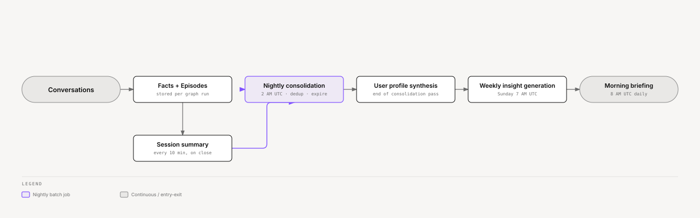

# Ze — Scheduled Jobs & Memory Lifecycle

Ze isn't only reactive. A set of background jobs run on a daily and weekly cadence
to keep memory clean, synthesize a portrait of the user, surface insights, and push
proactive messages — all without the user prompting anything.

This document explains what runs, when, and how each piece feeds into the next.

---

## The memory lifecycle

Every conversation leaves a record. Over time those records build into something
richer:



<sub>[Interactive version](diagrams/docs/scheduled-jobs.html)</sub>

---

## What happens during a conversation

**Facts** (`ze_memory/extractor.py`)

After each `execute_tool` node, `write_memory` fires
(fire-and-forget). Explicit companion writes already landed via `remember_fact`.
The extractor then runs a keep/drop + `speech_act` gate. It writes remaining facts
through `submit_perception_facts` as synthesized, `reviewed = false`. Eval threads
skip extraction. `POST /api/v0/memory/facts/review` exposes review/edit/reject.

**Episodes** (`ze_memory/retriever.py`)

Ze automatically writes a raw record of the conversation turn (prompt + response) as
an episode after every run. Episodes don't require user approval.

**Session summaries** (`ze_memory/session_summary.py`)

`SessionSummariser` runs every 10 minutes. When a session has been inactive for ≥ 30
minutes, Haiku generates a single narrative summary of the full session and writes it
to `memory_session_summaries`. If the user returns and adds more turns before the
session is archived, Ze regenerates the summary on the next tick. Raw episodes stay
until nightly archival removes them — at that point Ze skips the LLM call because
the eager summary already exists.

**Memory injection**

On the _next_ conversation, `fetch_context` retrieves facts (companion pins reviewed
facts always-on, then similarity-ranks the rest), raw episodes (current session only),
and session summaries (closed sessions). `_build_system_prompt` places constitution
and the agent job before that biography. Ze excludes sessions with a summary from the
raw episode query so the agent never sees both fragments and the narrative for the
same session. Ze also injects the user profile.

---

## Nightly consolidation (2 AM UTC)

**Module:** `ze_memory/consolidator.py`  
**Config:** `memory.consolidation.*` in `config/config.yaml` (optional overrides; defaults in `ze_memory/defaults.py`)

Three tasks run in sequence every night:

### 1. Fact deduplication

Near-duplicate facts dilute retrieval precision and waste token budget. The
consolidator scans all unreviewed facts, computes pairwise cosine similarity, and
merges candidates above the configured thresholds:


<sub>[Interactive version](diagrams/docs/dedup-threshold-ladder.html)</sub>

<details>
<summary>Table</summary>

| Similarity | Action |
|---|---|
| > 0.95 (`merge_silent_threshold`) | Silent merge — keep the newer fact, mark the older `contradicted = true`. No LLM call. |
| 0.85–0.95 (`merge_llm_threshold`) | NLI entailment confirms paraphrase → LLM merge (Haiku synthesises one value, marks both `contradicted = true`). NLI contradiction → mark older contradicted. |
| 0.60–0.85 | NLI contradiction ≥ `nli_contradiction_threshold` → mark older `contradicted`. Otherwise skip. |
| < 0.60 | No action — skip NLI. |

</details>

**Reviewed facts are never auto-merged.** A reviewed fact represents an explicit
user decision; touching it automatically would violate that contract.

### 2. Fact expiry

Three rules applied per run:

| Rule | Condition | Action |
|---|---|---|
| Grace delete | `expires_at` is set and has elapsed | Hard-delete |
| Contradicted cleanup | `contradicted = true` and older than `contradicted_ttl_days` (default: 30d) | Hard-delete |
| Stale unreviewed | `reviewed = false` and no activity for `unreviewed_ttl_days` (default: 90d) | Soft-expire: set `expires_at = NOW() + expiry_grace_days` |

Soft-expired facts appear in the morning briefing and in `GET /api/v0/memory/digest` so the
user can save them before the grace period ends. Reviewed facts are **never** expired
automatically.

### 3. Episode archival

Raw episodes accumulate quickly. Episodes older than `episode_recency_days` (default:
14d) are candidates for archival. When a batch of at least `episode_min_archive_batch`
(default: 10) candidates exists, Haiku summarizes them into a single archive row and
Ze deletes the originals. This keeps the episodes table lean without losing history.

### 4. Profile facet synthesis (end of every consolidation pass)

After dedup + expiry + archival, the consolidator calls `synthesise_profile()`. Haiku
reads all reviewed facts and the most recent episodes (up to `profile.episode_limit`,
default: 50) and produces a structured list of `ProfileFacet` objects upserted into
`memory_profile_facets` by key.

Profile facets are key-value pairs with stability (`stable` | `dynamic`) and confidence
scores. The current facets are available at `GET /api/v0/memory/profile`, and Ze injects them
into every agent's system prompt. Agents see the full synthesized portrait, not individual facts.

Profile synthesis is skipped if fewer than `profile.min_facts` (default: 3) reviewed
facts exist.

---

## Dream sleep pass (3 AM UTC)

**Module:** `ze_memory/dream/job.py` (`DreamJob`)  
**Config:** `dream.*` in `config/config.yaml`

When `dream.enabled: true`, the sleep pass runs nightly (default cron `0 3 * * *`):

1. **Replay scoring** — rank recent episodes by salience for future 78b synthesis.
2. **Decay** — lower `retrieval_weight` on stale episodes; archive when below threshold.
3. **Schema/policy candidates** — detect clusters for 78b artifact generation (staged only in 78a).
4. **Retrieval-cache expiry** — delete `memory_retrieval_cache` rows older than 1 day
   (Phase 79 session-cached NLI rerank; see [memory.md](memory.md)).

Ze writes journal entries to `memory_dream_journal` and surfaces them in the morning briefing.
See [dreaming.md](dreaming.md) for the full wake/sleep/dream pipeline.

---

## Weekly insights (Sunday 7 AM UTC)

**Module:** `ze_personal/jobs/insights.py`  
**Config:** `proactive.insights.*` in `config/config.yaml`

Every Sunday Ze looks back over the past 7 days of facts and episodes and generates
1–3 short, conversational observations — things the user might not have consciously
noticed:

> *"I've noticed you've mentioned sleep problems four times this week — anything going on?"*
>
> *"Your last three research sessions all circled back to distributed systems. Looks like that's becoming a recurring thread."*
>
> *"You said you wanted to practice Portuguese more, but I haven't seen that come up in our conversations for a couple of weeks."*

Insight categories: `pattern` | `trend` | `goal` | `tension`.

The same category won't fire again within `category_cooldown_days` (default: 7d) to
avoid repetition. Ze sends each insight as a `discretionary` push (kind `insight`) via
`ProactiveNotifier` (WebSocket or ntfy) before the 8 AM morning briefing, so they feel
like a natural start to the week.

Insight generation is skipped if fewer than `min_evidence` (default: 3) facts +
episodes exist in the lookback window.

---

## Morning briefing (8 AM UTC daily)

**Module:** `ze_personal/jobs/briefing.py`  
**Config:** `proactive.briefing.*` and `news.personalization.*` in `config/config.yaml`

A daily digest, sent as the `accountability` push kind `morning_brief` via `ProactiveNotifier`. No LLM call — it's a templated summary of stats and headlines:

- **Unreviewed facts** — facts Ze proposed that you haven't confirmed or rejected yet.
  If the count is at or above `unreviewed_nudge_threshold` (default: 5), the briefing
  includes a direct nudge to review them.
- **Upcoming workflows** — scheduled workflow runs in the next 24 hours.
- **Recent failures** — any workflow runs that failed in the past 24 hours.
- **Personalized headlines** — when the `ze-news` plugin is enabled, the briefing appends
  a news section. With enough user facts (≥ `news.personalization.min_facts`, default 5),
  Ze ranks articles by cosine similarity against a snapshot of the user's interest
  vector built from stored facts and active goal titles. The section splits into two
  clearly labeled buckets:

  ```
  📰 For you (based on your interests):
    • Article title (source)

  🔭 Outside your usual:
    • Article title (source)
  ```

  Ze ranks the discovery bucket (`explore_ratio`, default 20%) by recency, not by
  interest score, so the user always sees genuinely fresh off-profile content. Below
  the fact threshold, or when personalization is disabled, the section falls back to
  a plain recency-ordered list under `📰 Headlines:`.

The briefing is deduplicated — it will not fire if one was already sent within the past
20 hours.

---

## Calendar sync and reminders (7:45 AM UTC daily)

**Module:** `ze_calendar/jobs/calendar_reminder.py` (`CalendarReminderJob`)  
**Config:** `proactive.calendar.*` in `config/config.yaml`

Each morning `CalendarReminderService` syncs Google Calendar events up to
`sync_days_ahead` (default: 7) days ahead. For each event, Haiku assesses the
appropriate reminder interval (e.g. 15 minutes before a video call vs. 1 hour before
a flight). `WorkflowScheduler` creates one-shot `DateTrigger` jobs accordingly.

When a reminder fires, Ze sends the event title and time as a `requested` push (kind
`calendar_reminder`) via `ProactiveNotifier`. A reminder that came due while the server
was down fires on startup, marked late ("(late, was due HH:MM)"); future reminders are
re-registered as usual.

Calendar sync runs at 7:45 AM — before the 8 AM briefing — so Ze captures upcoming
events with same-day reminders.

---

## Workflow failure alerts (immediate)

**Module:** `ze_automation/workflow/scheduler.py` + `ze_proactive/notifier.py`

When a scheduled workflow step fails, Ze sends an `accountability` push (kind
`workflow_failure`) immediately — no waiting for the morning briefing. A
`workflow_failure_cooldown_hours` (default: 1h) prevents alert spam for
repeatedly-failing workflows.

---

## Goal advance sweep (every 15 minutes)

**Module:** `ze_automation/goals/executor.py` · registered in `ze_api/container.py`  
**Job id:** `goal_advance_sweep` · **Cron:** `*/15 * * * *`

For each goal with status `ACTIVE`, the sweep calls `GoalExecutor.advance(goal_id)`.
The advance loop either:

- Fires a **verification gate** (kind `goal_gate`, `accountability`, with Proceed / Stop /
  Redirect options), setting status to `AWAITING_GATE` until you respond, or
- Runs the next pending **milestone** via the normal agent registry, stores output and
  a learning, and sends a short progress line (kind `goal_milestone_done`,
  `accountability`, e.g. *"✅ Draft target list done (2/8)"*).

The sweep skips goals in `AWAITING_GATE`, `PAUSED`, `PLANNING`, `COMPLETED`, or
`ABANDONED`. It is lightweight — it returns early when there is no actionable next step.

Ze handles gate responses conversationally, not on the cron tick: approving
or redirecting calls `advance` again from the conversation handler.

See [docs/goals.md](goals.md) for the full goal engine documentation.

---

## Held write expiry (hourly)

**Module:** `ze_automation/jobs/held_write_expiry.py` · registered in `ze_automation/bootstrap.py`
**Job id:** `held_write_expiry` · **Cron:** `0 * * * *` (set `proactive.held_write_expiry.cron` to change it)

A held write is an irreversible call from an unattended run that nobody approved in advance.
Ze pushes a `write_approval_held` notification when it holds the call. The hold stays open
for 24 hours. This job finds holds past that time and resumes each one as a timeout. A timeout
counts as a deny: the call does not run, the step gets a declined result, and the run continues.

Set `proactive.held_write_expiry.enabled: false` to turn the job off. Holds then stay open
until someone answers them. The hold itself is described in
[workflows.md](workflows.md#irreversible-steps-in-unattended-runs).

---

## Weekly goal narrative (Sunday 6 PM UTC)

**Module:** `ze_automation/jobs/goal_narrative.py`  
**Cron:** `0 18 * * 0` (configurable via `proactive.goal_narrative.cron`)

For each active goal, Ze synthesizes a one-paragraph weekly update: what was completed this week, any pending gate, and what comes next. Ze sends it as an `accountability` push (kind `goal_narrative`). Skips goals that had no activity in the past 7 days.

---

## Weekly goal suggestions (Sunday 7 PM UTC)

**Module:** `ze_automation/jobs/goal_suggestion.py`  
**Cron:** `0 19 * * 0` (configurable via `proactive.goal_suggestion.cron`)

Analyzes recent memory facts, episodes, and past goal retrospectives to propose one new multi-week goal. Ze sends it as a `discretionary` push (kind `goal_suggestion`) with **Accept** / **Dismiss** options. Accepted suggestions open a goal creation flow. Suppressed if there are already 3+ active goals or if the last suggestion was dismissed within 7 days.

---

## Stuck goal detection (Tuesday 9 AM UTC)

**Module:** `ze_automation/jobs/stuck_goals.py`  
**Cron:** `0 9 * * 2` (configurable via `proactive.stuck_goals.cron`)

Checks all active goals for inactivity. The window is fixed in code at 7 days:

- **Milestone stuck**: an `ACTIVE` goal with no milestone progress for 7 days.
- **Gate stuck**: a goal in `AWAITING_GATE` that has waited 7 days at a gate. Ze
  counts the first open gate that has fired and ignores gates it has not reached, so
  each goal appears once.

Ze sends one `discretionary` push per run (kind `stuck_goal`) that lists every blocked goal (one row per goal, from its first fired open gate), with **Resume** / **Abandon** / **Redirect** options. `last_stuck_alert_at` on each goal prevents duplicate alerts within the same window, and Ze marks a goal alerted only when the push was delivered or held.

---

## Weekly accountability narrative (Monday 9 AM UTC)

**Module:** `ze_automation/jobs/accountability.py` (`AccountabilityJob`)  
**Cron:** `0 9 * * 1` (configurable via `proactive.accountability.schedule`)

A weekly plain-text summary of everything Ze did while you weren't watching:

```
Ze activity report (last 7 days)

💸 Cost: $0.42 across 38 runs
   • research: 19 runs, $0.1800
   • email: 12 runs, $0.1400
   • prospecting: 7 runs, $0.1000

🎯 Goals
   • Advanced: "Send 10 outreach emails"
   • Stalled: "Write technical blog post"

⚙️  Workflows: no failures

⚠️  Anomalies
   • prospecting spent $0.3100 on one run (5.0× baseline) on 2026-06-09
```

Data sourced from:

| Source | What it captures |
|---|---|
| `llm_cost_log` | Per-agent run counts, token totals, and costs |
| `goal_milestones` | Milestones completed this week; pending milestones idle > `stall_days` (default: 3) |
| `push_log` | Workflow failures in the period |
| `accountability_anomalies` | Cost outliers flagged by `CostAnomalyJob` |

Ze sends the narrative as an `accountability` push (kind `accountability_narrative`). The job is deduplicated with a 6-day window under key `weekly_accountability` — safe to retry without double-sending. No LLM call; the narrative is purely templated.

The same data is available on-demand via the `/status` WebSocket command (see [native-interface.md](native-interface.md)).

---

## Cost anomaly detection (every 6 hours)

**Module:** `ze_automation/jobs/cost_anomaly.py` (`CostAnomalyJob`)  
**Cron:** `0 */6 * * *` (configurable via `proactive.accountability.cost_anomaly_schedule`)

Silently scans recent LLM runs and alerts if any single run cost significantly more than that agent's historical baseline:

- **Baseline**: median cost-per-run over the past 30 days. Uses median (not mean) to resist distortion from the very anomalies this check aims to detect.
- **Minimum samples**: the job requires at least `anomaly_min_samples` (default: 5) historical runs before an agent can have a baseline. It silently skips new agents.
- **Threshold**: `anomaly_threshold` × baseline (default: 4.0×). A run at 4.01× fires an alert; one at 3.99× does not.
- **Deduplication**: the job skips session IDs already logged in `accountability_anomalies` within the past 24 hours, so a single run never fires twice.

Ze sends the alert as an `accountability` push (kind `cost_anomaly`, urgency `high`), so it is never budgeted, but the governor holds it during quiet hours.

Alert format (ntfy, urgency `high`):

```
⚠️ Ze cost anomaly detected

The prospecting agent spent $0.31 on one run — 5.0× its usual $0.06.
Date: 2026-06-09
```

Ze writes anomaly records to the `accountability_anomalies` table and prunes them automatically after `anomaly_retention_days` (default: 30 days).

The threshold is a conservative first guess — calibrate after 30 days of live data.

---

## Checkpoint pruning (hourly)

**Module:** `ze_core/orchestration/checkpoint_pruner.py` (`CheckpointPruner`) · registered in `ze_core/bootstrap.py`  
**Job id:** `checkpoint_pruning` · **Cron:** `0 * * * *`

LangGraph's `AsyncPostgresSaver` writes a full checkpoint on every node transition and
never prunes old ones on its own — resume/replay only ever reads the latest checkpoint
per thread, so history beyond a small safety margin is pure storage growth. For each
`(thread_id, checkpoint_ns)`, keeps the most recent `keep_per_thread` checkpoints
(default 3) and deletes older rows from `checkpoints` + their `checkpoint_writes`, plus
any `checkpoint_blobs` no longer referenced by a kept checkpoint's `channel_versions`.

This only reclaims *logical* rows — Postgres `VACUUM` (run automatically by autovacuum)
adds the freed pages to the free-space map for reuse but doesn't shrink the file on
disk. The `pg_total_relation_size` figure shown on the Data Overview page (`graph.checkpoints`
domain) will plateau rather than keep climbing once this job is running continuously,
but a one-time backlog won't visibly shrink there without a manual `VACUUM FULL` /
`pg_repack` (not scheduled — it takes an exclusive table lock).

---

## Cost reconciliation (every 15 minutes)

**Module:** `ze_core/telemetry/reconciler.py` (`CostReconciler`) · registered in `ze_api/container.py`  
**Job id:** `cost_reconciliation` · **Cron:** `*/15 * * * *`

Pulls actual billed costs from the OpenRouter API and reconciles them against
estimated records in `llm_cost_log`. Runs frequently to keep cost data fresh.

---

## Stale campaign recovery (every 15 minutes)

**Module:** `ze_prospecting/jobs/campaigns.py` (`recover_stale_campaigns`) · registered via `ProspectingPlugin.register_proactive_jobs()`  
**Job id:** `recover_stale_campaigns` · **Cron:** `*/15 * * * *`

Marks prospecting campaigns that have been running longer than
`PROSPECTING_STALE_TIMEOUT_MINUTES` (default: 10 min) as failed, preventing stuck
campaigns from blocking new runs.

---

## News fetch (every 30 minutes)

**Module:** `ze_news/jobs/fetch.py`  
**Config:** `news.fetch_schedule` in `config/config.yaml`

When the `ze-news` plugin is loaded, a fetch job runs on a configurable cron (default
`*/30 * * * *`). For each enabled source in `news.sources`, it fetches the RSS feed,
embeds each new article title + summary using the shared
`intfloat/multilingual-e5-base` model, and upserts into the `news_articles`
table. It skips duplicate URLs and prunes old articles after `news.retention_days`
(default: 7 days).

Each source is tagged at configuration time (e.g. `global`, `local`, `tech`, `pt`). The
`get_headlines` tool and the morning briefing use these tags for filtering.

---

## Open-loop upkeep (4 AM and 5 AM UTC)

**Modules:** `ze_worldstate/jobs/stale_suspicion.py`, `ze_worldstate/jobs/drift_sweep.py`
**Config:** `worldstate.stale_suspicion.*` and `worldstate.drift.*` in `config/config.yaml`

`StaleSuspicionJob` (default `0 4 * * *`) expires `suspected` loops that no new
evidence has confirmed within the window. `DriftSweepJob` (default `0 5 * * *`) moves
`active` loops to `drifting` when their drift deadline passes. New evidence on an
`active` loop pushes the deadline to at least 7 days from now; the drift window is a
code constant, not config. A loop that the user revives with `track_loop` gets a fresh window. See
[cognitive-architecture.md](cognitive-architecture.md).

---

## Hypothesis decay (3 AM UTC)

**Module:** `ze_correlation/jobs/hypothesis_decay.py` (`HypothesisDecayJob`)

The job lowers the confidence of correlation hypotheses that have gone without new
evidence. Set `correlation.hypothesis_decay.schedule` to change the default
`0 3 * * *`.

---

## Attention arbitration (every 4 hours)

**Module:** `ze_priority/arbitration.py` (`AttentionArbitrationJob`)
**Config:** `proactive.attention_arbitration.*`, `worldstate.push.*`, `correlation.push.*`

One job replaces the old per-source push sweeps. It collects the push-eligible open
loops and hypotheses, ranks them with `PriorityView`, and sends them through the
interruption governor in rank order. It sends as many as the shared budget allows and
stops at the first push the governor suppresses. Loop pushes honor `worldstate.push.enabled`; hypothesis pushes require `correlation.push.enabled: true` and `correlation.push.dry_run: false`. Loops (kind `loop_drift`) and
hypotheses (kind `hypothesis`) are both `discretionary`. The job no longer claims or
releases the budget itself; the governor does. See [cognitive-architecture.md](cognitive-architecture.md).

---

## Interruption governor

Every proactive push declares a `PushKind`: an event type plus a class, an urgency, and a source. One rule set in `ze_proactive/governor.py` decides what happens to each push.

| Class | Budgeted? | Quiet hours? |
|---|---|---|
| `requested` | No | Always delivered |
| `accountability` | No | Held |
| `discretionary` | Yes | Held |

Kinds by class:

| Class | Kinds |
|---|---|
| `requested` | `user_reminder`, `calendar_reminder`, `write_approval_held` |
| `accountability` | `confirmation_request`, `confirmation_timeout`, `workspace_run_completed`, `workflow_failure`, `goal_plan_proposed`, `goal_attention_needed`, `goal_plan_adapted`, `goal_milestone_done`, `goal_completed`, `goal_gate`, `cost_anomaly`, `accountability_narrative`, `goal_narrative`, `morning_brief`, `calendar_reminders_scheduled`, `quiet_hours_summary` |
| `discretionary` | `loop_drift`, `hypothesis`, `stuck_goal`, `goal_suggestion`, `goal_overlap`, `goal_reuse`, `dream_review`, `insight`, `contact_review`, `finance_stale_nudge`, `finance_recurring_new`, `finance_price_change`, `inbound_message` |

`proactive.budget.max_pushes_per_day` (default 5) is one shared budget for every discretionary push. Accountability and requested pushes never claim it. A discretionary push must carry a budget key; a repeat of the same key is a `duplicate` and goes no further.

### Quiet hours and release

Quiet hours hold accountability and discretionary pushes. Ze records a held push in the bell with delivery `held`, sends no chat message and no ntfy, and releases it when quiet hours end. A requested push always buzzes, even during quiet hours. The budget check runs before the quiet hold. A discretionary push with no budget left is suppressed even during quiet hours, so the daily cap holds.

The user sets quiet hours in Settings › Notifications. The window is stored in the `interruption_settings` table and evaluated in its own IANA zone. Quiet hours ship off. When the window ends, `QuietHoursReleaseJob` (`job_id = "quiet_hours_release"`, cron `proactive.notifications.release_cron`, default `*/5 * * * *`) delivers each held push in urgency order without a buzz, then sends one `quiet_hours_summary` push that buzzes once. A run with no held pushes does nothing.

### Catch-up for missed runs

Ze runs on a laptop, so a scheduled time can pass while the host is asleep. `ProactiveScheduler` records each run in `proactive_job_runs`. On startup, it runs a catch-up job once when the scheduled time passed since the last recorded run, within the job's `catch_up_max_age_hours`. The morning briefing sets this from `proactive.briefing.catch_up_max_age_hours` (default 6). A job with no recorded run does not run at startup. APScheduler `misfire_grace_time=None` with `coalesce=True` covers a process that was suspended over a fire time. The `quiet_hours_release` job does not catch up.

---

## Skill source recheck (6 AM UTC)

**Module:** `ze_skills/jobs/recheck.py`  
**Config:** `skills.recheck` in `config/config.yaml`

`SkillRecheckJob` re-fetches every imported skill's origin URL. Unchanged content
stays active. Changed content reverts to pending review and clears executable
approval. An unreachable source sets `last_check_error` and leaves the last
approved version in place.

See [skills.md](skills.md#daily-recheck).

---

## Full schedule at a glance

The pipeline diagram at the top of this document shows how conversations flow into
the morning briefing; the board below shows every scheduled job, grouped by cadence
tier instead of literal clock position.


<sub>[Interactive version](diagrams/docs/job-cadence-board.html)</sub>

<details>
<summary>Table</summary>

| Time (UTC) | Job | Module |
|---|---|---|
| 2:00 AM daily | Memory consolidation + profile synthesis | `ze_memory/consolidator.py` |
| 3:00 AM daily | Dream sleep pass + retrieval-cache expiry | `ze_memory/dream/job.py` |
| 3:00 AM daily | Hypothesis confidence decay | `ze_correlation/jobs/hypothesis_decay.py` |
| 4:00 AM daily | Stale open-loop suspicion expiry | `ze_worldstate/jobs/stale_suspicion.py` |
| 5:00 AM daily | Open-loop drift sweep | `ze_worldstate/jobs/drift_sweep.py` |
| 3:00 AM daily | Contacts consolidation (dedup + merge) | `ze_personal/contacts/consolidator.py` |
| 6:00 AM daily | Imported skill source-content recheck | `ze_skills/jobs/recheck.py` |
| Every 10 min | Session summary generation | `ze_memory/session_summary.py` |
| 7:00 AM Sun | Weekly insight generation | `ze_personal/jobs/insights.py` |
| 7:45 AM daily | Calendar sync + reminder scheduling | `ze_calendar/jobs/calendar_reminder.py` |
| 8:00 AM daily | Morning briefing (with personalized headlines) | `ze_personal/jobs/briefing.py` |
| 8:30 AM daily | Contact review suggestions | `ze_personal/jobs/contacts.py` |
| 6:00 PM Sun | Weekly goal narrative | `ze_automation/jobs/goal_narrative.py` |
| 7:00 PM Sun | Weekly goal suggestions | `ze_automation/jobs/goal_suggestion.py` |
| 9:00 AM Mon | **Weekly accountability narrative** | `ze_automation/jobs/accountability.py` |
| 9:00 AM Tue | Stuck goal detection | `ze_automation/jobs/stuck_goals.py` |
| Every 4 hours | Attention arbitration — ranked discretionary pushes through the governor | `ze_priority/arbitration.py` |
| Every 5 min | Quiet-hours release sweep | `ze_proactive/jobs/release_held.py` |
| Every 6 hours | **Cost anomaly detection** | `ze_automation/jobs/cost_anomaly.py` |
| Every 15 min | Goal advance sweep | `ze_automation/goals/executor.py` |
| Hourly | Held write expiry | `ze_automation/jobs/held_write_expiry.py` |
| Hourly | Checkpoint pruning | `ze_core/orchestration/checkpoint_pruner.py` |
| Every 15 min | Cost reconciliation | `ze_core/telemetry/reconciler.py` |
| Every 15 min | Stale campaign recovery | `ze_prospecting/jobs/campaigns.py` |
| Every 30 min | News article fetch + embed | `ze_news/jobs/fetch.py` |
| Immediate | Workflow failure alerts | `ze_proactive/notifier.py` |
| Immediate | Calendar event reminders (when they fire) | `ze_calendar/jobs/calendar_reminder.py` |
| Immediate | Goal verification gates + milestone progress | `ze_proactive/notifier.py` |

</details>

All scheduled jobs use APScheduler (via `WorkflowScheduler` or `ProactiveScheduler`).
Cron expressions are configurable in `config/config.yaml`. Jobs registered with
`ProactiveScheduler` catch up once after downtime (see
[Interruption governor](#interruption-governor)).

---

## Inspecting memory

| Endpoint | Description |
|---|---|
| `GET /api/v0/memory/facts` | All stored facts (with review status, expiry) |
| `GET /api/v0/memory/digest` | Unreviewed facts + upcoming expiries |
| `GET /api/v0/memory/profile` | Current user profile (latest synthesis) |
| `POST /api/v0/memory/consolidate` | Trigger a consolidation run manually |
| `POST /api/v0/memory/facts/review` | Confirm, reject, or edit a proposed fact |

---

## Adjusting the schedule

All cron expressions and thresholds live in `config/config.yaml` under `memory.consolidation`,
`memory.profile`, `memory.insights`, and `proactive`. See
[docs/configuration.md](configuration.md) for the full reference.

To trigger a consolidation manually (e.g. after bulk-approving many facts):

```bash
curl -X POST https://ze-backend.fly.dev/api/v0/memory/consolidate \
  -H "Authorization: Bearer $ZE_API_KEY"
```
