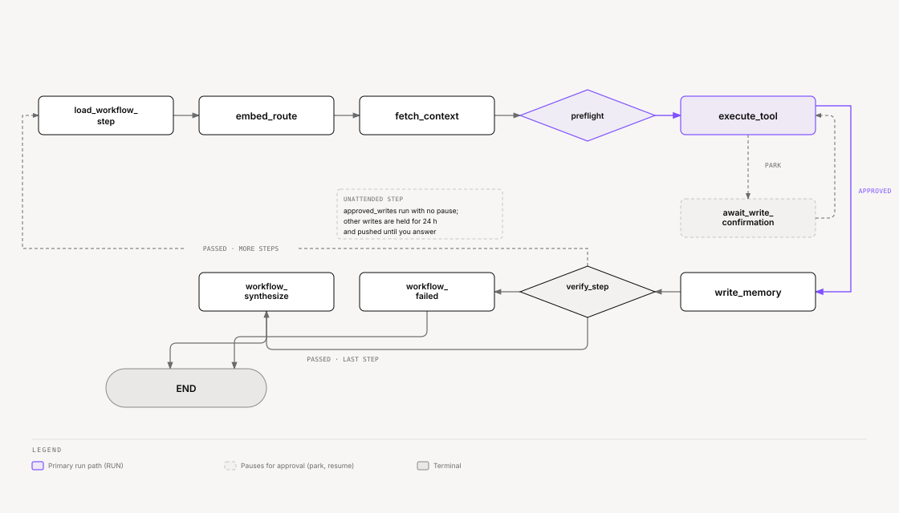

# Ze — Workflows

Workflows let Ze execute multi-step tasks automatically, either on a recurring
schedule or on demand. Each step is a natural-language instruction routed through
the normal orchestration graph — agents remain peers, none orchestrates another.

---

## Two ways to run

| Mode | Description |
|---|---|
| **Scheduled** | A named workflow with a cron expression. APScheduler fires it automatically. Ze keeps the run summary on the execution record and alerts you if the run fails. |
| **On-demand** | A stored workflow you trigger: *"run my daily brief"* or *"trigger the research digest"*. You can also trigger it through the REST API. |

Both modes share one execution path: a dedicated workflow LangGraph, compiled separately from the main conversation graph.

Ze no longer builds throwaway "dynamic plans". A request with several dependent steps goes to companion, which calls specialists in order (see [architecture.md](architecture.md)). To keep that work, ask Ze to turn it into a workflow or a goal.

---

## Creating a workflow (conversational)

Just describe what you want in the chat. Ze's `WorkflowManagerAgent` handles
the lifecycle:

> *"Every Monday at 8 AM, search for the top AI news from the past week and email me a summary."*

Ze will:

1. Parse the description into an ordered list of steps.
2. Extract a cron expression from the schedule phrase.
3. Ask you to confirm the plan (`manage` intent actions use `confirm` mode by default).
4. Store the workflow and schedule it.

You can also manage workflows conversationally:

| What to say | Action |
|---|---|
| *"Show me my workflows"* | List all stored workflows |
| *"Disable the Monday briefing"* | Pause a scheduled workflow |
| *"Delete the research digest"* | Remove a workflow permanently |
| *"Run the weekly summary now"* | Trigger on-demand, outside schedule |
| *"Cancel the running digest"* | Cancel an in-flight run (`cancel_workflow_run`) |
| *"Change step 2 of the digest to ..."* | Edit steps (`edit_workflow_steps`); Ze records a revision |

---

## How execution works

### Step execution loop

For a workflow with N steps, the graph runs through the following loop for each step:



<sub>[Interactive version](diagrams/docs/workflow-graph.html)</sub>

`load_workflow_step` resets per-step state and sets `prompt` to the step's task.
The graph then routes normally — `embed_route` picks the right agent, memory is
injected, and capability is enforced — exactly as if the user had typed the task.

### Branching

A step can declare `branches` (a list of `condition` → target pairs) and a `default_next`. Targets are step ids or the terminals `END` and `FAIL`. After a step passes verification, `route_branch` asks the verify-class model which condition the output matches. If none match, Ze follows `default_next`, then the next step in list order. A step that runs more than four times in one execution (the first run plus three revisits) fails the run with a loop-limit error. Workflows with no branches run in list order.

### Step verification

Each step can optionally declare a `verify` criterion — a natural-language description
of what a successful output looks like:

```json
{
  "task": "Search for the top 5 AI developments this week",
  "agent_hint": "research",
  "verify": "Output contains at least 3 distinct AI developments with dates"
}
```

Verification runs three checks in order:

1. **Tool success** — any tool call that returned `success=False` fails the step immediately.
2. **Non-empty output** — an empty agent result fails the step.
3. **Criteria check** — if `verify` is set, Haiku evaluates the output against the
   criteria string. Ze logs a Haiku failure (e.g. timeout) as a warning but does
   not fail the step — the check is non-blocking.

### Retries and failure policy

If a step fails with a transient error (timeout, rate limit, or HTTP 429/502/503/504), Ze waits 2 seconds and retries it, up to three attempts. `StepResult.attempt_count` records the count.

For any other failure, the step's `on_failure` policy decides what happens:

| Policy | Effect |
|---|---|
| `fail` (default) | End the run as failed. |
| `continue` | Record the failure and move to the next step. |
| `skip_to:<step_id>` | Record the failure and jump to that step. |

### Synthesis

After the last step, `workflow_synthesize` calls the verify-class model to merge the successful step outputs into a short summary. It lists any failed steps that did not stop the run. Ze stores the summary on the `workflow_executions` row. If no step succeeded, the run takes the failure path instead.

### Failure handling

When a run ends as failed, `workflow_failed` records the error and, if any steps succeeded, writes a partial summary of their output. The scheduler's failure handler then sends a `workflow_failure` notification through `ProactiveNotifier` (WebSocket or ntfy). The alert honors `proactive.alerts.workflow_failure_enabled` and `workflow_failure_cooldown_hours`.

### Cancellation

You can cancel a running execution from the chat or the run page. The run ends with status `cancelled` and a summary of the steps that finished.

---

## Data model

```
workflows
  id           UUID
  name         TEXT  (unique)
  description  TEXT
  steps        JSONB (list of WorkflowStep: task, agent_hint, verify, intent,
                      id, branches, default_next, on_failure)
  schedule     TEXT  (cron expression, NULL = on-demand only)
  enabled      BOOL
  last_run_at  TIMESTAMPTZ
  next_run_at  TIMESTAMPTZ

workflow_executions
  id              UUID
  workflow_id     UUID → workflows (nullable)
  status          pending | running | completed | failed | cancelled
  step_results    JSONB (list of StepResult, incl. branch_taken, attempt_count)
  steps_snapshot  JSONB (the steps as they were when the run started)
  summary         TEXT
  error           TEXT
  started_at      TIMESTAMPTZ
  completed_at    TIMESTAMPTZ

workflow_revisions   (append-only)
  workflow_id, revision_number, change_type,
  steps_before, steps_after, summary, actor (agent | api | system), created_at
```

Every create and step edit, from the agent or the REST API, appends a revision with a short diff summary and the actor. For agent edits, the actor carries the session and message id, so the UI can link to the conversation.

---

## Scheduling details

`WorkflowScheduler` wraps APScheduler with a Postgres job store. On startup it
loads all `enabled = true`, `schedule IS NOT NULL` workflows and registers
`CronTrigger` jobs. APScheduler itself holds no persistent state — the Postgres
records are the source of truth. On restart, `WorkflowScheduler` re-registers
all active jobs from the database.

Adding, disabling, or deleting a workflow updates both the `workflows` table and
the live APScheduler job registry atomically.

`WorkflowScheduler` computes `next_run_at` from the cron expression after each run
and writes it to Postgres.

---

## REST API

All routes live under `/api/v0/workflows`.

| Endpoint | Description |
|---|---|
| `GET /` | List all workflows |
| `GET /{id}` | Get a workflow with its steps |
| `PATCH /{id}/steps` | Replace the step list (schedule and history stay) |
| `GET /{id}/revisions` | Change history |
| `POST /{id}/trigger` | Run a workflow immediately |
| `GET /{id}/executions` | Execution history |
| `GET /{id}/executions/{execution_id}` | One execution with step results |
| `POST /{id}/executions/{execution_id}/cancel` | Cancel a running execution |

All endpoints require `Authorization: Bearer $ZE_API_KEY`. To create, enable, disable, or delete a workflow, talk to Ze; the REST API does not expose those actions.

The web app renders each run as a top-to-bottom flowchart. Steps are nodes, `branches` and `default_next` are labeled edges, and the executed path is highlighted. The workflow page also shows the change history.

---

## Caveats

- Steps execute one at a time — no parallelism within a workflow. Branches can loop back, within the four-visit limit.
- Workflows cannot call each other.
- External webhook triggers are not supported — scheduling and on-demand are the
  only entry points.
- Ze does not notify you of step-by-step progress for scheduled runs. You get a failure alert, and you can read the summary on the run page.
