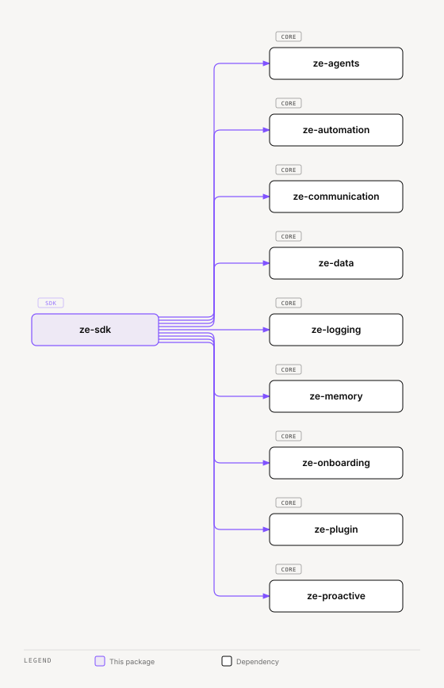

# ze-sdk

Public SDK surface for Ze plugin development. Flat re-export layer — plugin packages depend on this instead of importing `ze-core`, `ze-plugin`, or `ze-agents` directly.

## Role in Ze

`ze-sdk` is the only supported import path for plugin authors. It flattens the developer-facing API from `ze-agents`, `ze-automation`, `ze-collision`, `ze-communication`, `ze-correlation`, `ze-data`, `ze-logging`, `ze-memory`, `ze-onboarding`, `ze-plugin`, and `ze-proactive` into a single stable surface, so plugins never depend on engine internals directly.

### Key features

- Single import for agent authoring: `@agent`, `@tool`, `BaseAgent`, `get_logger`
- Write confirmation: `ToolReversibility`, `asks_first`, `no_ask_reason`, `ask_check`
- Plugin framework re-exports: `ZePlugin`, `DataDomain`, channel types
- Proactive job types and push kinds: `ProactiveScheduler`, `ProactiveJob`, `@proactive_job`, `PushKind`, `PushOutcome`
- Memory, signal, and onboarding types for plugin hook implementations (`Signal`, `SignalSource`)

### Integration

Every plugin's `pyproject.toml` lists `ze-sdk`. A plugin may also depend on other plugins or core packages, but it never depends on `ze-core`. The SDK has no runtime wiring of its own — it is a compile-time boundary that keeps the dependency graph one-directional: `plugins → ze-sdk → core packages`, never `plugins → ze-core`.

## Responsibilities

| Module | What it provides |
|---|---|
| `__init__.py` | `ZePlugin`, `DataDomain`, `@agent`, `@tool`, `BaseAgent`, `Settings`, `DBPool`, `get_logger` |
| `types.py` | Shared SDK types, including the lifetime markers (`Turn`, `Input`, `Thread`, `Run`) that declare each `state_extensions()` field's lifetime |
| `undo_payload` | In `__init__.py`. Builds the undo data that a `REVERSIBLE` tool returns under the `undo` key |
| `errors.py` | Plugin-facing error re-exports |
| `proactive.py` | `ProactiveJob`, `ProactiveScheduler`, `ProactiveNotifier`, `PushKind`, `PushOutcome`, `PushLogStore` |
| `contribution.py` | Contribution seam types, including `FeedbackKind`, `FeedbackRecord`, `FeedbackStore`, and `submit_feedback_record` |
| `memory.py` | Memory types, `PostgresMemoryStore`, `SignalSource` re-export, `FactRestoreConflictError` |
| `channels.py` | Channel ABC and registry re-exports |
| `onboarding.py` | Onboarding provider types |
| `automation.py` | Goal and workflow types, stores and planner contracts from `ze-automation` |
| `correlation.py` | `Hypothesis`, `HypothesisStore` and the Postgres store from `ze-correlation` |
| `screen.py` | Screen-context contract: `ScreenResolver`, `ScreenRef`, `ScreenLine`, `sanitize_text` |
| `ui.py` | `UiContribution`, `ModuleSubject`, `ModuleResult` and the module helpers |
| `api.py` | `require_api_key` for plugin REST routes |

## Dependencies



<sub>[Interactive version](../../docs/diagrams/packages/ze-sdk/dependencies.html)</sub>

## Usage

All plugin code should import from `ze_sdk`:

```python
from ze_sdk import ZePlugin, agent, tool, BaseAgent, get_logger
from ze_sdk.proactive import ProactiveScheduler, proactive_job, PushKind
from ze_sdk.memory import PostgresMemoryStore, Signal, SignalSource
from ze_sdk.channels import Channel
```

Never import `ze_core.*` or `ze_plugin.*` from plugin packages.

## Testing

From the repo root:

```bash
make test-sdk
```

See [docs/testing.md](../../docs/testing.md).
