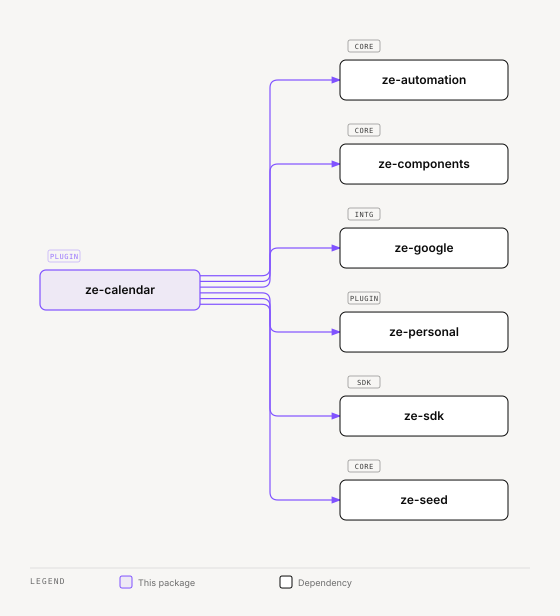

# ze-calendar

Calendar, reminders, and timezone domain for Ze. Provides the `CalendarAgent`, `RemindersAgent`, and all supporting infrastructure for Google Calendar integration and proactive reminder delivery.

## Role in Ze

Calendar is one of the most-used agent domains. Users ask about upcoming events, create reminders in natural language, and receive proactive nudges when reminders fire. Calendar events also feed contact extraction and correlation signal sources.

### Key features

- `CalendarAgent` — query and manage Google Calendar events
- `RemindersAgent` — natural-language time parsing, one-off and recurring reminders
- `CalendarReminderJob` — proactive delivery of due reminders via push or WebSocket
- `world_time` tool — timezone lookups for scheduling across regions
- Calendar signal source for the correlation engine
- `GET /api/v0/reminders` (`listReminders`) — the reminders World draws as deadlines. The plugin has no UI page of its own.

### Integration

Entry point `ze_calendar`. Depends on `ze-google` for Calendar API access and `ze-personal` for contact linking. Contributes two agents, the reminder job, REST store for reminders, data domains (export, import, delete) for the reminder tables, seed domains, and `CalendarSignalSource`.

```python
from ze_calendar.plugin import CalendarPlugin
```

`screen_resolvers.py` registers the `reminder` screen resolver.

## Responsibilities

| Module | What it provides |
|---|---|
| `agents/` | `CalendarAgent`, `RemindersAgent`, tools |
| `reminders/` | `ReminderStore`, `CalendarReminderService`, `CalendarReminderStore` |
| `jobs/` | `CalendarReminderJob` — fires reminders via `ProactiveScheduler` |
| `timezone/` | `TimezoneService`, `world_time` `@tool` |
| `api/` | `GET /api/v0/reminders` route and schemas |
| `signals.py` | `CalendarSignalSource` |
| `push_kinds.py` | `PushKind`s for user and calendar reminders |
| `action_records.py` | Action records for reminder and calendar writes |
| `screen_resolvers.py` | The `reminder` screen resolver |
| `seed.py` | Dev seed domain (`calendar.dev`) |
| `migrations/` | `zcal001` — `calendar_reminders`, `user_reminders` |
| `plugin.py` | `CalendarPlugin(ZePlugin)` — registers agents and jobs |

Every `WRITE` tool in this package declares `reversibility` and an `effect_phrase`. Retry reads these declarations to decide if a reply can be regenerated.

## Dependencies



<sub>[Interactive version](../../docs/diagrams/plugins/ze-calendar/dependencies.html)</sub>

## Reminders REST (phase 185)

`GET /api/v0/reminders` (`listReminders`) lists `{id, label, fire_at, sent_at, status}` with `status` one of `upcoming`, `overdue` (unsent, time passed) or `fired`. Filter by `status` (`upcoming`, `overdue`, `fired`, `all`) and `limit`. The route is absent when the plugin is disabled, and returns 503 when the reminder store is not available. A client joins a reminder to its loop through the loop's `reminder_id`.

## Testing

From the repo root:

```bash
make test-calendar
```

See [docs/testing.md](../../docs/testing.md).
