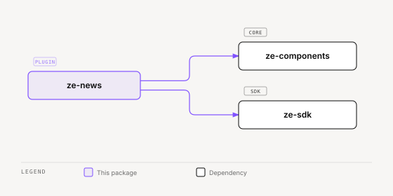

# ze-news

News fetching and personalised headlines for Ze. Fetches articles from curated RSS sources on a schedule, ranks them by the user's interest profile, and exposes them via the `NewsAgent`.

## Role in Ze

Ze keeps the user informed without them having to check feeds manually. RSS sources are fetched on a schedule, ranked by the user's memory profile and interest signals, and surfaced through the `NewsAgent`, the "What's new in my sources?" chip in Ask, and a Sources module on topic entities in Mind.

### Key features

- Curated RSS ingestion with configurable sources and fetch schedule
- pgvector-ranked personalisation against the user's memory profile
- Source credibility scoring (optional LLM-assisted; optional local NLI headline check)
- Semantic story dedup (optional NLI + embedding clustering on fetch)
- `NewsAgent` — headline queries and article search
- News signal source for the correlation engine

### Integration

Entry point `ze_news`. Contributes `NewsAgent`, `NewsFetchJob`, `NewsOnboardingProvider` (topics to follow, topics to avoid, and source languages, stored as profile facets), `NewsSignalSource`, three UI contributions (the Ask preset, the Mind `Sources` module, and a settings section), and the `GET /api/v0/news/settings` route. The plugin turns itself off when `news.enabled` is false or `news.sources` is empty. Article ranking uses the shared embedder.

```python
from ze_news.plugin import NewsPlugin
```

`screen_resolvers.py` registers the `news_article` screen resolver. A ref id is `article_ref_id(url)` (`refs.py`), the hex md5 of the URL, and the store looks it up with `NewsStore.get_by_ref`. Nothing in the web app emits `news_article` refs yet.

## Responsibilities

| Module | What it provides |
|---|---|
| `agents/` | `NewsAgent` — answers news queries using `get_headlines`, `search_news`, and `refresh_news` tools |
| `sources/` | RSS source definitions and fetcher |
| `jobs/` | `NewsFetchJob` — periodic RSS fetch, stored and ranked |
| `store.py` | `NewsStore` — Postgres-backed article storage with pgvector ranking |
| `registry.py` | `SourceRegistry` — manages active RSS sources |
| `credibility.py` | Source credibility scoring (heuristics, optional NLI, optional LLM) |
| `preferences.py` | `NewsPreferenceBuilder` — builds include and exclude preferences from memory facts and the profile |
| `onboarding.py` | `NewsOnboardingProvider` — one "Tune your news" step |
| `signals.py` | `NewsSignalSource` |
| `api/` | `GET /api/v0/news/settings` (`getNewsSettings`) |
| `ui/settings.py` | Builds the settings section tree |
| `locales/` | `en.yaml`, `pt.yaml` progress messages |
| `plugin.py` | `NewsPlugin(ZePlugin)` — registers `NewsAgent` and `NewsFetchJob` |
| `types.py` | Domain types |

Every `WRITE` tool in this package declares `reversibility` and an `effect_phrase`. Retry reads these declarations to decide if a reply can be regenerated.

## Dependencies



<sub>[Interactive version](../../docs/diagrams/plugins/ze-news/dependencies.html)</sub>

## Testing

From the repo root:

```bash
make test-news
```

See [docs/testing.md](../../docs/testing.md).
