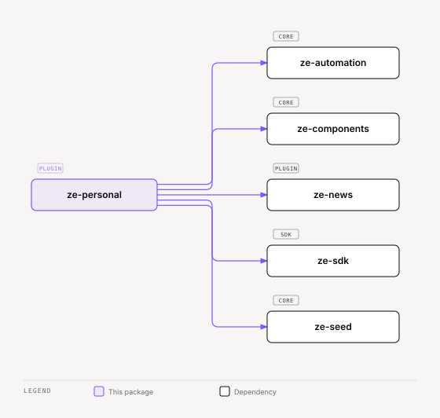

# ze-personal

Personal-assistant domain layer for Ze. Implements the user-facing features that make Ze feel like an assistant: persona, contacts, social cognition, and the research and companion agents. Contributes to the Ze graph via `ZePlugin`.

## Role in Ze

`ze-personal` is the heart of what makes Ze a personal assistant rather than a generic chatbot. It owns the user's persona and dials, contact tracking, the research and companion agents that handle most conversational turns, and the morning briefing and weekly insights jobs. Goals and workflows live in `ze-automation`. This plugin takes their stores and planners as constructor arguments, and it hosts the workflow execution graph nodes.

### Key features

- **Workflow execution** — the LangGraph nodes that run a stored workflow step by step (`graph/workflow.py`). The workflow stores, planner, and scheduler live in `ze-automation`
- **Persona** — named profiles with TARS-style numeric dials that shape agent tone and behaviour
- **Contacts** — person tracking with extraction from email, calendar, and conversation. A contact source's provenance follows its source type: `manual`, `conversation`, `email` and `calendar` are `prompt_supplied`, and `research` (prospecting) is `live_search`. A new contact takes the provenance of its first source. Migration `zc041` re-stamped existing contacts and sources. The web app shows them in Mind › People; the plugin has no nav entry of its own
- **Social cognition** — co-occurrence of people and projects in memory becomes correlation hypotheses, which Ze promotes to `WORKS_ON` and `COLLABORATES_WITH` edges on corroboration or when you confirm. The `who_is_on_project` and `confirm_project_membership` tools expose them
- **Proactive jobs** — morning briefing, weekly insights, contact review, nightly contacts consolidation, and the social co-occurrence job. The goal, workflow, and accountability jobs live in `ze-automation`
- **Agents** — `ResearchAgent` and `CompanionAgent`. The goal and workflow agents live in `ze-automation`

### Integration

Discovered via entry point `ze_personal`. `PersonalPlugin` is a dependency for most other plugins (email, calendar, prospecting). Contributes graph nodes for workflow execution and contact extraction, memory policies, an onboarding provider, REST stores and the contacts page route, data domains, and its proactive jobs.

```python
from ze_personal.plugin import PersonalPlugin
```

`contacts/screen_resolvers.py` registers the `contact` screen resolver.

## Responsibilities

| Module | What it provides |
|---|---|
| `agents/` | `research/` and `companion/` agents, plus the companion's `remember_fact`, `forget_fact`, and `get_briefing` tools |
| `persona/` | `PostgresPersonaStore`, identity builder, types |
| `contacts/` | `PersonStore`, `ContactChannelStore`, consolidator, extractors, tools, `contact` screen resolver |
| `channels/` | `UserChannelStore`, `ChannelWatermarkStore`, `ThreadChannelMap` |
| `social/` | Co-occurrence candidates, scoring, promotion, and the `who_is_on_project` and `confirm_project_membership` tools |
| `graph/` | `workflow.py` execution nodes, `memory_hooks.py` contact extraction |
| `jobs/` | `MorningBriefing`, `InsightEngine`, `ContactReviewNotifier`, `SocialCooccurrenceJob` |
| `api/`, `ui/` | The `GET /api/v0/contacts/page` route and its server-driven page tree |
| `onboarding.py`, `seed.py` | The onboarding provider and the dev seed domains |
| `plugin.py` | `PersonalPlugin(ZePlugin)` — wires all domain services into the Ze graph |

Every `WRITE` tool in this package declares `reversibility` and an `effect_phrase`. Retry reads these declarations to decide if a reply can be regenerated.

## Dependencies



<sub>[Interactive version](../../docs/diagrams/plugins/ze-personal/dependencies.html)</sub>

## Testing

From the repo root:

```bash
make test-personal
```

See [docs/testing.md](../../docs/testing.md).
