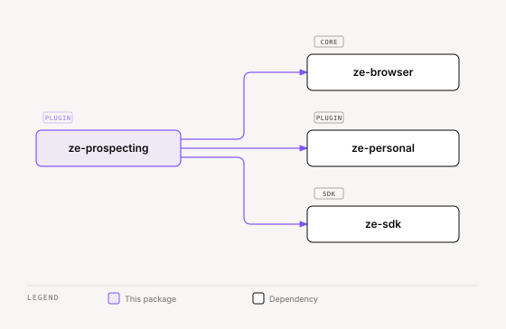

# ze-prospecting

Autonomous prospect research for Ze. Provides the `ProspectingAgent`, campaign store, browser-driven web research, and stale-campaign recovery.

## Role in Ze

Prospecting is Ze's autonomous outreach research mode. Given a target profile, the agent browses the web, gathers intelligence, drafts outreach messages, and tracks campaigns over multiple iterations — all without the user micromanaging each step.

### Key features

- `ProspectingAgent` — autonomous research loop with browser tools and outreach drafting
- `ProspectCampaignStore` — Postgres-backed campaign persistence across sessions
- Stale campaign recovery job — marks campaigns that stayed `running` past the timeout as `failed`

### Integration

Entry point `ze_prospecting`. Depends on `ze-browser` for web fetching and `ze-personal` for contact linking. Contributes the prospecting agent, the campaign store, data domains for export/import, and a proactive recovery job. Requires the browser sidecar running for web research.

```python
from ze_prospecting.plugin import ProspectingPlugin
```

## Responsibilities

| Module | What it provides |
|---|---|
| `agents/` | `ProspectingAgent`, research and outreach tools |
| `store.py` | `ProspectCampaignStore` — Postgres-backed campaign persistence |
| `jobs/campaigns.py` | `recover_stale_campaigns` — proactive recovery job |
| `types.py` | `ProspectingSettings` |
| `action_records.py` | Action records for outreach writes |
| `migrations/` | `zpros001` — `prospect_campaigns`, `prospect_outreach` |
| `plugin.py` | `ProspectingPlugin(ZePlugin)` — registers agent, store, and job |

Every `WRITE` tool in this package declares `reversibility` and an `effect_phrase`. Retry reads these declarations to decide if a reply can be regenerated.

## Dependencies



<sub>[Interactive version](../../docs/diagrams/plugins/ze-prospecting/dependencies.html)</sub>

## Configuration

Prospecting settings come from the environment: `PROSPECTING_MAX_ITERATIONS`, `PROSPECTING_MAX_LOOP_TOKENS`, `PROSPECTING_STALE_TIMEOUT_MINUTES`, `BROWSER_DELAY_MS`, and `BROWSER_MAX_TEXT_CHARS`. A non-empty `prospecting` block in `config/config.yaml` replaces the environment values. It takes the keys `max_iterations`, `max_loop_tokens`, `stale_timeout_minutes`, `browser_delay_ms`, and `browser_max_text_chars`.

## Testing

From the repo root:

```bash
make test-prospecting
```

See [docs/testing.md](../../docs/testing.md).
